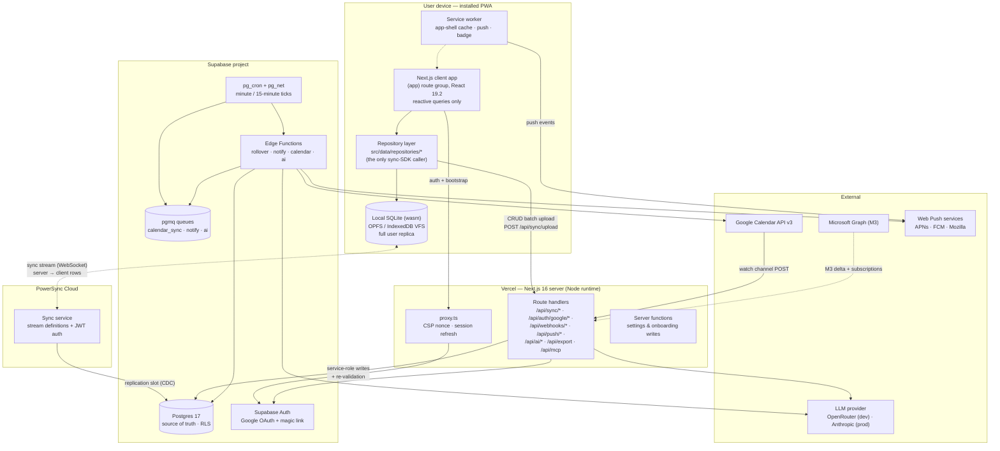
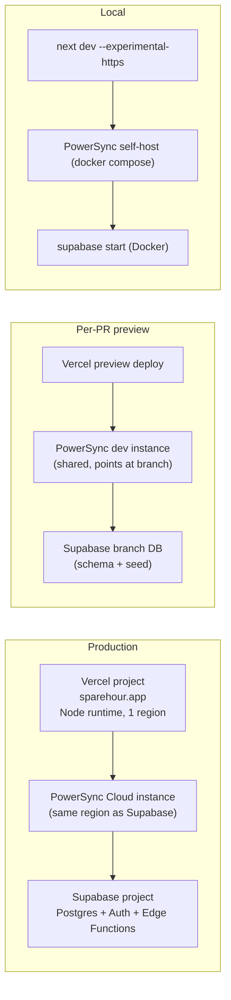
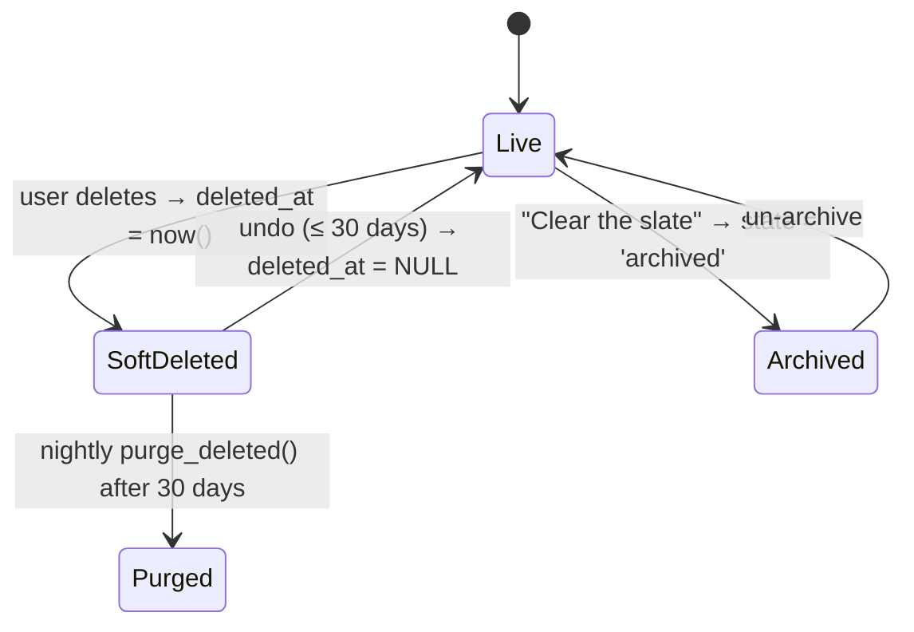
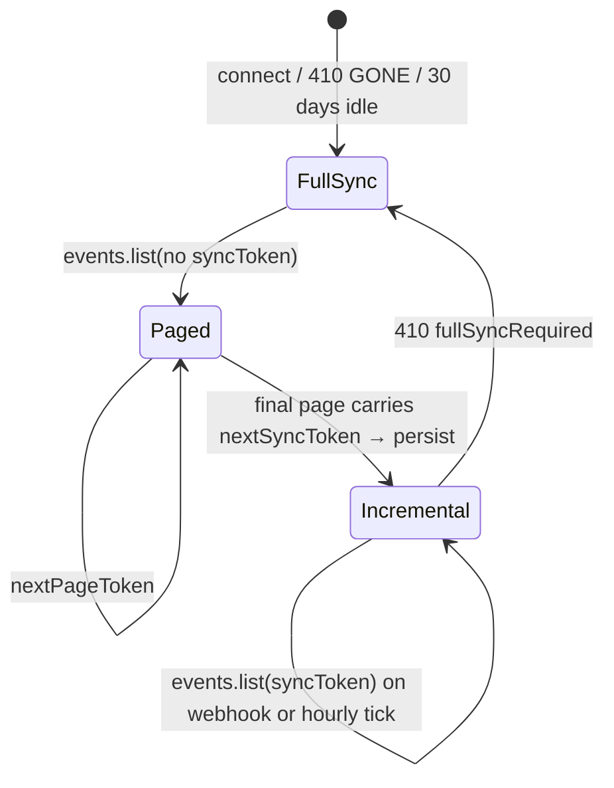
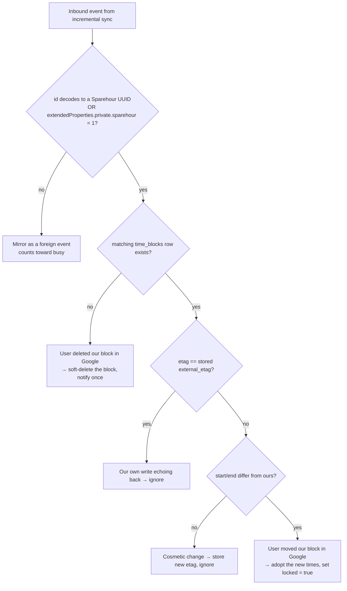
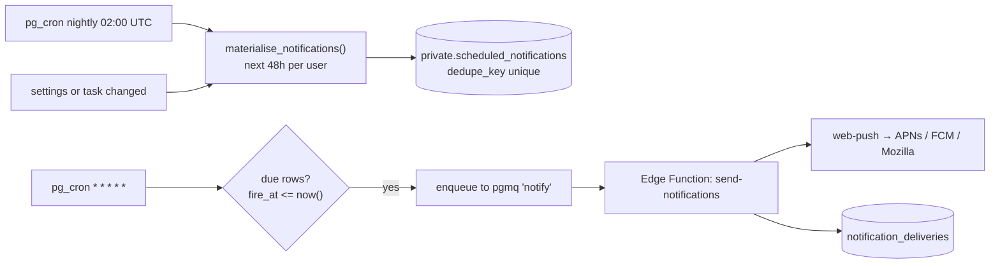
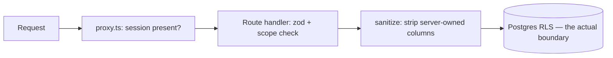
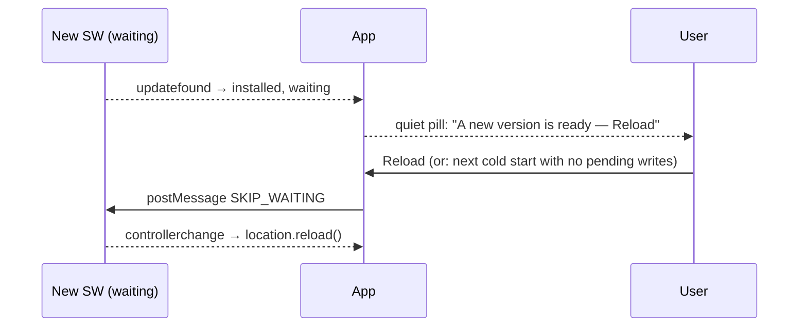
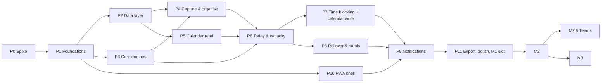

# Sparehour — System Design

**Status:** Draft for review · **Version:** 0.1 · **Date:** 2026-09-13 · **Author:** principal engineer

**Reads with:** [`docs/DECISIONS.md`](../DECISIONS.md) (product source of truth) · [`docs/FEATURES.md`](../FEATURES.md) (milestone tags) · [`docs/research/06-sync-engines.md`](../research/06-sync-engines.md) (sync-layer evaluation) · [`AGENTS.md`](../../AGENTS.md) (Next.js 16 has breaking changes; consult `node_modules/next/dist/docs/`).

**Stack assumption.** This document is written against **PowerSync + Supabase (Postgres + Auth)**, the recommendation in `06-sync-engines.md`. That choice is *still open* (DECISIONS.md, Q21). Everything sync-specific is confined behind a repository layer and a sync adapter (§4.9, §12.1) so that the Firestore fallback changes roughly one directory. A 2–3 day validation spike (Appendix A) gates the decision.

**Verification conventions.** Facts checked against vendor docs on 2026-09-13 are cited inline. Anything I could not confirm is marked **[UNVERIFIED]** and must be settled during the spike. Version numbers are pinned so that a future reader can tell how stale this document is.

---

## Contents

| § | Section |
|---|---|
| 1 | [Goals, non-goals, quality budgets](#1-goals-non-goals-quality-budgets) |
| 2 | [Architecture overview](#2-architecture-overview) |
| 3 | [Data model](#3-data-model) |
| 4 | [Sync & conflict model](#4-sync--conflict-model) |
| 5 | [Core engines](#5-core-engines) |
| 6 | [Google Calendar integration](#6-google-calendar-integration) |
| 7 | [Notifications](#7-notifications) |
| 8 | [AI module, MCP server & public API](#8-ai-module-mcp-server--public-api) |
| 9 | [Auth & security](#9-auth--security) |
| 10 | [PWA & offline](#10-pwa--offline) |
| 11 | [Frontend architecture](#11-frontend-architecture) |
| 12 | [Repo structure, testing, CI, environments](#12-repo-structure-testing-ci-environments) |
| 13 | [Observability, analytics, cost model](#13-observability-analytics-cost-model) |
| 14 | [Milestone build plan](#14-milestone-build-plan) |
| 15 | [Risks & open decisions](#15-risks--open-decisions) |
| A | [Appendix A — stack validation spike](#appendix-a--stack-validation-spike) |

---

## 1. Goals, non-goals, quality budgets

### 1.1 Engineering goals (derived from the product promise)

| # | Product promise | Engineering goal |
|---|---|---|
| G1 | "A Today that knows your real free time" | Capacity is a **pure function** over local data, recomputed reactively in <5 ms, never a server round-trip. |
| G2 | "Guilt-free planning loop" | Carry-over is primarily a **derived view**, not a mutation, so it is correct the instant the app opens — even if the nightly job has not run. |
| G3 | "Calm, instant" | p75 interaction latency <50 ms for every list/complete/reschedule action. No spinners on the critical path. |
| G4 | "Works offline" | Every read and every write works with the network off, indefinitely, and reconciles without data loss. |
| G5 | "Never moves your calendar on its own" | All calendar writes are user-approved and tagged as ours; external edits win over our intent. |
| G6 | Teams "without a migration" (Q20) | `space_id` on every row and membership-aware RLS from day one, even while only personal spaces exist. |
| G7 | AI is optional and labeled | AI never sits on a critical path; every AI capability has a deterministic fallback or a visible "unavailable" state. |
| G8 | Exit guarantee (M3) | The Postgres schema is the product's durable asset; export is a first-class endpoint, not an afterthought. |

### 1.2 Non-goals

- **Not** a real-time collaborative editor. No CRDT text merging at M1–M2.5; notes are last-writer-wins with a loser copy kept in the activity log (§4.4).
- **Not** full auto-scheduling. "Plan my day" is always propose → preview → approve (DECISIONS.md, "Never full-auto by default").
- **Not** server-rendered app screens. The `(app)` route group is a client shell over local SQLite; SSR is used only for marketing, auth and onboarding.
- **Not** sub-task trees, Gantt, sprints, workload charts (FEATURES.md "Never").
- **Not** end-to-end encrypted at launch. E2EE is "Later"; the design keeps OAuth tokens server-only so E2EE for task content stays feasible.
- **Not** multi-region. Single region (EU or US, §9.7) until there is a reason.

### 1.3 Quality attributes & budgets

These are **budgets, not aspirations**: each has an owner check in CI or in the observability dashboard (§13).

| Attribute | Budget | Measured by | Failure action |
|---|---|---|---|
| Interaction latency (complete, reschedule, reorder, quick-add) | p75 <50 ms, p99 <120 ms, local write committed before paint | Client `performance.mark` around the repository call; reported as a histogram | Block release |
| Today screen cold open (warm cache, installed PWA) | p75 <1.2 s to interactive | Playwright trace + RUM | Block release |
| First-load JS for `(app)` shell | ≤ 320 KB gzipped **excluding** the SQLite wasm; wasm ≤ 1.2 MB, loaded in parallel and cached by the SW | `next build` output + `size-limit` in CI | Block merge |
| Marketing route JS | ≤ 90 KB gzipped; zero sync-SDK bytes | `size-limit` route budget | Block merge |
| Capacity recompute (14-day range) | <5 ms p95 on a mid-2021 laptop, <15 ms on an iPhone 12 | Bench in `vitest bench` | Block merge |
| Quick-add parse | <2 ms p99 for a 200-char input | Bench | Block merge |
| Offline duration supported | Unbounded; queue survives reload, tab close, and OS restart | Playwright offline test + manual 72 h soak | Block M1 exit |
| Sync convergence after reconnect | p95 <3 s for a 50-operation backlog | Synthetic probe (§13.2) | Page |
| Calendar sync lag (external change → visible in app) | p50 <60 s, p95 <5 min (push channel); <15 min (polling fallback) | `calendar_sync_lag_seconds` metric | Alert |
| Notification delivery | ≥97 % of scheduled pushes accepted by the push service within 60 s of `fire_at` | `notification_deliveries` table | Alert |
| Battery / background cost | No periodic background sync; no polling while hidden; SW wakes only for push. Foreground sync socket idle-closes after 60 s hidden | Manual profiling; `visibilitychange` audit | Review |
| Cost per active user | ≤ $0.35/mo all-in at 1 k users; ≤ $0.12/mo at 50 k (§13.5) | Monthly cost review | Re-architect trigger |
| Accessibility | WCAG 2.2 AA on Today, Inbox, Project, quick-add, settings | axe in CI + manual keyboard pass | Block release |

### 1.4 Why the latency budget drives the architecture

A 50 ms budget for "complete a task" rules out any design where the write crosses the network before the UI updates. It also rules out optimistic-update-plus-rollback as the *primary* mechanism, because rollback is exactly the "you feel behind" experience the product is trying to remove. The only shape that satisfies G3 and G4 together is: **a real local database that is the source of truth for reads, with an append-only outbox that reconciles in the background.** Everything else in this document follows from that.

---

## 2. Architecture overview

### 2.1 Container diagram



### 2.2 Responsibilities

| Component | Owns | Explicitly does **not** own |
|---|---|---|
| Client app (`(app)` group) | All rendering, all reads, optimistic writes, the five core engines (§5) | Any authoritative state; any secret |
| Repository layer | Mapping domain objects ↔ local SQL; producing outbox entries; the *only* import of the sync SDK | Business rules (those live in `src/core`) |
| Local SQLite | Fast reads, offline durability, the CRUD queue | Conflict resolution (server-side) |
| Service worker | App-shell caching, update flow, push display, badge | Data caching (data lives in SQLite, not in the Cache API) |
| Next.js route handlers | OAuth dances, the upload endpoint, webhooks, AI proxying, export, MCP | Long-running or scheduled work |
| PowerSync service | Streaming Postgres rows to the right devices; auth via JWT | Validation, business rules |
| Postgres | Source of truth, constraints, RLS, soft deletes | Presentation concerns |
| Edge Functions + pg_cron | Scheduled and queued work: rollover, notification fan-out, calendar sync, AI jobs | User-facing request handling |

### 2.3 Where the background workers run

Four workloads, with different shapes:

| Workload | Shape | Frequency | Duration |
|---|---|---|---|
| W1 Carry-over rollover | Per-user, at their local day boundary | Every 15 min tick, ~1/96 of users each | ms per user, set-based SQL |
| W2 Notification scheduling + send | Per-user, minute-accurate | Every minute | ms–seconds; fan-out to push services |
| W3 Calendar sync | Reactive (webhook) + periodic reconcile | Webhook bursts + hourly reconcile + daily channel renewal | Seconds per account; network-bound |
| W4 AI jobs | On demand (interactive) + weekly (batch) | Sporadic | 2–60 s |

**Options considered**

| Option | Fit | Cost | Objection |
|---|---|---|---|
| **Supabase `pg_cron` + `pg_net` + Edge Functions** | W1 is *pure SQL* and wants to run next to the data; W2/W3 are short fan-outs | Included in Pro; Edge Function invocations are cheap | Edge Functions have a wall-clock cap (Deno, ~150 s **[UNVERIFIED — confirm current limit]**); no native retry/DLQ without pgmq |
| Vercel Cron + route handlers | Already deploying there; same language/tooling | Free tier caps cron *frequency* and count; Pro needed for minute-level | Adds a network hop to Postgres for a job that is pure SQL; function duration limits; cold starts on every tick |
| Trigger.dev / Inngest | Best retries, fan-out, observability, long jobs | An extra vendor + an extra bill | Overkill for a solo product at M1; a fifth thing to operate |
| Long-running container (Fly/Render worker) | Full control, no duration cap | ~$7–20/mo + ops | Ops burden; the thing most likely to be silently down |

**Recommendation**

- **M1–M2:** `pg_cron` drives everything. W1 runs as a **plain SQL function** invoked by `pg_cron` — no network hop, transactional, trivially idempotent. W2 and W3 use `pg_cron` → `pgmq` enqueue → a `pg_cron`-scheduled Edge Function that drains the queue with a visibility timeout. Webhooks land on Vercel route handlers (they need the public HTTPS surface and our own auth/verification) and do nothing but validate + enqueue, returning 200 in <100 ms.
- **Escape hatch:** if any single job needs >60 s of wall clock (realistically only a full 18-month calendar backfill for a heavy user, or an import at M3), move *that job only* to **Trigger.dev**. Keep the job bodies as plain TypeScript functions in `src/server/jobs/*` with a thin invoker, so the host is swappable (§12.1).
- **Why not Vercel Cron as the primary:** the rollover job is the one job that must be exactly-once-per-user-per-day and cheap; running it as SQL inside the database removes an entire class of failure (partial fan-out, timeouts mid-loop) and costs nothing.

### 2.4 Deployment topology



Notes:
- **Edge runtime is deprecated in Next.js 16** (`node_modules/next/dist/docs/01-app/03-api-reference/03-file-conventions/02-route-segment-config/runtime.md`: "The Edge Runtime is deprecated. Remove the `runtime` export"). All route handlers run on Node. This matters: the upload endpoint needs `node:crypto` and a Postgres driver.
- Co-locate Vercel region, PowerSync instance and Supabase region. A cross-region hop on the upload path is the difference between a 60 ms and a 300 ms sync ack.
- Preview deploys share one PowerSync dev instance pointed at a Supabase branch database; sync correctness is verified in CI against the local docker stack, not against previews.

### 2.5 Three flows worth drawing

**Flow A — a local write (the 99 % case).**

```mermaid
sequenceDiagram
  autonumber
  participant U as User
  participant R as Repository
  participant DB as Local SQLite
  participant SDK as Sync SDK
  participant API as /api/sync/upload
  participant PG as Postgres
  participant PS as PowerSync
  U->>R: complete(taskId)
  R->>DB: BEGIN; UPDATE tasks SET state='done', completed_at=... ; COMMIT
  DB-->>R: committed (<5 ms)
  R-->>U: UI repaints from reactive query
  Note over DB,SDK: CRUD entry appended to the local queue
  SDK->>API: POST batch {mutations[], client_version}
  API->>PG: apply partial UPDATE + ledger insert (one tx)
  PG-->>PS: logical replication
  PS-->>DB: authoritative row (usually identical)
  API-->>SDK: 200 {applied:[...], rejected:[...]}
```

**Flow B — an external calendar change.**

```mermaid
sequenceDiagram
  autonumber
  participant G as Google
  participant WH as /api/webhooks/google-calendar
  participant Q as pgmq
  participant EF as Edge Function
  participant PG as Postgres
  participant C as Client
  G->>WH: POST (X-Goog-Channel-ID, X-Goog-Resource-State)
  WH->>WH: verify channel token + look up account
  WH->>Q: enqueue {calendar_account_id, calendar_id}
  WH-->>G: 200 (<100 ms)
  EF->>Q: dequeue (visibility timeout 60 s)
  EF->>G: events.list(syncToken=…)
  G-->>EF: changed events + nextSyncToken
  EF->>PG: upsert calendar_events, store syncToken
  PG-->>C: rows stream down; capacity recomputes
```

**Flow C — day rollover.**

```mermaid
sequenceDiagram
  autonumber
  participant CR as pg_cron (*/15)
  participant F as sparehour.run_rollover()
  participant PG as Postgres
  participant C as Client
  CR->>F: invoke
  F->>PG: SELECT users whose local date advanced since last run
  loop per user (set-based)
    F->>PG: carry / skip / expire per miss_policy; bump carry_count
    F->>PG: auto-Someday tasks untouched ≥ auto_someday_days
    F->>PG: INSERT rollover_runs (user_id, local_date) ON CONFLICT DO NOTHING
  end
  PG-->>C: changed rows stream down
  Note over C: The "Carried over" section was already correct<br/>(derived view) — the job only fixes counters and states.
```

---

## 3. Data model

### 3.1 Conventions

| Concern | Decision | Rationale |
|---|---|---|
| Primary keys | `uuid`, **UUIDv7**, generated **on the client** | Time-ordered (good index locality), collision-free offline, lets the client reference a row before it reaches the server |
| Tenancy | `space_id uuid NOT NULL` on **every** user-data row | G6. A personal space is created at signup; teams (M2.5) add rows to `space_members` only |
| Enums | `text` + `CHECK (col IN (...))` — **not** Postgres `ENUM` | SQLite has no enums; adding a value is a one-line migration instead of `ALTER TYPE` gymnastics; PowerSync maps `text` cleanly |
| Local dates | `date` (`YYYY-MM-DD`), never a timestamp | A do-date is a calendar fact. Storing it as a timestamp is the single largest source of DST/travel bugs in planner apps |
| Local times | `time` (`HH:MM`), never a timestamp | Same reason. `(do_date, do_time, user.timezone)` resolves to an instant only at render time |
| Instants | `timestamptz`, always UTC | Calendar events, block boundaries, audit rows |
| Soft delete | `deleted_at timestamptz NULL` on every user-data table | Undo, 30-day recovery, and a clean "delete" signal to the sync layer |
| Hard delete | Nightly `purge_deleted()` after 30 days | GDPR-friendly; keeps tables small |
| Timestamps | `created_at`, `updated_at` (trigger-maintained server-side, client-supplied on insert), `last_touched_at` on tasks | `updated_at` is set by a `BEFORE UPDATE` trigger so server-side jobs can't forget it |
| Ordering | `sort_key text` — a base-62 fractional index | §5.6 |
| Server-owned columns | `carry_count`, `last_carried_at`, `external_event_id` (mirror), all `*_etag`, all counters | Clients never upload these; the upload endpoint drops them (§4.3) |

**Schema layout.** Two Postgres schemas:

- `public` — everything that syncs to devices. Listed in the `powersync` publication.
- `private` — server-only: OAuth tokens, watch channels, the mutation ledger, queues, AI prompt logs. **Not** in the publication, so it is physically impossible for a client bug to leak it.

### 3.2 DDL

```sql
-- ============ identity & tenancy ============
create table public.users (
  id            uuid primary key references auth.users(id) on delete cascade,
  email         text not null,
  display_name  text,
  avatar_url    text,
  personal_space_id uuid not null,
  created_at    timestamptz not null default now(),
  updated_at    timestamptz not null default now(),
  deleted_at    timestamptz
);

create table public.spaces (
  id         uuid primary key,
  kind       text not null check (kind in ('personal','team')),
  name       text not null,
  owner_id   uuid not null references public.users(id),
  created_at timestamptz not null default now(),
  updated_at timestamptz not null default now(),
  deleted_at timestamptz
);
create index spaces_owner_idx on public.spaces(owner_id) where deleted_at is null;

-- M2.5, but the table and the RLS that reads it exist from day one
create table public.space_members (
  id         uuid primary key,
  space_id   uuid not null references public.spaces(id) on delete cascade,
  user_id    uuid not null references public.users(id) on delete cascade,
  role       text not null check (role in ('owner','admin','member')) default 'member',
  invited_by uuid references public.users(id),
  joined_at  timestamptz,
  created_at timestamptz not null default now(),
  updated_at timestamptz not null default now(),
  deleted_at timestamptz,
  unique (space_id, user_id)
);
create index space_members_user_idx on public.space_members(user_id) where deleted_at is null;

-- ============ organisation ============
create table public.areas (
  id         uuid primary key,
  space_id   uuid not null references public.spaces(id) on delete cascade,
  name       text not null,
  icon       text,
  color      text,
  sort_key   text not null,
  created_at timestamptz not null default now(),
  updated_at timestamptz not null default now(),
  deleted_at timestamptz
);
create index areas_space_idx on public.areas(space_id, sort_key) where deleted_at is null;

create table public.projects (
  id           uuid primary key,
  space_id     uuid not null references public.spaces(id) on delete cascade,
  area_id      uuid references public.areas(id) on delete set null,
  name         text not null,
  notes_md     text,
  state        text not null default 'active'
                 check (state in ('active','someday','done','archived')),
  do_date      date,                 -- an "activate on" date for the project itself
  deadline     date,
  completed_at timestamptz,
  sort_key     text not null,
  created_at   timestamptz not null default now(),
  updated_at   timestamptz not null default now(),
  deleted_at   timestamptz
);
create index projects_space_state_idx on public.projects(space_id, state, sort_key)
  where deleted_at is null;
create index projects_area_idx on public.projects(area_id, sort_key) where deleted_at is null;

create table public.headings (
  id         uuid primary key,
  space_id   uuid not null references public.spaces(id) on delete cascade,
  project_id uuid not null references public.projects(id) on delete cascade,
  title      text not null,
  sort_key   text not null,
  created_at timestamptz not null default now(),
  updated_at timestamptz not null default now(),
  deleted_at timestamptz
);
create index headings_project_idx on public.headings(project_id, sort_key) where deleted_at is null;

-- ============ tasks ============
create table public.tasks (
  id            uuid primary key,
  space_id      uuid not null references public.spaces(id) on delete cascade,
  project_id    uuid references public.projects(id) on delete set null,
  heading_id    uuid references public.headings(id) on delete set null,
  assignee_id   uuid references public.users(id),        -- M2.5
  title         text not null,
  notes_md      text,
  state         text not null default 'inbox'
                  check (state in ('inbox','active','someday','done','dropped','archived')),
  priority      smallint not null default 0 check (priority between 0 and 3),
  -- dates: all local calendar values
  do_date       date,
  do_time       time,
  deadline      date,
  start_date    date,                       -- hides the task until this date
  evening       boolean not null default false,
  -- effort
  estimate_min  integer check (estimate_min is null or estimate_min between 1 and 1440),
  actual_min    integer,
  -- carry-over (server-owned)
  carry_count   integer not null default 0,
  last_carried_at   date,
  last_touched_at   timestamptz not null default now(),
  miss_policy   text not null default 'carry' check (miss_policy in ('carry','skip','expire')),
  -- recurrence
  recurrence_rule       text,               -- RFC 5545 RRULE, no DTSTART
  recurrence_mode       text check (recurrence_mode in ('fixed','after_completion')),
  recurrence_series_id  uuid,               -- = id for a rolling series master
  recurrence_paused_until date,
  -- ordering
  sort_key      text not null,              -- position within project/heading/inbox
  day_sort_key  text,                       -- position within a Today list
  -- provenance
  source        text not null default 'quickadd'
                  check (source in ('quickadd','email','voice','share','import','ai','mcp')),
  completed_at  timestamptz,
  created_at    timestamptz not null default now(),
  updated_at    timestamptz not null default now(),
  deleted_at    timestamptz,
  constraint tasks_done_has_completed_at
    check ((state = 'done') = (completed_at is not null)),
  constraint tasks_do_time_requires_do_date
    check (do_time is null or do_date is not null)
);
-- the three hot query shapes
create index tasks_today_idx   on public.tasks(space_id, do_date, day_sort_key)
  where deleted_at is null and state in ('inbox','active');
create index tasks_project_idx on public.tasks(project_id, sort_key)
  where deleted_at is null and state in ('inbox','active');
create index tasks_deadline_idx on public.tasks(space_id, deadline)
  where deleted_at is null and deadline is not null and state in ('inbox','active');
create index tasks_series_idx  on public.tasks(recurrence_series_id) where deleted_at is null;
create index tasks_logbook_idx on public.tasks(space_id, completed_at desc)
  where deleted_at is null and state = 'done';
create index tasks_fts_idx on public.tasks
  using gin (to_tsvector('simple', coalesce(title,'') || ' ' || coalesce(notes_md,'')));

create table public.checklist_items (
  id         uuid primary key,
  space_id   uuid not null references public.spaces(id) on delete cascade,
  task_id    uuid not null references public.tasks(id) on delete cascade,
  title      text not null,
  done       boolean not null default false,
  sort_key   text not null,
  created_at timestamptz not null default now(),
  updated_at timestamptz not null default now(),
  deleted_at timestamptz
);
create index checklist_task_idx on public.checklist_items(task_id, sort_key) where deleted_at is null;

create table public.tags (
  id         uuid primary key,
  space_id   uuid not null references public.spaces(id) on delete cascade,
  name       text not null,
  color      text,
  created_at timestamptz not null default now(),
  updated_at timestamptz not null default now(),
  deleted_at timestamptz
);
create unique index tags_space_name_idx on public.tags(space_id, lower(name)) where deleted_at is null;

create table public.task_tags (
  id         uuid primary key,          -- surrogate PK so the sync layer has one key per row
  space_id   uuid not null references public.spaces(id) on delete cascade,
  task_id    uuid not null references public.tasks(id) on delete cascade,
  tag_id     uuid not null references public.tags(id) on delete cascade,
  created_at timestamptz not null default now(),
  updated_at timestamptz not null default now(),
  deleted_at timestamptz,
  unique (task_id, tag_id)
);
create index task_tags_tag_idx on public.task_tags(tag_id) where deleted_at is null;

-- completions of a rolling recurring task (§5.2)
create table public.task_completions (
  id              uuid primary key,
  space_id        uuid not null references public.spaces(id) on delete cascade,
  task_id         uuid not null references public.tasks(id) on delete cascade,
  occurrence_date date not null,
  completed_at    timestamptz not null,
  actual_min      integer,
  created_at      timestamptz not null default now(),
  updated_at      timestamptz not null default now(),
  deleted_at      timestamptz,
  unique (task_id, occurrence_date)
);
create index task_completions_logbook_idx on public.task_completions(space_id, completed_at desc);

-- "just this once" exceptions to a recurrence rule (§5.2)
create table public.recurrence_exceptions (
  id              uuid primary key,
  space_id        uuid not null references public.spaces(id) on delete cascade,
  series_id       uuid not null,
  occurrence_date date not null,
  kind            text not null check (kind in ('skip','move')),
  moved_to        date,
  created_at      timestamptz not null default now(),
  updated_at      timestamptz not null default now(),
  deleted_at      timestamptz,
  unique (series_id, occurrence_date)
);

-- ============ time ============
create table public.time_blocks (
  id                uuid primary key,
  space_id          uuid not null references public.spaces(id) on delete cascade,
  user_id           uuid not null references public.users(id) on delete cascade,
  task_id           uuid references public.tasks(id) on delete set null,
  title             text,                       -- for blocks with no task
  start_at          timestamptz not null,
  end_at            timestamptz not null,
  locked            boolean not null default false,
  source            text not null default 'manual' check (source in ('manual','plan')),
  -- calendar mirror (server-owned)
  calendar_id       uuid references public.calendars(id) on delete set null,
  external_event_id text,
  external_etag     text,
  push_state        text not null default 'pending'
                      check (push_state in ('pending','synced','failed','detached')),
  created_at        timestamptz not null default now(),
  updated_at        timestamptz not null default now(),
  deleted_at        timestamptz,
  constraint time_blocks_ordered check (end_at > start_at)
);
create index time_blocks_day_idx on public.time_blocks(user_id, start_at)
  where deleted_at is null;
create index time_blocks_task_idx on public.time_blocks(task_id) where deleted_at is null;
create unique index time_blocks_external_idx
  on public.time_blocks(calendar_id, external_event_id)
  where external_event_id is not null and deleted_at is null;
create index time_blocks_push_idx on public.time_blocks(push_state)
  where push_state in ('pending','failed') and deleted_at is null;

create table public.calendars (
  id                   uuid primary key,
  space_id             uuid not null references public.spaces(id) on delete cascade,
  calendar_account_id  uuid not null references public.calendar_accounts(id) on delete cascade,
  external_id          text not null,              -- Google calendarId
  summary              text not null,
  timezone             text,
  color                text,
  access_role          text,                       -- owner|writer|reader|freeBusyReader
  read                 boolean not null default true,   -- include in capacity
  write_target         boolean not null default false,  -- exactly one per user
  sync_token           text,                       -- server-owned
  last_synced_at       timestamptz,
  created_at           timestamptz not null default now(),
  updated_at           timestamptz not null default now(),
  deleted_at           timestamptz,
  unique (calendar_account_id, external_id)
);
create unique index calendars_one_write_target
  on public.calendars(calendar_account_id) where write_target and deleted_at is null;

-- read-only mirror of external events
create table public.calendar_events (
  id            uuid primary key,
  space_id      uuid not null references public.spaces(id) on delete cascade,
  calendar_id   uuid not null references public.calendars(id) on delete cascade,
  external_id   text not null,
  recurring_event_id text,
  original_start_at  timestamptz,
  summary       text,
  start_at      timestamptz,
  end_at        timestamptz,
  start_date    date,           -- set instead of start_at for all-day events
  end_date      date,
  all_day       boolean not null default false,
  busy          boolean not null default true,     -- transparency = opaque
  status        text,                              -- confirmed|tentative|cancelled
  self_response text,                              -- accepted|declined|tentative|needsAction
  event_type    text,                              -- default|outOfOffice|focusTime|workingLocation
  is_ours       boolean not null default false,    -- our block, echoed back
  etag          text,
  created_at    timestamptz not null default now(),
  updated_at    timestamptz not null default now(),
  deleted_at    timestamptz,
  unique (calendar_id, external_id)
);
create index calendar_events_window_idx on public.calendar_events(space_id, start_at, end_at)
  where deleted_at is null and status <> 'cancelled';
create index calendar_events_allday_idx on public.calendar_events(space_id, start_date)
  where all_day and deleted_at is null;

create table public.work_hours (
  id         uuid primary key,
  space_id   uuid not null references public.spaces(id) on delete cascade,
  user_id    uuid not null references public.users(id) on delete cascade,
  weekday    smallint not null check (weekday between 0 and 6),  -- 0 = Monday
  start_time time not null,
  end_time   time not null,
  created_at timestamptz not null default now(),
  updated_at timestamptz not null default now(),
  deleted_at timestamptz,
  constraint work_hours_ordered check (end_time > start_time)
);
create index work_hours_user_idx on public.work_hours(user_id, weekday) where deleted_at is null;
-- multiple rows per weekday are allowed (split days: 09:00–12:00 and 13:00–17:30)

create table public.user_settings (
  user_id             uuid primary key references public.users(id) on delete cascade,
  space_id            uuid not null references public.spaces(id) on delete cascade,
  timezone            text not null default 'UTC',      -- IANA
  week_start          smallint not null default 0 check (week_start between 0 and 6),
  day_rollover_hour   smallint not null default 4 check (day_rollover_hour between 0 and 6),  -- 04:00 local; user-adjustable 00:00–06:00
  buffer_pct          smallint not null default 15 check (buffer_pct between 0 and 60),
  default_estimate_min smallint not null default 30,
  max_block_min       smallint not null default 90,
  min_block_min       smallint not null default 25,
  carry_ask_after     smallint not null default 3,
  auto_someday_days   smallint not null default 30,
  morning_nudge_time  time default '08:30',
  shutdown_nudge_time time,                             -- null = off (Q24 default)
  quiet_hours_start   time default '21:30',
  quiet_hours_end     time default '07:30',
  notify_block_start  boolean not null default true,
  notify_deadline     boolean not null default true,
  notify_morning      boolean not null default true,
  notify_shutdown     boolean not null default false,
  theme               text not null default 'system' check (theme in ('system','light','dark')),
  evening_starts_at   time not null default '18:00',
  ai_enabled          boolean not null default true,
  created_at          timestamptz not null default now(),
  updated_at          timestamptz not null default now()
);

create table public.day_plans (
  id            uuid primary key,
  space_id      uuid not null references public.spaces(id) on delete cascade,
  user_id       uuid not null references public.users(id) on delete cascade,
  date          date not null,
  planned_at    timestamptz,
  shutdown_at   timestamptz,
  highlights    text,
  day_rating    smallint check (day_rating between 1 and 5),
  -- capacity snapshot, taken at plan time, for planned-vs-actual (M2)
  capacity_work_min   integer,
  capacity_busy_min   integer,
  capacity_buffer_min integer,
  capacity_planned_min integer,
  capacity_spare_min  integer,
  created_at    timestamptz not null default now(),
  updated_at    timestamptz not null default now(),
  deleted_at    timestamptz,
  unique (user_id, date)
);

create table public.focus_sessions (           -- M2
  id         uuid primary key,
  space_id   uuid not null references public.spaces(id) on delete cascade,
  user_id    uuid not null references public.users(id) on delete cascade,
  task_id    uuid references public.tasks(id) on delete set null,
  started_at timestamptz not null,
  ended_at   timestamptz,
  duration_min integer,
  kind       text not null default 'timer' check (kind in ('timer','pomodoro','stopwatch')),
  created_at timestamptz not null default now(),
  updated_at timestamptz not null default now(),
  deleted_at timestamptz
);

create table public.activity_log (             -- M2; server-written, read-only on clients
  id         uuid primary key,
  space_id   uuid not null references public.spaces(id) on delete cascade,
  actor_id   uuid,                              -- null = system
  actor_kind text not null default 'user' check (actor_kind in ('user','system','agent')),
  entity     text not null,                     -- 'task' | 'project' | ...
  entity_id  uuid not null,
  verb       text not null,                     -- 'created'|'completed'|'carried'|'rescheduled'|...
  detail     jsonb not null default '{}'::jsonb,
  created_at timestamptz not null default now()
);
create index activity_entity_idx on public.activity_log(entity, entity_id, created_at desc);
create index activity_space_idx  on public.activity_log(space_id, created_at desc);

create table public.push_subscriptions (
  id            uuid primary key,
  user_id       uuid not null references public.users(id) on delete cascade,
  endpoint      text not null unique,
  p256dh        text not null,
  auth          text not null,
  ua            text,
  platform      text,                 -- 'ios-standalone' | 'android' | 'desktop'
  declarative   boolean not null default false,  -- UA advertises Declarative Web Push
  failure_count smallint not null default 0,
  last_success_at timestamptz,
  created_at    timestamptz not null default now(),
  updated_at    timestamptz not null default now(),
  deleted_at    timestamptz
);
create index push_subs_user_idx on public.push_subscriptions(user_id) where deleted_at is null;

create table public.ai_requests (              -- M2
  id             uuid primary key,
  space_id       uuid not null references public.spaces(id) on delete cascade,
  user_id        uuid not null references public.users(id) on delete cascade,
  capability     text not null,      -- 'parseBrainDump' | 'breakDownTask' | ...
  provider       text not null,      -- 'anthropic' | 'openrouter'
  model          text not null,
  prompt_version text not null,
  input_tokens   integer,
  output_tokens  integer,
  cached_input_tokens integer,
  cost_usd       numeric(10,6),
  latency_ms     integer,
  status         text not null check (status in ('ok','invalid_output','timeout','error','capped')),
  cache_hit      boolean not null default false,
  created_at     timestamptz not null default now()
);
create index ai_requests_user_month_idx
  on public.ai_requests(user_id, date_trunc('month', created_at));

create table public.agent_actions (            -- M3
  id           uuid primary key,
  space_id     uuid not null references public.spaces(id) on delete cascade,
  user_id      uuid not null references public.users(id) on delete cascade,
  client_id    uuid not null,          -- MCP client / PAT
  scope        text not null,
  state        text not null default 'proposed'
                 check (state in ('proposed','approved','applied','rejected','undone','expired')),
  summary      text not null,          -- human sentence shown in the approval inbox
  mutations    jsonb not null,         -- forward patch
  inverse      jsonb,                  -- undo patch, written when applied
  applied_at   timestamptz,
  undone_at    timestamptz,
  expires_at   timestamptz not null default (now() + interval '7 days'),
  created_at   timestamptz not null default now(),
  updated_at   timestamptz not null default now()
);
create index agent_actions_pending_idx on public.agent_actions(user_id, state, created_at desc);
```

**Server-only schema (`private`, never synced):**

```sql
create table private.calendar_accounts (
  id                  uuid primary key,
  space_id            uuid not null,
  user_id             uuid not null references public.users(id) on delete cascade,
  provider            text not null check (provider in ('google','microsoft','caldav')),
  external_account_id text not null,        -- Google 'sub'
  email               text not null,
  scopes              text[] not null,
  access_token_enc    bytea not null,       -- AES-256-GCM, §9.4
  refresh_token_enc   bytea not null,
  token_expires_at    timestamptz,
  key_version         smallint not null default 1,
  status              text not null default 'ok'
                        check (status in ('ok','needs_reauth','revoked')),
  last_error          text,
  created_at          timestamptz not null default now(),
  updated_at          timestamptz not null default now(),
  deleted_at          timestamptz,
  unique (user_id, provider, external_account_id)
);

create table private.calendar_channels (
  id                  uuid primary key,     -- also the Google channel id (<= 64 chars as uuid text)
  calendar_id         uuid not null,
  resource_id         text not null,
  token               text not null,        -- opaque verification token, <= 256 chars
  expires_at          timestamptz not null,
  created_at          timestamptz not null default now()
);
create index calendar_channels_expiry_idx on private.calendar_channels(expires_at);

-- idempotency ledger for the upload endpoint (§4.2)
create table private.mutations (
  mutation_id text primary key,              -- '<device_id>:<client_op_id>'
  user_id     uuid not null,
  applied_at  timestamptz not null default now(),
  result      text not null check (result in ('applied','rejected','noop'))
);
create index mutations_gc_idx on private.mutations(applied_at);

create table private.scheduled_notifications (
  id          uuid primary key,
  user_id     uuid not null references public.users(id) on delete cascade,
  kind        text not null check (kind in
                ('block_start','deadline_eve','deadline_day','morning','shutdown','urgent_repeat')),
  entity_id   uuid,
  fire_at     timestamptz not null,
  local_time  time not null,
  timezone    text not null,
  dedupe_key  text not null unique,          -- '<user>:<kind>:<entity>:<local_date>'
  payload     jsonb not null,
  status      text not null default 'pending'
                check (status in ('pending','sent','skipped_quiet','cancelled','failed')),
  attempts    smallint not null default 0,
  created_at  timestamptz not null default now()
);
create index sched_notif_due_idx on private.scheduled_notifications(fire_at)
  where status = 'pending';

create table private.notification_deliveries (
  id              uuid primary key,
  notification_id uuid not null,
  subscription_id uuid not null,
  http_status     smallint,
  error           text,
  sent_at         timestamptz not null default now()
);

create table private.rollover_runs (
  user_id    uuid not null,
  local_date date not null,
  ran_at     timestamptz not null default now(),
  stats      jsonb not null default '{}'::jsonb,
  primary key (user_id, local_date)
);

create table private.api_tokens (              -- M3 PATs + MCP clients
  id           uuid primary key,
  user_id      uuid not null references public.users(id) on delete cascade,
  name         text not null,
  token_hash   bytea not null,                 -- sha256
  scopes       text[] not null,
  last_used_at timestamptz,
  expires_at   timestamptz,
  revoked_at   timestamptz,
  created_at   timestamptz not null default now()
);

create table private.rate_limits (
  bucket     text primary key,                 -- '<subject>:<route>:<window>'
  tokens     integer not null,
  refilled_at timestamptz not null default now()
);
```

**Triggers.**

```sql
create or replace function private.touch_updated_at() returns trigger
language plpgsql as $$
begin new.updated_at := now(); return new; end $$;
-- attached BEFORE UPDATE to every table with an updated_at column

create or replace function private.touch_task() returns trigger
language plpgsql as $$
begin
  -- last_touched_at drives auto-Someday aging; it must NOT move when the
  -- rollover job itself bumps carry_count, or nothing would ever age out.
  if (new.carry_count is not distinct from old.carry_count) then
    new.last_touched_at := now();
  end if;
  return new;
end $$;
```

### 3.3 Row Level Security

RLS is the security boundary (§9.3). Every `public` table has `enable row level security` and `force row level security`.

```sql
-- SECURITY DEFINER so that reading space_members does not re-enter RLS
create or replace function public.is_space_member(target uuid)
returns boolean language sql stable security definer
set search_path = public, pg_temp as $$
  select exists (
    select 1 from public.space_members m
    where m.space_id = target
      and m.user_id  = auth.uid()
      and m.deleted_at is null
      and m.joined_at is not null
  );
$$;
revoke execute on function public.is_space_member(uuid) from public;
grant  execute on function public.is_space_member(uuid) to authenticated;

-- the shape repeated for areas, projects, headings, tasks, checklist_items,
-- tags, task_tags, task_completions, recurrence_exceptions, day_plans,
-- focus_sessions, calendars, calendar_events, time_blocks, work_hours
create policy tasks_rw on public.tasks
  for all to authenticated
  using      (public.is_space_member(space_id))
  with check (public.is_space_member(space_id));

-- per-user tables inside a shared space: membership is not enough
create policy time_blocks_rw on public.time_blocks
  for all to authenticated
  using      (user_id = auth.uid())
  with check (user_id = auth.uid() and public.is_space_member(space_id));

create policy work_hours_rw   on public.work_hours   for all to authenticated
  using (user_id = auth.uid()) with check (user_id = auth.uid());
create policy user_settings_rw on public.user_settings for all to authenticated
  using (user_id = auth.uid()) with check (user_id = auth.uid());
create policy day_plans_rw    on public.day_plans    for all to authenticated
  using (user_id = auth.uid()) with check (user_id = auth.uid());

-- server-written, client-read-only
create policy activity_read on public.activity_log
  for select to authenticated using (public.is_space_member(space_id));
create policy ai_requests_read on public.ai_requests
  for select to authenticated using (user_id = auth.uid());
create policy agent_actions_read on public.agent_actions
  for select to authenticated using (user_id = auth.uid());
-- no INSERT/UPDATE/DELETE policy at all => writes are impossible for `authenticated`

-- membership: you can see the rows of spaces you belong to
create policy space_members_read on public.space_members
  for select to authenticated using (public.is_space_member(space_id));
```

**The privacy rule for teams (Q20 / DECISIONS "planning stays personal").** In a team space, tasks are shared; **`time_blocks`, `work_hours`, `user_settings`, `day_plans` and `focus_sessions` are not** — they are filtered by `user_id = auth.uid()`. Teammate availability (a "Later" feature) will be exposed as a derived, aggregated view, never as raw blocks.

**Index-for-RLS note.** `is_space_member` runs once per row group in the planner when marked `stable`; the `space_members(user_id)` index makes it a single index probe. Verify with `EXPLAIN (ANALYZE, BUFFERS)` on the Today query during the spike — an RLS predicate that is not inlined is the classic way a local-first app ends up with a 400 ms sync backfill.

### 3.4 Local (client) schema mapping

SQLite has 5 storage classes. The mapping is mechanical and lives in exactly one file, `src/data/schema.client.ts`:

| Postgres | Local SQLite column | Client representation | Notes |
|---|---|---|---|
| `uuid` | `text` | `string` | lower-case, hyphenated |
| `text` | `text` | `string` | |
| `boolean` | `integer` | `boolean` | `0`/`1`; the mapper coerces, never the UI |
| `smallint` / `integer` | `integer` | `number` | |
| `numeric` | `text` | `string`→`Decimal` | never `real` for money |
| `date` | `text` | `PlainDate`-shaped `string` | `YYYY-MM-DD`; comparisons are lexicographic, which is why this works |
| `time` | `text` | `string` | `HH:MM` |
| `timestamptz` | `text` | ISO-8601 `Z` string | ordering is lexicographic and correct |
| `jsonb` | `text` | parsed object | parsed in the mapper |
| `text[]` | `text` | `string[]` | JSON-encoded |

Two rules that are easy to get wrong and expensive to fix later:

1. **Never let a raw row escape the repository.** `src/data/repositories/*` returns branded domain types from `src/core/types`. The rest of the app never sees `0 | 1` booleans or knows that `do_date` is a string.
2. **Every synced table needs an `id` the sync engine can key on.** That is why `task_tags` has a surrogate `id` instead of a composite PK.

Additionally, three **local-only** tables exist on the client and are never uploaded: `ui_state` (last view, collapsed sections), `plan_proposals` (the pending "Plan my day" preview, §5.5), and `device` (the `device_id` used for mutation ids).

### 3.5 Sync streams

Streams define what a device downloads. Syntax verified against PowerSync **Sync Streams** (GA 2026-05-14, `config.edition: 3`); legacy Sync Rules remain supported but are on a deprecation path, so we start on streams. Streams support `SELECT` with subqueries, `INNER JOIN` and CTEs; `GROUP BY`, `ORDER BY` and `LIMIT` are **not** supported, and every synced table must expose a `text` primary key named `id`.

```yaml
config:
  edition: 3

streams:
  # ---- the working set: everything in the spaces the user belongs to ----
  space_data:
    auto_subscribe: true
    priority: 1
    with:
      my_spaces: |
        SELECT space_id FROM space_members
        WHERE user_id = auth.user_id()
          AND deleted_at IS NULL AND joined_at IS NOT NULL
    queries:
      - SELECT * FROM spaces          WHERE id       IN (SELECT space_id FROM my_spaces) AND deleted_at IS NULL
      - SELECT * FROM space_members   WHERE space_id IN (SELECT space_id FROM my_spaces) AND deleted_at IS NULL
      - SELECT * FROM areas           WHERE space_id IN (SELECT space_id FROM my_spaces) AND deleted_at IS NULL
      - SELECT * FROM projects        WHERE space_id IN (SELECT space_id FROM my_spaces) AND deleted_at IS NULL
      - SELECT * FROM headings        WHERE space_id IN (SELECT space_id FROM my_spaces) AND deleted_at IS NULL
      - SELECT * FROM tasks           WHERE space_id IN (SELECT space_id FROM my_spaces) AND deleted_at IS NULL AND state <> 'done'
      - SELECT * FROM checklist_items WHERE space_id IN (SELECT space_id FROM my_spaces) AND deleted_at IS NULL
      - SELECT * FROM tags            WHERE space_id IN (SELECT space_id FROM my_spaces) AND deleted_at IS NULL
      - SELECT * FROM task_tags       WHERE space_id IN (SELECT space_id FROM my_spaces) AND deleted_at IS NULL
      - SELECT * FROM recurrence_exceptions
                                      WHERE space_id IN (SELECT space_id FROM my_spaces) AND deleted_at IS NULL

  # ---- personal rows: never shared, even inside a team space ----
  user_data:
    auto_subscribe: true
    priority: 0                        # arrives before space_data; Today needs settings + work hours
    queries:
      - SELECT * FROM users          WHERE id      = auth.user_id()
      - SELECT * FROM user_settings  WHERE user_id = auth.user_id()
      - SELECT * FROM work_hours     WHERE user_id = auth.user_id() AND deleted_at IS NULL
      - SELECT * FROM time_blocks    WHERE user_id = auth.user_id() AND deleted_at IS NULL
      - SELECT * FROM day_plans      WHERE user_id = auth.user_id() AND deleted_at IS NULL
      - SELECT * FROM focus_sessions WHERE user_id = auth.user_id() AND deleted_at IS NULL
      - SELECT * FROM agent_actions  WHERE user_id = auth.user_id()
                                       AND state IN ('proposed','applied')

  # ---- calendar mirror, windowed by a client-supplied range ----
  calendar_window:
    auto_subscribe: false              # the app subscribes with an explicit window
    priority: 2
    queries:
      - SELECT * FROM calendars
        WHERE space_id IN (SELECT space_id FROM space_members
                           WHERE user_id = auth.user_id() AND deleted_at IS NULL)
          AND deleted_at IS NULL
      - SELECT * FROM calendar_events
        WHERE space_id IN (SELECT space_id FROM space_members
                           WHERE user_id = auth.user_id() AND deleted_at IS NULL)
          AND deleted_at IS NULL
          AND start_at <  subscription.parameter('to_date')::timestamptz
          AND end_at   >  subscription.parameter('from_date')::timestamptz

  # ---- the Logbook: large, cold, opened on demand ----
  logbook:
    auto_subscribe: false
    priority: 3
    queries:
      - SELECT * FROM tasks
        WHERE space_id IN (SELECT space_id FROM space_members
                           WHERE user_id = auth.user_id() AND deleted_at IS NULL)
          AND state = 'done'
          AND completed_at >= subscription.parameter('since')::timestamptz
      - SELECT * FROM task_completions
        WHERE space_id IN (SELECT space_id FROM space_members
                           WHERE user_id = auth.user_id() AND deleted_at IS NULL)
          AND completed_at >= subscription.parameter('since')::timestamptz
```

Client side:

```ts
// src/data/powersync/streams.ts
export async function subscribeCoreStreams(db: CommonPowerSyncDatabase, tz: string) {
  const { from, to } = calendarWindow(Temporal.Now.plainDateISO(tz)); // −30d … +90d
  await db.syncStream('calendar_window', { from_date: from, to_date: to })
          .subscribe({ ttl: 60 * 60 * 24, priority: 2 });
}
export async function openLogbook(db: CommonPowerSyncDatabase, since: string) {
  const sub = await db.syncStream('logbook', { since }).subscribe({ ttl: 60 * 60 });
  await sub.waitForFirstSync();
  return sub;                    // sub.unsubscribe() on close; data stays cached for ttl
}
```

**Security note on parameters.** `auth.user_id()` comes from the signed JWT and is the only thing access control may depend on. `subscription.parameter(...)` is client-controlled, so it appears **only** in the date-window and `since` predicates — never in a `space_id` or `user_id` filter. That keeps every stream out of the `accept_potentially_dangerous_queries` category.

**Why these boundaries.**

| Stream | Subscribed | Size at 3 years of use | Reason it is separate |
|---|---|---|---|
| `user_data` | always, priority 0 | <2 MB | Today cannot render without settings + work hours; it must land first. Also the privacy boundary inside a team space. |
| `space_data` | always, priority 1 | ~5–15 MB | The working set. Excludes `state='done'`, which is ~80 % of rows after a year. |
| `calendar_window` | always, `[today−30d, today+90d]`, widened on demand | ~1–4 MB | Calendars grow fastest and almost all of it is irrelevant. A rolling window is the difference between a 3 s and a 20 s first sync. |
| `logbook` | on open, `since = today−180d` | grows forever | Cold data. `ttl` keeps it cached after unsubscribe so re-opening is instant. |

`deleted_at IS NULL` in every query means a soft delete is delivered to the device as a **row removal** — the semantics we want (§4.4). The same is true of `state <> 'done'` in `space_data`: completing a task removes it from the default replica and the Logbook stream re-adds it, which is exactly the lifecycle we want and costs one extra round-trip only when the Logbook is open.

**Bucket budget.** PowerSync's default is 1 000 buckets per user (`PSYNC_S2305` beyond that). Our design produces 4 streams × (1 personal space + N team spaces) — single digits. There is no per-project or per-task stream, deliberately.

**A note on DDL ordering.** §3.2 is grouped by domain for readability; the migration files order objects by dependency (`spaces` → `users` → `areas` → `projects` → … → `calendar_accounts` → `calendars` → `calendar_events` / `time_blocks`). The `public.calendars → private.calendar_accounts` foreign key is legal and intentional: the client holds an opaque `calendar_account_id` and can never read the row behind it.

**Why these boundaries.**

| Stream | Subscribed | Size at 3 years of use | Reason it is separate |
|---|---|---|---|
| `space_data` | always | ~5–15 MB | The working set. Must be complete for offline. |
| `user_data` | always | <2 MB | Filtered by user even inside a team space — the privacy boundary. |
| `calendar_window` | always, `[today-30d, today+90d]`; widened on demand | ~1–4 MB | Calendars are the fastest-growing table and almost all of it is irrelevant. A rolling window keeps the replica small and the initial sync fast. |
| `logbook` | on open, `since = today-180d` | grows forever | Completed tasks are ~80 % of rows after a year. Keeping them out of the default replica is the difference between a 3 s and a 20 s first sync. |

`deleted_at IS NULL` in every stream means a soft delete is delivered to the device as a **row removal**, which is exactly the semantics we want (§4.4).

---

## 4. Sync & conflict model

### 4.1 The write path

Every mutation goes through `src/data/repositories/*`, which does exactly three things inside one local transaction: apply the change, touch `updated_at`, and (where relevant) append an undo record to the in-memory undo stack. PowerSync observes the write through its own CRUD table and calls `uploadData` after a debounce (`crudUploadThrottleMs`, default 1 000 ms; we set **400 ms** — fast enough that a reload rarely loses the ack, slow enough to batch a burst of edits).

```ts
// src/data/powersync/connector.ts
export class SparehourConnector implements PowerSyncBackendConnector {
  async fetchCredentials(): Promise<PowerSyncCredentials | null> {
    const res = await fetch('/api/sync/token', { credentials: 'include' });
    if (res.status === 401) return null;              // signed out → SDK stops syncing
    const { endpoint, token, expiresAt } = await res.json();
    return { endpoint, token, expiresAt: new Date(expiresAt) };
  }

  async uploadData(db: CommonPowerSyncDatabase): Promise<void> {
    const tx = await db.getNextCrudTransaction();
    if (!tx) return;
    const body = {
      device_id: await db.getClientId(),
      client_version: BUILD_ID,
      transaction_id: tx.transactionId ?? null,
      ops: tx.crud.map(toWireOp),                     // { client_id, op, table, id, data }
    };
    const res = await fetch('/api/sync/upload', {
      method: 'POST', credentials: 'include',
      headers: { 'content-type': 'application/json' },
      body: JSON.stringify(body),
    });

    if (res.status >= 500 || res.status === 429) throw new Error(`retryable ${res.status}`);
    if (res.status === 401) throw new Error('auth');  // triggers fetchCredentials + retry
    // 2xx AND 4xx-validation both complete the transaction: see §4.2
    const result = await res.json();
    if (result.rejected.length) reportRejections(result.rejected);
    await tx.complete();
  }
}
```

**The single most important constraint** (PowerSync docs, *Handling Write / Validation Errors*): if `uploadData` throws, the SDK retries **from the head of the queue, indefinitely**. One permanently-invalid operation therefore blocks every subsequent write on that device. So:

| Server outcome | HTTP | Client action |
|---|---|---|
| All ops applied | 200 | `tx.complete()` |
| Some ops rejected (validation, RLS, stale reference) | **200** with `rejected[]` | `tx.complete()`, surface a toast, let the server row overwrite local state |
| Auth expired | 401 | throw → `fetchCredentials` → retry |
| Rate limited | 429 | throw → retry with backoff |
| Server error | 5xx | throw → retry |
| Malformed request (a client bug) | 400 | `tx.complete()` + report to Sentry. Never block the queue on our own bug. |

Rejections are not silently swallowed: because the client never got the row it wanted, the authoritative row arrives on the next sync and the local value reverts. That revert *is* the rollback — PowerSync has no explicit rollback API; the local DB is overwritten by server state once the queue drains.

### 4.2 The upload endpoint

`POST /api/sync/upload` — a Node-runtime route handler. It calls **one** Postgres function so that validation, the mutation ledger and the writes are a single transaction, and it calls it **as the user** (Supabase client constructed with the user's access token) so that **RLS is the enforcement boundary, not our TypeScript**.

```ts
// src/app/api/sync/upload/route.ts
export const maxDuration = 30;

export async function POST(req: NextRequest) {
  const supabase = await createUserScopedClient();          // anon key + user's JWT
  const { data: { user } } = await supabase.auth.getUser();
  if (!user) return Response.json({ error: 'unauthenticated' }, { status: 401 });

  const parsed = UploadBody.safeParse(await req.json());     // zod
  if (!parsed.success) return Response.json({ error: 'bad_request' }, { status: 400 });

  if (!(await rateLimit(`upload:${user.id}`, 600, '1 minute')))
    return Response.json({ error: 'rate_limited' }, { status: 429 });

  const ops = parsed.data.ops.map(sanitize);                 // drops server-owned columns
  const { data, error } = await supabase.rpc('apply_mutations', {
    p_device: parsed.data.device_id,
    p_ops: ops,
  });
  if (error) return Response.json({ error: 'server' }, { status: 500 });
  return Response.json(data);                                // { applied, rejected }
}
```

```sql
-- SECURITY INVOKER: every statement inside runs under the caller's RLS
create or replace function public.apply_mutations(p_device text, p_ops jsonb)
returns jsonb language plpgsql security invoker
set search_path = public, private, pg_temp as $$
declare
  op jsonb; mid text; applied jsonb := '[]'; rejected jsonb := '[]';
begin
  for op in select * from jsonb_array_elements(p_ops) loop
    mid := p_device || ':' || (op->>'client_id');

    -- 1. idempotency: a replayed op is a no-op, not an error
    insert into private.mutations (mutation_id, user_id, result)
    values (mid, auth.uid(), 'applied')
    on conflict (mutation_id) do nothing;
    if not found then
      applied := applied || jsonb_build_array(op->>'client_id');
      continue;
    end if;

    -- 2. table allow-list
    if op->>'table' not in ('tasks','projects','areas','headings','checklist_items',
                            'tags','task_tags','time_blocks','day_plans','work_hours',
                            'user_settings','calendars','task_completions',
                            'recurrence_exceptions','focus_sessions','spaces') then
      rejected := rejected || jsonb_build_object('client_id', op->>'client_id',
                                                 'code','table_not_allowed');
      continue;
    end if;

    -- 3. apply. PATCH = partial UPDATE  => per-column last-writer-wins.
    --    DELETE  = soft delete.          => deletes win (see §4.4).
    --    PUT     = INSERT ... ON CONFLICT DO UPDATE over supplied columns only.
    begin
      perform private.apply_one(op);
      applied := applied || jsonb_build_array(op->>'client_id');
    exception
      when insufficient_privilege             -- 42501, an RLS denial
        or foreign_key_violation              -- 23503, referenced row gone
        or unique_violation                   -- 23505
        or check_violation                    -- 23514
        or not_null_violation then            -- 23502
        update private.mutations set result = 'rejected' where mutation_id = mid;
        rejected := rejected || jsonb_build_object('client_id', op->>'client_id',
                                                   'code', SQLSTATE);
    end;
  end loop;
  return jsonb_build_object('applied', applied, 'rejected', rejected);
end $$;
```

Notes:

- **Idempotency key** is `device_id:client_id`. `CrudEntry.clientId` is a per-device auto-incrementing operation id, and `db.getClientId()` is stable per local database — together they are globally unique without extra bookkeeping. `private.mutations` is garbage-collected after 14 days by `purge_mutations()`.
- **Re-validation**: the `sanitize` step drops columns the client may never write (`carry_count`, `last_carried_at`, `external_event_id`, `external_etag`, `sync_token`, `etag`, `is_ours`, `push_state`) *and* any column not in the table's allow-list. RLS then re-checks tenancy. Two independent layers.
- **Why not write straight to PostgREST** (the PowerSync reference implementation's approach)? Because we would lose the ledger, the sanitize step, and the ability to swap backends. The cost is one RPC instead of N REST calls — which is also *faster*. The reference approach stays as the spike's day-1 shortcut (§A).

### 4.3 Conflict rules

PowerSync's documented default is server-authoritative per-field last-write-wins, with deletes winning. We keep that and make it explicit per column class:

| Column class | Examples | Rule | Why |
|---|---|---|---|
| Independent scalars | `title`, `priority`, `do_date`, `estimate_min`, `evening` | Per-column LWW by **arrival order at the server** (PATCH carries only changed columns) | Two devices editing different fields of the same task both win |
| Atomic pairs | (`state`,`completed_at`), (`start_at`,`end_at`) | Written as one `opData` object, so they move together | Prevents `state='done'` with a null `completed_at` |
| Free text | `notes_md` | LWW **plus** the losing text is written to `activity_log` with verb `note_overwritten` | Nothing a user typed is ever unrecoverable, without paying for CRDTs |
| Ordering | `sort_key`, `day_sort_key` | Fractional indices; concurrent inserts converge. Tie-break on `(sort_key, id)` | §5.6 |
| Server-owned | `carry_count`, `last_carried_at`, `external_*`, `push_state`, `sync_token` | Client writes are dropped server-side | Removes a whole conflict class by construction |
| Set membership | `task_tags` rows | Add and remove are separate rows; remove = soft delete → delete wins | "Remove tag" is not lost by a concurrent "add tag" |
| Soft delete | `deleted_at` | Deletes win. A later PATCH on a deleted row is ignored unless it explicitly sets `deleted_at = NULL` (undo) | Matches PowerSync's guidance and user expectation |

**Worth stating plainly:** this is *arrival-order* LWW, not wall-clock LWW. A device that has been offline for two days and then reconnects will overwrite fields another device changed yesterday. For a single-user product that is correct (it is the same human, and their most recent intent is usually the offline one). For M2.5 team spaces it is not obviously correct, so shared-space tasks additionally record `updated_by` and surface "X changed this while you were offline" in the activity feed rather than silently converging. Upgrading to per-field vector clocks is an open decision (§15).

### 4.4 Delete semantics



- A soft delete drops the row out of every sync stream (`deleted_at IS NULL` in the query), so the device sees a **row removal** and the UI updates instantly.
- Undo re-inserts locally with the same `id` and uploads a PATCH clearing `deleted_at`; the row reappears everywhere.
- **"Clear the slate" is archive, never delete** (DECISIONS.md). Archived rows stay in `space_data` so they remain searchable; the UI filters them.
- Hard deletion happens only in `purge_deleted()` (30 days) and in account deletion (§9.6).

### 4.5 Server-written rows

The rollover job, the calendar mirror, notification bookkeeping and AI results all write **directly to Postgres**. PowerSync's replication picks the change up and streams it to devices with no extra work — this is the main reason the design is on Postgres rather than a proprietary store.

Two hazards and their mitigations:

1. **A server write racing a client write on the same row.** Because the client's PATCH is a partial update of *different* columns (the client never writes server-owned columns), the two are commutative. This is not luck; it is what the server-owned-column rule buys.
2. **A server write arriving while the device is offline with a queued write.** Arrival order decides (§4.3). For the rollover job specifically this is harmless: it only touches server-owned columns plus `state`, and it re-checks the predicate at apply time, so a task the user already rescheduled is skipped.

### 4.6 Multi-tab

PowerSync coordinates tabs through a shared worker (`shared-powersync-<dbFilename>`); on Safari, iOS and Android shared workers are off by default and the SDK falls back to `BroadcastChannel`, which the docs describe as less reliable. We therefore do **not** rely on shared-worker semantics for anything of ours. Cross-tab coordination for Sparehour's own background work uses the **Web Locks API** (Baseline since March 2022, available in every target browser):

```ts
// only one tab runs the local rollover check, the badge updater, the notification
// re-materialiser, and the calendar-window widener
navigator.locks.request('sparehour:leader', { mode: 'exclusive' }, async (lock) => {
  await runLeaderLoop();               // holds the lock for the lifetime of the tab
});
```

Other consequences we design around:
- The shared sync worker calls `fetchCredentials`/`uploadData` of the **most recently opened tab**. Both must therefore be free of per-tab state — they are (both read cookies and the local DB only).
- `useQuery` results are invalidated across tabs, so a completion in tab A repaints tab B.
- VFS choice (§10.3) is what actually enables multi-tab on Safari: `OPFSCoopSyncVFS`.

### 4.7 Schema migrations

**Server (Postgres).** Supabase CLI migrations in `supabase/migrations/*.sql`, forward-only, expand/contract:

| Phase | Action | Constraint |
|---|---|---|
| Expand | Add the new column/table, nullable, with a default | Never in the same release as any client that requires it |
| Backfill | `UPDATE … WHERE id IN (…)` in batches of 5 000 with a sleep | Must not hold a long transaction — PowerSync replicates from a slot and a long transaction stalls every device |
| Migrate | Ship the client that reads/writes the new shape | Gate with `min_client_version` |
| Contract | Drop the old column once telemetry shows no client older than the gate has synced for 30 days | |

Renames are never done in place: add new, dual-write from the server, switch reads, drop old.

**Client.** PowerSync has *no client-side migration step by design*: synced rows live as JSON in `ps_data__<table>` and the declared `Schema` compiles to SQLite **views**. Changing the schema changes only view definitions; local data is untouched. Rows for tables not yet in the client schema are parked in `ps_untyped` and adopted automatically when the table is added later — which means **sync-side changes can safely ship ahead of the client release**. `db.updateSchema(newSchema)` applies a schema change at runtime and re-runs watched queries.

Two carve-outs:
- **Raw tables** (`Schema.withRawTables`) are real SQLite tables and *do* need hand-written migrations. We use none at M1; if the capacity query ever needs a real index that a view cannot provide, that is the moment to introduce one, and it comes with a migration cost.
- **Local-only tables** (`ui_state`, `plan_proposals`, `device`) are ours to migrate. They hold nothing precious; the migration strategy is "drop and recreate on version bump".

**Version gating.** `GET /api/bootstrap` returns `{ min_client_version, flags, server_time }`. The client compares `BUILD_ID`; if it is below the gate it shows a blocking "Update Sparehour" screen and asks the service worker to `skipWaiting()`. This is the only mechanism that lets us contract the schema at all.

### 4.8 What the client actually stores

```ts
// src/data/schema.client.ts — the single mapping file
import { column, Schema, Table } from '@powersync/web';

const tasks = new Table(
  {
    space_id: column.text, project_id: column.text, heading_id: column.text,
    title: column.text, notes_md: column.text, state: column.text,
    priority: column.integer,                     // smallint
    do_date: column.text, do_time: column.text,   // 'YYYY-MM-DD' / 'HH:MM'
    deadline: column.text, start_date: column.text,
    evening: column.integer,                      // boolean 0/1
    estimate_min: column.integer, actual_min: column.integer,
    carry_count: column.integer, last_carried_at: column.text,
    last_touched_at: column.text, miss_policy: column.text,
    recurrence_rule: column.text, recurrence_mode: column.text,
    recurrence_series_id: column.text, recurrence_paused_until: column.text,
    sort_key: column.text, day_sort_key: column.text, source: column.text,
    completed_at: column.text, created_at: column.text, updated_at: column.text,
  },
  {
    indexes: {
      today:   ['do_date', 'day_sort_key'],
      project: ['project_id', 'sort_key'],
      series:  ['recurrence_series_id'],
    },
    trackPrevious: { columns: ['notes_md', 'state', 'do_date'], onlyWhenChanged: true },
  }
);

const uiState       = Table.createLocalOnly({ key: column.text, value: column.text });
const planProposals = Table.createLocalOnly({ payload: column.text, created_at: column.text });
const device        = Table.createLocalOnly({ key: column.text, value: column.text });

export const AppSchema = new Schema({ tasks, /* … */ uiState, planProposals, device });
export type DB = (typeof AppSchema)['types'];
```

Three things this file encodes, each of which is a footgun elsewhere:

1. **Only three column types exist** — `text`, `integer`, `real`. There is no boolean and no date type. Booleans are `integer`, dates and instants are `text`. The repository layer coerces; nothing above it ever sees a `0 | 1`.
2. **Never declare `id`** — the SDK adds it.
3. **`trackPrevious`** on `notes_md`, `state` and `do_date` gives the upload endpoint the old values, which is what makes the `note_overwritten` audit entry (§4.3) and precise activity-log verbs possible.

One SQLite-view gotcha to encode in the repository layer: because synced tables are views with `INSTEAD OF` triggers, `result.rowsAffected` can be `0` on a successful `UPDATE`/`DELETE`. Every repository write that needs confirmation uses `… RETURNING id` and checks `rows.length`.

### 4.9 Under the Firestore fallback

The isolation boundary is `src/data/`. Everything outside it uses repositories that take and return domain objects. Concretely:

| Concern | PowerSync + Supabase | Firestore fallback | Blast radius |
|---|---|---|---|
| Local store | SQLite (wasm) via `@powersync/web` | Firestore IndexedDB cache with `persistentMultipleTabManager()` | `src/data/powersync/` → `src/data/firestore/` |
| Queries | SQL in `src/data/queries/*.sql.ts` | Composite-index queries; **joins must be denormalised** | `src/data/queries/` rewritten |
| Reactivity | `useQuery` (watched SQL) | `onSnapshot` | `src/data/hooks/` |
| Writes | local write + CRUD queue + our endpoint | `setDoc`/`updateDoc` with the offline queue | `src/data/repositories/` internals |
| Conflicts | per-field LWW we control server-side | whole-document LWW; **we lose per-field merges** | §4.3 degrades; `notes_md` audit still possible via Cloud Function |
| Permissions | Postgres RLS | Security Rules | `supabase/` → `firestore.rules` |
| Server jobs | SQL + Edge Functions | Admin SDK + Cloud Functions | `src/server/jobs/` bodies stay; invokers change |
| Auth | Supabase Auth | Firebase Auth | `src/server/auth/` |
| Full-text search | Postgres `tsvector` | client-side over the local cache, or Typesense | Search degrades |

**What genuinely gets worse:** no joins (so `tasks + tags + project` becomes a denormalised read model maintained by a Cloud Function trigger), whole-document LWW (two devices editing different fields of one task lose one of them), a cache that is an eviction-prone 100 MB by default rather than a full replica, and re-billing for a full query when a client has been offline >30 minutes. **What gets better:** no upload endpoint to write, no sync-stream definitions, and effectively zero shutdown risk.

**Estimated switch cost** if taken before any feature code lands: ~3 days. After M1 ships: ~2–3 weeks, dominated by the denormalised read models. This asymmetry is the whole reason for the spike (Appendix A).

---

## 5. Core engines

All five engines live in `src/core/`, which has **no React, no I/O, and no imports from `src/data`**. They are pure functions over plain data. That is what makes them unit-testable, property-testable, and reusable server-side (the rollover job and the MCP server both call the same code).

### 5.0 The time module

Everything here depends on one primitive set, in `src/core/time`:

| Type | Meaning | Backed by |
|---|---|---|
| `LocalDate` | `2026-09-13` — a calendar day, no zone | `Temporal.PlainDate` |
| `LocalTime` | `14:30` — a wall time, no zone | `Temporal.PlainTime` |
| `Instant` | an absolute moment | `Temporal.Instant` |
| `Zone` | an IANA id | `string` |

**Decision: Temporal, with `temporal-polyfill@1.0.5` for Safari.** Temporal reached Stage 4 (ES2026) and ships natively in Chrome 144+, Firefox 139+ and Node 26+; Safari has it only behind a flag, so the polyfill (~20 KB gzipped, tree-shakeable) loads there. The alternative — `date-fns@4.4.0` + `@date-fns/tz@1.5.0` — is a `Date` wrapper; for an app whose central bug class is "a do-date became an instant", the primitive that *cannot represent a zoneless date* is the wrong primitive. (Note `date-fns-tz@3.2.0` is superseded by `@date-fns/tz`; do not reach for it.)

```ts
export const toInstant = (d: LocalDate, t: LocalTime, zone: Zone): Instant =>
  d.toZonedDateTime({ timeZone: zone, plainTime: t }).toInstant();

// The only correct way to ask "what day is it for this user right now"
export const todayFor = (settings: UserSettings, now: Instant): LocalDate => {
  const z = now.toZonedDateTimeISO(settings.timezone);
  // day_rollover_hour (default 04:00) means 01:30 still belongs to "yesterday"
  return z.hour < settings.dayRolloverHour ? z.toPlainDate().subtract({ days: 1 })
                                           : z.toPlainDate();
};
```

Two rules the whole codebase obeys: **never add 86 400 000 ms to get tomorrow** (use `PlainDate.add({days:1})`), and **never store a do-date as a timestamp**.

---

### 5.1 Quick-add parser

**Goal.** `Draft the Acme proposal fri 3pm ~45m #acme @calls !1 {mon} every 2 weeks` becomes a fully populated task, deterministically, in under 2 ms, with every matched span reported so the input can be syntax-highlighted as the user types.

#### Grammar

```ebnf
input        = { segment } ;
segment      = protected | token | word ;
protected    = '`' , { any - '`' } , '`'
             | '"' , { any - '"' } , '"' ;          (* never parsed *)
token        = project | tag | estimate | priority | deadline
             | start | recurrence | evening | datetime | notes ;

project      = '#' , ( bareword | quoted ) ;
tag          = '@' , ( bareword | quoted ) ;
estimate     = '~' , duration ;
priority     = '!' , ( '1' | '2' | '3' ) ;
deadline     = '{' , date-expr , '}' ;
start        = 'after' , ws , date-expr ;
recurrence   = ( 'every' | 'every!' ) , ws , recur-spec ;
evening      = 'evening' | 'tonight' | 'this evening' ;
notes        = '//' , { any } ;                     (* to end of line *)

duration     = number , [ 'm' | 'min' | 'h' | 'hr' ]          (* 45, 45m, 1h, 1h30, 1.5h *)
             | number , 'h' , number , [ 'm' ] ;
date-expr    = ...                                  (* §5.1.3 *)
recur-spec   = [ number ] , unit , [ 'on' , daylist ]          (* 2 weeks, mon, weekday *)
             | daylist ;                                       (* mon,wed,fri *)
bareword     = ( letter | digit | '-' | '_' ) + ;
quoted       = '"' , { any - '"' } , '"' ;
```

Escapes: `\#`, `\@`, `\~`, `\!`, `\{` produce the literal character. Anything inside backticks or straight double quotes is copied to the title verbatim and never scanned — this is how you type "the `#1` priority issue".

#### Slot semantics

| Slot | Sigil | Maps to | Multiple occurrences |
|---|---|---|---|
| project | `#` | `project_id` (fuzzy match; `#+Name` creates) | **last wins** |
| tags | `@` | `task_tags` rows | **all accumulate** |
| estimate | `~` | `estimate_min` | last wins |
| priority | `!` | `priority` (`!1`→3 high, `!2`→2, `!3`→1, absent→0) | last wins |
| deadline | `{…}` | `deadline` | last wins |
| start | `after X` | `start_date` | last wins |
| recurrence | `every`/`every!` | `recurrence_rule` + `recurrence_mode` | last wins |
| evening | bare word | `evening = true` | idempotent |
| do-date / time | free text | `do_date`, `do_time` | last wins |
| notes | `//` or `\n` | `notes_md` | concatenated |

`!1` = highest follows Todoist, which is what the target user already has in their fingers. The internal `priority` column keeps 3 = most important so that `ORDER BY priority DESC` reads naturally; the mapping lives in one place.

#### Date and time recognition

**Decision: `chrono-node@2.10.1` in `strict` mode, wrapped, plus a custom refiner for our vocabulary.** Chrono is actively maintained (repo pushed 2026-09-06), is a pure function of `(text, reference, options)`, and encodes years of English edge cases we would otherwise re-discover. Hand-writing the recognizer was the alternative; it loses on coverage and wins on nothing that matters.

Three guardrails make it deterministic and safe for our data model:

```ts
// src/core/quickadd/datetime.ts
import * as chrono from 'chrono-node';

const parser = chrono.strict.clone();
parser.refiners.push(sparehourRefiner);   // eow, eom, "this weekend", "next standup"

export function recogniseDateTime(text: string, ctx: ParseContext): DateTimeMatch | null {
  const results = parser.parse(text, { instant: ctx.nowAsDate, timezone: ctx.zone },
                                      { forwardDate: true });
  const r = results.at(-1);                                   // last occurrence wins
  if (!r) return null;
  if (!r.start.isCertain('day')) return null;                 // guardrail 1: no guessing
  return {
    span: [r.index, r.index + r.text.length],
    // guardrail 2: never persist chrono's Date. Project into calendar values.
    date: Temporal.PlainDate.from({ year: r.start.get('year')!,
                                    month: r.start.get('month')!,
                                    day: r.start.get('day')! }),
    time: r.start.isCertain('hour')
      ? Temporal.PlainTime.from({ hour: r.start.get('hour')!,
                                  minute: r.start.get('minute') ?? 0 })
      : null,
  };
}
```

Guardrail 3 is that `strict` mode refuses loose phrases; the `casual` parser is used **only** in the M2 brain-dump path, where output is reviewed before it is committed. Chrono resolves to UTC offsets rather than IANA zones, which is exactly why we discard its `Date` and keep only the calendar fields.

#### Algorithm

```
parse(input, ctx) -> ParseResult
  1. mask   := protectRanges(input)            # backticks, double quotes, escapes
  2. spans  := []
     for each sigil scanner in [project, tag, estimate, priority, deadline,
                                start, recurrence, evening, notes]:
         for each match m not overlapping mask or spans (left to right):
             spans.push(m); applySlot(m)       # last-wins per §5.1.2
  3. residual := input minus spans minus mask
  4. dt := recogniseDateTime(residual, ctx)
     if dt: spans.push(dt); do_date := dt.date; do_time := dt.time
  5. title := collapseWhitespace(input minus all spans, unmasking protected text)
  6. if title is empty: return { ok: false, reason: 'empty_title', spans }
  7. if do_time present and do_time >= ctx.eveningStartsAt: evening := true
  8. if deadline < do_date: swap-and-warn                    # user almost certainly meant
  9. if start_date > do_date: do_date := start_date
 10. return { ok: true, draft, spans, unresolved: { projectName?, tagNames[] } }
```

Steps 8 and 9 are the only places the parser is opinionated. Both produce a visible chip so the user can undo the correction. Project and tag *resolution* (name → id, create-if-missing) happens in the repository, not here — the parser stays pure.

#### Test corpus (extract)

The full corpus lives in `src/core/quickadd/__fixtures__/corpus.jsonl` — ~220 cases at M1. Reference: Friday 2026-09-11 09:00, `Europe/London`, week starts Monday.

| Input | title | do_date | do_time | est | pri | deadline | other |
|---|---|---|---|---|---|---|---|
| `Email Sam` | Email Sam | — | — | — | 0 | — | inbox |
| `Email Sam today` | Email Sam | 2026-09-11 | — | — | 0 | — | |
| `Email Sam tmr 3pm` | Email Sam | 2026-09-12 | 15:00 | — | 0 | — | |
| `Draft proposal fri 3pm ~45m #acme @calls !1` | Draft proposal | 2026-09-11 | 15:00 | 45 | 3 | — | project acme, tag calls |
| `Pay invoice {fri}` | Pay invoice | — | — | — | 0 | 2026-09-11 | deadline only, never "overdue" until missed |
| `Review deck ~1h30` | Review deck | — | — | 90 | 0 | — | |
| `Review deck ~1.5h` | Review deck | — | — | 90 | 0 | — | |
| `Standup every weekday 9:15` | Standup | 2026-09-11 | 09:15 | — | 0 | — | `FREQ=WEEKLY;BYDAY=MO,TU,WE,TH,FR`, fixed |
| `Water plants every! 3 days` | Water plants | 2026-09-11 | — | — | 0 | — | `FREQ=DAILY;INTERVAL=3`, after_completion |
| `Book flights after mon` | Book flights | — | — | — | 0 | — | start_date 2026-09-14, hidden until then |
| `Read chapter evening` | Read chapter | — | — | — | 0 | — | evening = true |
| `Call mum tonight 8pm` | Call mum | 2026-09-11 | 20:00 | — | 0 | — | evening = true (time ≥ 18:00) |
| `Fix the \#1 bug` | Fix the #1 bug | — | — | — | 0 | — | escape |
| ``Fix `#1` bug`` | Fix `#1` bug | — | — | — | 0 | — | protected span |
| `Ship v2 {next fri} every 2 weeks !2 ~2h #"Q4 launch"` | Ship v2 | 2026-09-11 | — | 120 | 2 | 2026-09-18 | `FREQ=WEEKLY;INTERVAL=2`, project "Q4 launch" |
| `Buy milk #groceries #errands` | Buy milk | — | — | — | 0 | — | project = errands (last wins) |
| `Prep @deep @focus` | Prep | — | — | — | 0 | — | both tags |
| `wed` | *(rejected)* | | | | | | `empty_title` |
| `Review // needs the Q3 numbers` | Review | — | — | — | 0 | — | notes = "needs the Q3 numbers" |

Property tests (`fast-check@4.10.0`):
- **Idempotence** — `parse(parse(x).title, ctx).spans` is empty for all `x`. A parsed title never re-parses.
- **Span disjointness** — no two spans overlap, and every span index is within bounds.
- **Round-trip** — `parse(format(draft), ctx)` deep-equals `draft` for every generated draft.
- **Purity** — `parse(x, ctx)` twice is byte-identical (catches accidental `Date.now()`).

---

### 5.2 Recurrence engine

#### Storage model: one rolling instance + a completion log

A recurring task is **one row** whose `do_date` moves forward, plus an append-only `task_completions` row per occurrence. The alternative — materialising future rows — was rejected: it multiplies rows by ~365 per yearly-horizon daily task, makes carry-over ambiguous ("which of the 30 pending instances carried over?"), and makes "change the rule" a bulk rewrite. Things and Todoist both ship the rolling model, and FEATURES.md's "future occurrences visible" is satisfied by *virtual* expansion for display, which costs nothing.

| Field | Meaning |
|---|---|
| `recurrence_rule` | RFC 5545 RRULE **without** `DTSTART` — e.g. `FREQ=WEEKLY;BYDAY=MO,WE,FR` |
| `recurrence_mode` | `fixed` (next occurrence from the scheduled date) or `after_completion` (from the completion date) |
| `recurrence_series_id` | equals the row's own `id`; reserved for a future materialised model |
| `recurrence_paused_until` | pause repeats without deleting the rule |
| `recurrence_exceptions` | one row per `skip` or `move` — the RFC 5545 `EXDATE`/moved-instance analogue |

#### Expansion is done on calendar dates, never instants

`rrule@2.8.1` is **dormant** (last release 2023-11-10) and its timezone handling is a documented footgun: it deals in floating/UTC values and requires Luxon for `TZID`. We use it **only as rule algebra**, never letting it see a timezone, and let Temporal own all projection. That confines the dormant dependency to pure calendar arithmetic, which does not rot.

```ts
// src/core/recurrence/expand.ts
import { RRule } from 'rrule';

/** Expand a date-only RRULE. All Date objects are UTC-midnight sentinels. */
export function occurrencesAfter(rule: string, dtstart: LocalDate,
                                 after: LocalDate, limit: number): LocalDate[] {
  const r = new RRule({ ...RRule.parseString(rule), dtstart: utcMidnight(dtstart) });
  return r.all((d, i) => i < limit)
          .map(fromUtcMidnight)                          // -> LocalDate
          .filter(d => Temporal.PlainDate.compare(d, after) > 0);
}
```

If we later ingest real `.ics` feeds (CalDAV, "Later"), `ical.js@2.2.1` and `ICAL.RecurExpansion` replace this — it is the only genuinely maintained full-iCalendar option and it honours `VTIMEZONE`.

#### Next-occurrence algorithm

```
nextOccurrence(task, completedOn, ctx) -> LocalDate | null
  if task.recurrence_paused_until and completedOn < paused_until:
      return paused_until
  base := (task.recurrence_mode == 'after_completion') ? completedOn : task.do_date
  loop:
      candidates := occurrencesAfter(task.recurrence_rule, base, base, 12)
      for d in candidates:
          ex := exceptionFor(task.recurrence_series_id, d)
          if ex is null:        return d
          if ex.kind == 'move': return ex.moved_to
          # ex.kind == 'skip'   -> continue to the next candidate
      base := candidates.last            # keep walking; guards against long EXDATE runs
      if no candidates: return null      # UNTIL/COUNT exhausted -> series ends
```

Note the two modes differ only in `base`. `every! 3 days` completed four days late lands three days *from today*; `every 3 days` lands on the schedule regardless — which is precisely the distinction that makes routines stop piling up (FEATURES.md, "Per-task miss policy").

#### Completion

```
completeRecurring(task, now, ctx):
  occ := task.do_date ?? todayFor(ctx)
  transaction:
    insert task_completions(task_id, occurrence_date = occ,
                            completed_at = now, actual_min)
    next := nextOccurrence(task, localDate(now), ctx)
    if next is null:
        task.state = 'done'; task.completed_at = now
    else:
        task.do_date        = next
        task.state          = 'active'
        task.completed_at   = null
        task.carry_count    = 0            # a fresh occurrence starts clean
        task.last_touched_at= now
        reset checklist_items.done = false # a routine's checklist resets
  undo: delete the completion row, restore the previous do_date/state
```

**Completing early** (today < `do_date`) is legal and records the completion against the *scheduled* occurrence, then advances from it — so finishing Friday's task on Wednesday does not give you a second Friday task.

#### Series edits

| User action | Effect |
|---|---|
| "Just this once" — move | `recurrence_exceptions(kind='move', occurrence_date=D, moved_to=D')`; the rule is untouched |
| "Just this once" — skip | `recurrence_exceptions(kind='skip', occurrence_date=D)`; `do_date` advances |
| "Change the rule" | `recurrence_rule` replaced; `do_date` recomputed from **today** forward; past completions keep their dates; existing exceptions with `occurrence_date >= today` are dropped (they referred to a schedule that no longer exists) and the user is told how many |
| "Pause until X" | `recurrence_paused_until = X`; the task disappears from Today and reappears on X |
| "Stop repeating" | `recurrence_rule = NULL`; the current instance survives as a plain task |
| "Delete the series" | soft-delete the task; completions are retained for the Logbook |

#### Interaction with carry-over

A recurring task with `miss_policy = 'skip'` that is missed does **not** carry: the rollover job advances it to the next occurrence and writes nothing to `carry_count`. `expire` drops the occurrence entirely. `carry` behaves like a normal task. This is the mechanism that stops "water the plants" accumulating 14 red rows.

#### Tests

- Golden table of ~60 `(rule, dtstart, mode, completions) → expected dates` cases, including `BYSETPOS` (`FREQ=MONTHLY;BYDAY=MO;BYSETPOS=-1` — last Monday), `UNTIL`, `COUNT`, and `INTERVAL`.
- Property (`fast-check`): **segment composition** — expanding over `[t0,t1]` then `[t1,t2]` equals expanding over `[t0,t2]`.
- Property: **DST invariance** — for every IANA zone in a sample and every rule, the *sequence of calendar dates* is identical regardless of zone. This is the test that would fail immediately if anyone reintroduced instant arithmetic.
- Property: every produced date satisfies the rule's `BYDAY`/`BYMONTHDAY` constraint.

---

### 5.3 Carry-over / rollover engine

#### The key design decision: carry-over is a view first, a job second

"Carried over" in the Today UI is a **derived query**:

```sql
-- the Carried over section — always correct, no job required
SELECT * FROM tasks
WHERE state IN ('inbox','active') AND deleted_at IS NULL
  AND do_date IS NOT NULL AND do_date < :today
  AND (start_date IS NULL OR start_date <= :today)
ORDER BY carry_count DESC, day_sort_key;
```

This removes the single hardest requirement from the job: it no longer has to run *punctually*. If the server is down at the user's day boundary (04:00 local by default, adjustable 00:00–06:00), or they fly to Tokyo, or DST shifts the hour, the UI is still right the moment they open the app. The job exists only to maintain things a view cannot compute: the `carry_count` counter, the ask-after-3 prompt, auto-Someday aging, and the `skip`/`expire` miss policies.

#### The job

Runs as `sparehour.run_rollover()` invoked by `pg_cron` every 15 minutes. It is pure SQL — no network hop, one transaction, and it cannot half-finish.

```sql
create or replace function sparehour.run_rollover() returns void
language plpgsql security definer as $$
declare u record; today date;
begin
  for u in
    select s.user_id, s.timezone, s.day_rollover_hour,
           s.carry_ask_after, s.auto_someday_days, s.space_id
    from public.user_settings s
  loop
    -- DST-safe: derive the local calendar date, never add 86400 seconds
    today := (timezone(u.timezone, now())
              - make_interval(hours => u.day_rollover_hour))::date;

    -- idempotency: one run per (user, local_date). A second tick is a no-op,
    -- and a "day" that repeats because of a DST fall-back is also a no-op.
    insert into private.rollover_runs (user_id, local_date)
    values (u.user_id, today) on conflict do nothing;
    if not found then continue; end if;

    -- 1. miss policy = expire: the occurrence is simply gone
    update public.tasks t set state = 'dropped', updated_at = now()
     where t.space_id = u.space_id and t.deleted_at is null
       and t.state in ('inbox','active') and t.do_date < today
       and t.miss_policy = 'expire';

    -- 2. miss policy = skip (recurring): jump to the next occurrence, no guilt counter
    update public.tasks t
       set do_date = sparehour.next_occurrence(t, today), updated_at = now()
     where t.space_id = u.space_id and t.deleted_at is null
       and t.state in ('inbox','active') and t.do_date < today
       and t.miss_policy = 'skip' and t.recurrence_rule is not null;

    -- 3. miss policy = carry: bump the counter once per day, at most
    update public.tasks t
       set carry_count = t.carry_count + 1,
           last_carried_at = today,
           updated_at = now()
     where t.space_id = u.space_id and t.deleted_at is null
       and t.state in ('inbox','active') and t.do_date < today
       and t.miss_policy = 'carry'
       and (t.last_carried_at is null or t.last_carried_at < today);

    -- 4. auto-Someday: untouched for auto_someday_days, regardless of carry count
    update public.tasks t
       set state = 'someday', do_date = null, carry_count = 0, updated_at = now()
     where t.space_id = u.space_id and t.deleted_at is null
       and t.state in ('inbox','active')
       and t.last_touched_at < now() - make_interval(days => u.auto_someday_days);

    update private.rollover_runs set stats = jsonb_build_object('ran', true)
     where user_id = u.user_id and local_date = today;
  end loop;
end $$;
```

#### Guarantees

| Property | How it is achieved |
|---|---|
| **Idempotent** | `rollover_runs (user_id, local_date)` primary key + `last_carried_at < today` guard. Running it 96 times a day changes nothing after the first. |
| **DST-safe** | The local date comes from `timezone(tz, now())`. Spring-forward (a 23 h day) and fall-back (a 25 h day, where the same local hour occurs twice) both produce exactly one run. |
| **Travel-safe** | If the user flies east and "loses" a day, that day simply never gets a `rollover_runs` row; nothing carries twice. Flying west repeats a local date — the conflict clause absorbs it. |
| **Crash-safe** | One transaction per user; a crash mid-loop leaves earlier users done and later users to be picked up by the next tick. |
| **Cheap** | Four set-based `UPDATE`s per user per day. At 50 k users that is ~200 k row-touches spread over 96 ticks. |
| **Doesn't fight the user** | `last_touched_at` is not bumped by the job itself (the `touch_task` trigger skips updates that only change `carry_count`), so a task the user keeps ignoring really does age out. |

#### Ask-after-3 and Clear the slate

The "Still want this?" prompt is **not** a stored flag — it is `carry_count >= settings.carry_ask_after` evaluated in the UI, which means changing the setting takes effect instantly and retroactively, and the prompt cannot get stuck. Choosing *Someday* / *Break it down* / *Drop* resets `carry_count = 0` as part of the action.

```
clearTheSlate(userId, scope) :=
  transaction:
    UPDATE tasks SET state = 'archived', do_date = NULL, carry_count = 0
     WHERE <scope> AND state IN ('inbox','active') AND do_date < today
  push one undo entry covering the whole batch
```
It archives. It never deletes. The undo entry is a single batch so one Cmd+Z restores everything.

#### What rollover never does

- It never touches `deadline`. Only a missed **deadline** is shown as overdue/red (DECISIONS.md). Do-dates moving is the normal, guilt-free path.
- It never sends a notification. There is no "you have N overdue tasks" (FEATURES.md, *Never*).
- It never moves a `time_block`. Blocks in the past are history.

#### Tests

- Property: **idempotence** — `run(run(state)) == run(state)` for arbitrary generated task sets and settings.
- Property: **monotonicity** — `carry_count` never decreases except through an explicit user action.
- Property: **DST** — simulate every day of 2026 in `America/Santiago`, `Australia/Lord_Howe` (a 30-minute DST shift) and `Pacific/Chatham`; assert exactly one run per local date.
- Property: **conservation** — every task in the input is in exactly one of {carried, skipped, expired, someday, untouched} in the output; none vanish.

---

### 5.4 Capacity & spare-time calculator

This is the product. If it is wrong, nothing else matters.

#### Definition

```
spare(day)  = work(day) − busy(day) − buffer(day) − committed(day) − unscheduled(day)
buffer(day) = min(round5(15% × work(day)), work(day) − busy(day))        # 15% = buffer_pct
```

| Term | Definition |
|---|---|
| `work(day)` | Σ lengths of the user's `work_hours` windows for that weekday, as local intervals |
| `busy(day)` | Σ lengths of **merged** busy calendar intervals, each clipped to the work windows |
| `buffer(day)` | **`buffer = min(round5(15% × work), work − busy)`** — settled formula; `15%` is `buffer_pct` |
| `committed(day)` | Σ lengths of `time_blocks` on that day, merged and clipped to the work windows, **minus** any part already counted in `busy` (a block mirrored to Google appears in both) |
| `unscheduled(day)` | Σ `coalesce(estimate_min, default_estimate_min)` over active tasks with `do_date = day` that have **no** time block |

**The buffer formula, and why it has two terms.** The first term, `15 % × work`, is a stable tax on the *workday*: it does not shrink as meetings fill the day, which is exactly when you need slack most (`15 % × (work − busy)` would give you *less* on your worst days). The second term caps the buffer at whatever is actually left after meetings, so on a day that is wall-to-wall meetings the buffer collapses to zero rather than pushing `spare` negative on its own — an overload warning must always be caused by *work you planned*, never by an accounting artefact. `round5` rounds to the nearest 5 minutes because a buffer of "1 h 21 min" is false precision. `buffer_pct` is a setting, default 15 (DECISIONS.md).

**Reference day** (the canonical golden fixture, `capacity/__fixtures__/reference-day.json`):

| Term | Value | Working |
|---|---|---|
| `work` | 9 h 00 = 540 min | 09:00–18:00 |
| `busy` | 2 h 00 = 120 min | two meetings, merged and clipped |
| `buffer` | **1 h 20 = 80 min** | `min(round5(540 × 0.15) = round5(81) = 80, 540 − 120 = 420)` |
| `committed + unscheduled` | 2 h 20 = 140 min | planned estimates |
| **`spare`** | **3 h 20 = 200 min** | `540 − 120 − 80 − 140` |

Every change to this engine must reproduce this row exactly; it is the first test that runs.

**Why `committed` and `unscheduled` are separate.** Double-counting is the classic bug: a task with a 60-minute estimate *and* a 60-minute block must consume 60 minutes, not 120. Splitting the terms makes the invariant checkable (`committed ∩ unscheduled = ∅` by construction, because a task is in exactly one set).

#### Calendar event classification

Deciding what counts as busy is where planners get it wrong. The rule table:

| Event property | Counts toward `busy`? | Rationale |
|---|---|---|
| `transparency = transparent` (Free) | **No** | The user marked it free |
| `self_response = 'declined'` | **No** | You are not going |
| `self_response = 'needsAction'` | **Yes**, but rendered hatched | Unanswered invites still block planning; the UI nudges |
| `self_response = 'tentative'` | **Yes** | Conservative; a setting can flip it |
| `status = 'cancelled'` | No | |
| `event_type = 'outOfOffice'` | **Zeroes the whole overlapped work window** | OOO means the day is gone, not that a meeting exists |
| `event_type = 'focusTime'` | **Yes** | It is protected work time, already committed |
| `event_type = 'workingLocation'` | No | Metadata, zero duration in practice |
| `event_type = 'birthday'` / all-day | **No**, but flagged on the day header | All-day events are almost never 8 hours of work; subtracting them makes every birthday an overload |
| All-day event whose summary matches a user-configured "away" pattern | Zeroes the day | Opt-in, M2 |
| `is_ours = true` (our own block, echoed back) | **No** in `busy` — counted in `committed` | Echo suppression at the capacity layer, independent of §6.6 |
| Calendar with `read = false` | No | Per-calendar toggle |

#### Algorithm

```
capacityFor(day, ctx) -> Capacity
  zone      := ctx.settings.timezone
  windows   := workWindows(day, ctx.workHours)        # [(start,end)] local instants
  if windows is empty: return { kind: 'no_work_day', … }

  workMin   := totalMinutes(windows)

  raw       := [ toInterval(e) for e in ctx.events
                 if overlaps(e, day) and countsAsBusy(e) ]
  if any e.event_type == 'outOfOffice' overlapping windows:
      windows := subtract(windows, oooIntervals)      # OOO removes the window itself
      workMin := totalMinutes(windows)

  busy      := clip(merge(raw), windows)              # merge THEN clip
  busyMin   := totalMinutes(busy)

  free      := subtract(windows, busy)                # the gaps we can actually plan into

  blocks    := clip(merge([ toInterval(b) for b in ctx.blocks if onDay(b, day) ]), free)
  commitMin := totalMinutes(blocks)

  blockedTaskIds := { b.task_id for b in ctx.blocks if onDay(b, day) }
  unschedMin     := Σ estimateOf(t, ctx) for t in ctx.tasks
                      where t.do_date == day and t.state in ('inbox','active')
                        and t.id ∉ blockedTaskIds

  # settled formula: a stable 15 % tax on the workday, capped by what meetings left
  bufferMin := min( round5(workMin * ctx.settings.buffer_pct / 100),
                    workMin − busyMin )
  spareMin  := workMin − busyMin − bufferMin − commitMin − unschedMin

  return { workMin, busyMin, bufferMin, commitMin, unschedMin, spareMin,
           free: subtract(free, blocks),               # what is genuinely open
           state: classify(spareMin, workMin),
           projectedFinish: projectFinish(day, ctx) }
```

`merge` is the standard sort-by-start sweep:

```
merge(intervals):
  sort by start
  out := []
  for iv in intervals:
    if out non-empty and iv.start <= out.last.end: out.last.end := max(out.last.end, iv.end)
    else: out.push(iv)
  return out                                          # O(n log n)
```

#### Overload states

| State | Condition | UI |
|---|---|---|
| `no_work_day` | no work windows | "Not a working day" — no warning, ever |
| `comfortable` | `spare ≥ 0.25 × work` | quiet |
| `full` | `0 ≤ spare < 0.25 × work` | neutral "Your day is full" |
| `tight` | `−0.1 × work ≤ spare < 0` | "About 40 min more than fits" + one-tap "move something" |
| `overloaded` | `spare < −0.1 × work` | the same sentence with a bigger number. **Never a red count, never a guilt word.** |

The copy rule matters as much as the arithmetic: the message always names a *quantity of time* and offers an *action*, never a count of failures.

#### Projected finish time

```
projectFinish(day, ctx) -> LocalTime | null
  cursor := max(now, firstWorkWindowStart)
  queue  := [ blocks on/after cursor, ordered by start ]
        ++ [ unscheduled tasks for today, ordered by (day_sort_key) ]
  remaining := Σ durations of queue
  for gap in freeGapsAfter(cursor):                   # from capacityFor
      take := min(gap.length, remaining)
      remaining -= take
      cursor    = gap.start + take
      if remaining == 0: return localTime(cursor)
  return null            # "won't finish today" — shown as "~1h 20m spills over"
```

Llama Life's "at this pace you're done at 5:40pm" is the reference. Two refinements: the walk honours fixed blocks (you cannot work through your 3 pm meeting), and when it returns `null` the UI shows the *overflow*, not a failure.

#### Where it runs and how it stays fast

Entirely client-side, from local SQLite, via a reactive query. The inputs are four `useQuery` subscriptions (work hours, calendar events in range, blocks in range, tasks in range); `capacityFor` is a pure memoised function keyed by `(day, inputVersions)`. A 14-day week-view recompute is ~14 × (merge of <40 intervals) — comfortably inside the 5 ms budget.

Server-side, the identical function is imported by the notification job to decide whether to include "your day looks full" in the morning nudge. Same code, no drift.

#### Tests

- The **reference day** above (9 h, 2 h meetings → 80 min buffer, 140 min planned → 200 min spare), then ~40 golden fixtures: split work days, back-to-back meetings, a meeting straddling lunch, all-day OOO, declined invites, an event that starts before the workday and ends inside it, a block outside work hours, a day with no work hours, DST-transition days, and a **fully-booked day** (9 h of meetings → buffer 0, spare = −planned, never lower).
- Property: `buffer ≤ work − busy` always holds, and `spare ≥ −(committed + unscheduled)` — the buffer alone can never produce an overload.
- Property: `spare` is **monotonic decreasing** in every subtracted term.
- Property: adding a time block for a task that already had an estimate leaves `spare` unchanged (the no-double-count invariant).
- Property: `merge` output is sorted, disjoint, and has the same union measure as its input.
- Property: for any interval set, `totalMinutes(subtract(W, B)) + totalMinutes(clip(B, W)) == totalMinutes(W)`.

---

### 5.5 "Plan my day" scheduler (M2)

**Contract:** deterministic, explainable, and it never touches the calendar until the user presses Approve.

#### Inputs

```ts
type PlanInput = {
  day: LocalDate;
  capacity: Capacity;             // §5.4 — gives `free`, already excluding busy time
  lockedBlocks: TimeBlock[];      // locked = the planner may not move or remove them
  existingBlocks: TimeBlock[];    // unlocked plan-generated blocks: may be replaced
  candidates: Task[];             // active tasks: do_date = day, or overdue, or picked
  settings: { maxBlockMin; minBlockMin; defaultEstimateMin; eveningStartsAt; };
  now: Instant;
};
```

#### Scoring

```
score(task, day) =
    100 * deadlinePressure(task, day)      # 0..1, 1 = due today or past
  +  30 * (task.priority / 3)
  +  20 * carryPressure(task)              # min(carry_count, 5) / 5
  +  10 * agePressure(task)                # days since created, capped at 30, /30
  +   8 * (task.do_date == day ? 1 : 0)    # you already said today
  −  15 * (task.estimate_min > 120 ? 1 : 0)   # very large tasks want a deliberate slot

deadlinePressure(t, day) =
  if t.deadline is null:                   0
  else slack := workingDaysBetween(day, t.deadline)
       if slack <= 0: 1
       else min(1, t.estimate_min / max(1, remainingCapacityUntil(t.deadline)))
```

`deadlinePressure` is the piece worth dwelling on: a deadline in five days with 20 minutes of work left is *not* urgent; a deadline in five days with 12 hours of work and 6 hours of capacity is. Scoring on **work-vs-capacity-remaining** rather than days-remaining is what makes the explanations feel intelligent without any model behind them.

Weights live in one exported constant, are shown in an "advanced" settings panel at M2.5, and every one of them is a number the explanation can quote.

#### Algorithm — greedy first-fit with a deadline back-pass

```
plan(input) -> Proposal
  1. gaps := input.capacity.free minus lockedBlocks        # sorted, disjoint
     split each gap at eveningStartsAt so evening tasks can be targeted

  2. ranked := candidates sorted by (score desc, deadline asc, sort_key asc, id asc)
     # every tie-break is total => the sort is stable and the plan is reproducible

  3. # Back-pass first: anything that CANNOT fit unless placed early gets placed first.
     for t in ranked where t.deadline == day and mustFinishToday(t):
         place(t, strategy = LATEST_FIT_BEFORE(deadlineTime))

  4. # Forward pass
     for t in ranked not yet placed:
         if t.evening: candidateGaps := gaps after eveningStartsAt
         else:         candidateGaps := gaps, excluding evening unless nothing else fits
         if t.start_date > day or t.do_time: honour the constraint (fixed start)
         dur := clamp(estimateOf(t), minBlockMin, maxBlockMin)
         g   := firstGap(candidateGaps, dur)
         if g exists: place(t, g)
         else if estimateOf(t) > maxBlockMin:
             chunks := splitInto(estimateOf(t), maxBlockMin, minBlockMin)
             place as many chunks as fit; mark task 'partially scheduled'
         else: unplaced.push(t, reason = 'no_gap')

  5. return { blocks, unplaced, reasons, planHash = sha256(canonical(input, weights)) }
```

Complexity is `O(n log n + n·g)` where `g` is the number of gaps (single digits in practice).

#### Explanations

Every placement carries a **structured** reason; prose is rendered from a template. AI is *not* required for explanations — at M2 it may rewrite them into friendlier English, and if AI is off or unavailable the template text is shown as-is. This is the difference between "explainable" and "an LLM said so".

```ts
type Reason =
  | { kind: 'deadline';   deadline: LocalDate; slackMin: number }
  | { kind: 'priority';   priority: 1|2|3 }
  | { kind: 'carried';    times: number }
  | { kind: 'only_gap';   gapStart: LocalTime; gapMin: number }
  | { kind: 'evening' }
  | { kind: 'split';      partIndex: number; partCount: number }
  | { kind: 'fixed_time'; at: LocalTime };
```

> **10:00–10:45 · Draft the Acme proposal**
> Due Friday and there are only 2 h of free time before then.
>
> **14:00–15:30 · Review the deck** (1 of 2)
> High priority, and this is the longest uninterrupted gap today.
>
> **Not scheduled · Reorganise the shared drive**
> No gap left today. It stays on Today and will carry over quietly.

#### Preview → approve → undo

```mermaid
sequenceDiagram
  participant U as User
  participant P as plan() (pure)
  participant L as plan_proposals (local-only)
  participant D as Local DB
  participant G as Google Calendar
  U->>P: "Plan my day"
  P->>L: Proposal (blocks + reasons + planHash)
  L-->>U: Preview overlay on the day timeline
  U->>U: drag a block / lock one / remove one
  U->>P: re-plan (locked blocks become hard constraints)
  U->>D: Approve → one transaction: insert time_blocks(source='plan')
  D-->>U: repaint (<50 ms)
  D-->>G: push queue picks the blocks up (async, §6.5)
  U->>D: Undo → delete that batch; the push queue issues deletes
```

- `plan()` is pure: no writes, no network. It can be called on every keystroke of the preview.
- The proposal lives in a **local-only table**, so it never syncs and a half-finished preview on one device does not appear on another.
- Approve is one transaction with one undo entry. Undo removes every block in the batch, and the calendar push queue reverses the Google-side writes.
- **Re-plan the rest of today** (FEATURES.md, M2) is the same function with `now` moved forward and every past or locked block pinned.

#### Tests

- **Determinism**: `plan(x)` twice → identical `planHash`. Run in CI with a shuffled input array to catch accidental reliance on input order.
- **Feasibility**: no two produced blocks overlap; none overlaps a locked block or a busy interval; all lie inside work windows.
- **Conservation**: every candidate appears exactly once in `blocks ∪ unplaced` (counting chunks as one task).
- **Monotonicity**: removing a candidate never *worsens* the placement of a higher-scored one.
- Property (`fast-check`): for randomly generated gap sets and task sets, total scheduled minutes ≤ total free minutes.

---

### 5.6 Ordering with fractional indexing

**Decision: `fractional-indexing-jittered@1.1.0`**, with `(sort_key, id)` as the total order.

Rationale: the deterministic `fractional-indexing@4.0.0` (rocicorp) generates *identical* keys when two offline clients insert between the same pair — a collision, and worse, interleaving when both insert a run. The jittered variant adds randomness so concurrent inserts diverge. Since Sparehour's whole premise is offline-capable multi-device editing, and M2.5 adds genuine multi-user concurrency, jitter is the correct default.

> ⚠️ **Migration hazard to record now:** `fractional-indexing@4.0.0` changed the default of `intDigits` from the fixed base-52 head alphabet to `digits`. If we ever depend on it with a custom alphabet and persisted keys, a naive 3.x → 4.x bump silently reorders existing rows. We use base-62 defaults, which are unaffected — but the pin is exact and the reason is written in `package.json`.

#### Key scopes

A `sort_key` is only meaningful within a container. The containers are:

| List | Scope | Column |
|---|---|---|
| Project body | `(project_id, heading_id)` | `tasks.sort_key` |
| Inbox | `(space_id, project_id IS NULL)` | `tasks.sort_key` |
| Today (unscheduled) | `(space_id, do_date)` | `tasks.day_sort_key` |
| Areas sidebar | `(space_id)` | `areas.sort_key` |
| Projects in an area | `(area_id)` | `projects.sort_key` |
| Headings in a project | `(project_id)` | `headings.sort_key` |
| Checklist | `(task_id)` | `checklist_items.sort_key` |

Today needs a second key because a task's position in its project has nothing to do with its position in your day. Moving a task between containers rewrites only the key for that container.

#### Operations

```ts
// src/core/ordering/index.ts
import { generateKeyBetween, generateNKeysBetween } from 'fractional-indexing-jittered';

export const moveBetween = (before?: string, after?: string) =>
  generateKeyBetween(before ?? null, after ?? null);

export const insertMany = (before: string | null, after: string | null, n: number) =>
  generateNKeysBetween(before, after, n);

// Total order — jitter makes exact collisions improbable, `id` makes them harmless.
export const compare = (a: Orderable, b: Orderable) =>
  a.sortKey === b.sortKey ? (a.id < b.id ? -1 : 1)
                          : (a.sortKey < b.sortKey ? -1 : 1);
```

A drag writes **one row**: the moved item's key. That is the property that makes reordering a 500-item project instant offline and generates one CRUD entry instead of 500.

#### Key growth and rebalancing

Repeatedly inserting between the same two items grows keys by roughly one character per insert. A nightly `pg_cron` job rebalances any container where `max(length(sort_key)) > 40`:

```sql
with ranked as (
  select id, row_number() over (partition by project_id order by sort_key, id) rn,
         count(*) over (partition by project_id) n
  from public.tasks where project_id = $1 and deleted_at is null
)
update public.tasks t set sort_key = k.key
from ranked r join unnest(sparehour.even_keys(r.n)) with ordinality k(key, rn) using (rn)
where t.id = r.id;
```

Rebalancing is a server-side write, so it streams to devices like any other change (§4.5). It rewrites every row in the container, so it is rate-limited to containers that genuinely need it — in practice, almost never.

#### Tests

- Property: for any sequence of random moves, the resulting order matches a reference `Array.splice` model.
- Property: `compare` is a strict total order (irreflexive, transitive, trichotomous).
- Property: two clients inserting concurrently at the same position converge to *some* deterministic order on both, with no lost items.
- Regression: a rebalance preserves the visible order exactly.

---

## 6. Google Calendar integration

### 6.1 Scopes

Verified 2026-09-13 against Google's scope list and verification docs. **No Calendar scope is *restricted*** — none appears on Google's restricted-scopes list — but the event-reading scopes are **sensitive**, which means Basic + Additional verification (Google: "typically takes 3–5 business days"), no CASA assessment, no fee.

Google provides **no scope that limits writes to "events this app created" on a calendar the user picks.** That boundary has to be enforced in our code, or accepted as a separate app-owned calendar. Hence a two-tier model:

| Tier | Scopes | What the user gets | Asked when |
|---|---|---|---|
| **Read** (required) | `calendar.events.readonly`, `calendar.calendarlist.readonly` | Capacity, the day timeline, busy/free — all calendars | At connect. `calendar.freebusy` is insufficient: it returns intervals without titles. |
| **Write A — my primary calendar** (**default**) | `+ calendar.events.owned` | Blocks land on the user's own primary calendar (or any calendar they own that they pick as the write target) | When two-way blocking is enabled |
| **Write B — Sparehour calendar** (privacy option; **automatic fallback**) | `+ calendar.app.created` | Blocks are written to a secondary calendar named "Sparehour" that the app creates and solely owns | If the user chooses it in settings, **or automatically when they decline the `calendar.events.owned` consent** |

**Decision (signed off 2026-09-14): default to Write A.** The point of two-way sync is that colleagues see the blocks as busy — and a secondary calendar does **not** appear in a colleague's free/busy lookup of the user's address, so an app-owned calendar would silently defeat the feature for the users who want it most. The cost is that Google has no scope confining writes to "our events" on a calendar the user owns, so the *only-touch-our-own-events* guarantee is enforced in our code: every write is keyed by a client-generated event ID in our ID space and tagged in `extendedProperties.private` (§6.5), and the sync layer never updates or deletes an event that fails both checks (§6.6). Write B remains for users who do not want blocks on a shared calendar, and it is the automatic fallback when the consent screen comes back without `calendar.events.owned` — the app then re-requests with `calendar.app.created` and explains the difference in one sentence.

> **[UNVERIFIED]** Google does not publish a per-scope sensitivity label for `calendar.app.created`. This now matters only for the fallback path: the default (`calendar.events.owned`) is a sensitive scope, so Basic + Additional verification (3–5 business days, no CASA) is required regardless and must start during P5, not at M1 exit. Confirm the `app.created` label in the Cloud Console consent-screen scope picker when the verification request is filed.

Scopes are requested **incrementally** (`include_granted_scopes=true`): connect asks for read only, so the first-run experience is a short consent screen, and the write scope is requested at the moment the user enables blocking — which is also the Pro paywall (Q22).

### 6.2 Tokens

| Concern | Decision |
|---|---|
| Storage | `private.calendar_accounts.{access_token_enc, refresh_token_enc}`, AES-256-GCM, key from `CALENDAR_TOKEN_KEY` (32 bytes, base64), `key_version` column for rotation |
| Visibility | `private` schema is not in the PowerSync publication. A client cannot request it under any circumstance. |
| Refresh | Lazily on 401 plus proactively when `token_expires_at < now() + 5 min`, guarded by `SELECT … FOR UPDATE SKIP LOCKED` so concurrent workers do not race |
| Revocation | `invalid_grant` → `status = 'needs_reauth'`, a single in-app banner, **no email spam**, and all watch channels stopped |
| Disconnect | Calls Google's revoke endpoint, deletes the token rows, keeps `calendar_events` for 7 days (in case of a mis-click) then purges |

### 6.3 Initial and incremental sync



**The parameter set is frozen.** Google requires every request in a sync series — *including the initial one* — to use identical query parameters; deviating returns 400. Ours:

```
calendarId   = <per calendar>
singleEvents = true          # recurring series expanded into instances
showDeleted  = true          # cancelled instances must reach us to be removed
maxResults   = 250
eventTypes   = default, focusTime, outOfOffice     # birthday/workingLocation excluded
```

Three parameters we would *like* and cannot have, because they are incompatible with `syncToken`: `timeMin`/`timeMax` and **`privateExtendedProperty`**. Consequences, both load-bearing:

1. **We cannot window the sync by date.** A user with a decade of history does a full sweep on first connect. Mitigation: the full sync writes only events inside `[today−90d, today+400d]` into `calendar_events` and discards the rest, so the *table* is windowed even though the *fetch* is not. Progress is reported in the UI.
2. **We cannot ask Google for "only our events".** Echo suppression is entirely client-of-Google-side (§6.6).

Deleted and cancelled events arrive as full resources with `status: 'cancelled'` — we soft-delete the mirror row. A `410 GONE` (`fullSyncRequired`, triggered by token expiry *or an ACL change*) clears `sync_token`, truncates that calendar's mirror rows, and restarts.

### 6.4 Push channels

| Property | Value |
|---|---|
| Request | `POST /calendars/{calendarId}/events/watch` with `{ id, type:'web_hook', address, token, params:{ ttl } }` |
| `id` | our channel UUID, ≤ 64 chars |
| `token` | HMAC of `(calendar_id, channel_id)` under a server secret, ≤ 256 chars — verified on every callback |
| TTL | default **604 800 s (7 days)**; no auto-renewal exists |
| Endpoint | `POST /api/webhooks/google-calendar`, HTTPS with a valid CA-signed certificate. **No domain verification is required for Calendar** (unlike the Gmail/Drive folklore). |
| Headers | `X-Goog-Channel-ID`, `X-Goog-Message-Number`, `X-Goog-Resource-ID`, `X-Goog-Resource-State`, `X-Goog-Resource-URI`; `X-Goog-Channel-Token` when set |
| First message | `X-Goog-Resource-State: sync`, message number 1 → acknowledge and ignore |
| Renewal | `pg_cron` daily: for every channel with `expires_at < now() + 24 h`, create a new one, then `channels.stop` the old one (new-before-old, so no gap) |

**Push is an optimisation, not a source of truth.** Google states plainly that notifications are not 100 % reliable and that a small percentage are dropped under normal conditions. The design therefore always runs a **reconciling poll**: every connected calendar is incrementally synced at least hourly regardless of webhooks, and on every app foreground after >15 minutes hidden. The push channel only shortens p50 lag from ~30 minutes to <60 seconds.

The webhook handler does the minimum and returns fast:

```ts
// src/app/api/webhooks/google-calendar/route.ts   (Node runtime)
export async function POST(req: NextRequest) {
  const channelId = req.headers.get('x-goog-channel-id');
  const token     = req.headers.get('x-goog-channel-token');
  const state     = req.headers.get('x-goog-resource-state');
  if (!channelId || !verifyChannelToken(channelId, token)) return new Response(null, { status: 404 });
  if (state === 'sync') return new Response(null, { status: 200 });   // handshake
  await enqueue('calendar_sync', { channel_id: channelId });          // pgmq
  return new Response(null, { status: 200 });                          // < 100 ms
}
```

A notification carries **no event data** — every one requires a follow-up `events.list(syncToken)`. The queue coalesces: bursts for the same calendar within the visibility window collapse into one sync.

### 6.5 Writing blocks

```
pushBlock(block):
  event_id := base32hex(block.id)                 # deterministic, 5..1024 chars, our ID space
  body := {
    id: event_id,                                  # client-generated ID = idempotency key
    summary: block.title ?? task.title,
    start: { dateTime: block.start_at, timeZone: user.timezone },
    end:   { dateTime: block.end_at,   timeZone: user.timezone },
    colorId: settings.block_color_id,              # from colors.get, cached — never hardcoded
    transparency: 'opaque',
    reminders: { useDefault: false, overrides: [] },   # Sparehour owns reminders, not Google
    extendedProperties: { private: {
      sparehour: '1',
      block_id:  block.id,
      task_id:   block.task_id ?? '',
      origin:    block.source                      # 'manual' | 'plan'
    } },
    description: 'Planned in Sparehour'
  }
  try   events.insert(calendarId = writeTarget, body, sendUpdates='none')
  catch 409 (already exists) -> events.update(event_id, body, ifMatch = stored etag)
  store external_event_id, external_etag; push_state := 'synced'
```

- **Client-generated event IDs** are the cornerstone. Google documents them for exactly this purpose: they keep local and remote in sync and prevent duplicate creation when a call fails. They also give us a free echo filter — an inbound event whose id decodes to one of our UUIDs is ours.
- `extendedProperties.private` is the *secondary* marker (limits: key ≤ 44 chars, value ≤ 1024, 300 properties, 32 kB per event — we use four small ones). It survives an id we did not generate (e.g. a user copying the event).
- `colorId` indexes the **event** colour map from `GET /colors`, fetched once and cached with its `updated` timestamp. The numeric ranges are *not documented*; hardcoding them is a bug waiting for a Google change.
- `sendUpdates: 'none'` — a personal time block must never email anyone.
- The push queue is a worker over `time_blocks WHERE push_state IN ('pending','failed')`, so a block is created locally first (instant UI) and reaches Google asynchronously. Deleting a block enqueues an `events.delete`; a 404/410 on delete is success.

### 6.6 Echo suppression and external edits



The rules in words:

| External action on one of our events | Sparehour's response |
|---|---|
| Moved or resized | **Google wins.** The block adopts the new times and is marked `locked`, so "Plan my day" will not move it back. G5: we never fight the user's calendar. |
| Deleted | Block is soft-deleted, `push_state = 'detached'`, the task returns to Today unscheduled, and the user sees one quiet line in the day view. No notification. |
| Renamed | Title adopted; the link to the task is kept (it lives in `extendedProperties`, not the title). |
| Moved to another calendar | Treated as delete-then-foreign-create. We do not chase it. |
| Recurring-instance edit | Instances arrive individually because `singleEvents=true`; each carries `recurringEventId` + `originalStartTime`, which is the stable identity for a moved instance. **[UNVERIFIED — Google's sync guide does not spell out single-instance propagation; test against a real calendar during the spike, including whether editing a parent series re-emits every instance in one page.]** |

A short-TTL write log (`(event_id, etag)` for 60 s after each of our writes) suppresses the notification our own write triggers, so a user dragging a block does not see it flicker. Google documents no guidance here at all; this is entirely ours.

### 6.7 Multiple accounts, quotas, failure

- **Multiple accounts** are first-class: `calendar_accounts` is 1:N per user, each with its own tokens, channels and sync tokens. Exactly one calendar across all accounts has `write_target = true` (enforced by a partial unique index per account plus an application check across accounts).
- **Quotas** (2026): 10 000 queries/minute per project, **600 per user per project**, 1 M requests/day free. A full sync of a heavy calendar is ~40 paged calls — three orders of magnitude inside the per-user budget. The per-project ceiling is the one that bites at scale, so backfills are queued with a global concurrency cap.
- **Backoff** on 403 `rateLimitExceeded`/`userRateLimitExceeded` and 429 (Google says treat them identically): `min(2^n + jitter_ms, 32 s)`, max 8 attempts, then park the account and alert.
- **Workspace usage limits** (403 `quotaExceeded`) are separate abuse limits — e.g. &gt;100 000 events created in a short period, &gt;60 calendars created. Our write volume is a few events per user per day; the relevant defence is simply never bulk-creating, and the design never does.
- **412 precondition failed** on an `If-Match` update → re-fetch, re-apply, retry once, then treat as an external edit (§6.6).

### 6.8 Outlook / Microsoft Graph (M3)

| Concern | Plan |
|---|---|
| Read | `GET /me/calendarView/delta?startDateTime=…&endDateTime=…`, paging `@odata.nextLink` (`$skiptoken`) to `@odata.deltaLink` (`$deltatoken`). `/me/events/delta` (unbounded) is **beta only**, so v1.0 forces a rolling window — the mirror becomes `[today−90d, today+400d]` re-baselined monthly. |
| Gotcha | `@removed` includes events *outside* the window that changed; we filter by our own range rather than trusting it. Also: each calendar must be tracked individually. |
| Scopes | `Calendars.Read` for the read path (Graph's `event: delta` lists it as least-privileged), `Calendars.ReadWrite` for blocks. `Calendars.ReadBasic` omits body/attachments and may suffice — **[UNVERIFIED: Microsoft's own doc contradicts itself on ReadBasic's privilege ordering; test it against delta directly.]** |
| Notifications | `POST /subscriptions`, max expiry **10 080 min (&lt;7 days)** for `event`; validation handshake must return the **URL-decoded** token as `text/plain` within **10 s**; every notification needs a 2xx within **3 s** or the endpoint gets throttled and eventually dropped. Handler therefore validates, enqueues, returns `202`. |
| Lifecycle | Subscribe `lifecycleNotificationUrl` even though it is optional for calendar: the delivery token expires ~hourly and silently stops delivery. Handle `reauthorizationRequired` via `POST /subscriptions/{id}/reauthorize`. |
| Code shape | `src/server/calendar/providers/{google,microsoft}.ts` implement one `CalendarProvider` interface (`listCalendars`, `syncEvents`, `upsertBlock`, `deleteBlock`, `watch`, `unwatch`). Everything above it is provider-agnostic from M1, even though only Google exists. |

---

## 7. Notifications

### 7.1 What we send (Q24)

| Kind | Default | Timing |
|---|---|---|
| `block_start` | **on** | at block start |
| `deadline_eve` | **on** | 18:00 the day before |
| `deadline_day` | **on** | at morning nudge time |
| `morning` | **on** | `morning_nudge_time`, once |
| `shutdown` | off | `shutdown_nudge_time` |
| `urgent_repeat` | off (M2) | opt-in per task, repeats until acknowledged |
| ~~"N tasks overdue"~~ | **never** | FEATURES.md, *Never* |

**Actions (signed off 2026-09-14).** `block_start`, `deadline_*` and `morning` notifications carry three actions — **Start · Snooze · Plan**. On Chrome, Firefox (152+) and Android they render as notification buttons (`sh.actions` in the payload, §7.2). On Safari and iOS, which support no notification actions, the single tap opens an in-app action sheet with the same three choices. Both paths dispatch the same command-registry entries (§11.4), so the behaviour — not just the intent — is identical.

### 7.2 Transport: one payload, two paths

**Declarative Web Push** lets Safari render the notification without waking a service worker — which matters because iOS service-worker push is the least reliable link in the chain. It shipped in iOS/iPadOS **18.4** and macOS Safari **18.5**; Chrome and Firefox have not shipped it. The payload is designed so **the same bytes work everywhere**:

```jsonc
{
  "web_push": 8030,                     // sentinel: declarative-capable UAs parse this
  "notification": {
    "title": "Draft the Acme proposal",
    "body": "10:00–10:45 · starts now",
    "navigate": "https://sparehour.app/today?focus=<task_id>",
    "app_badge": 3,
    "lang": "en-GB",
    "silent": false
  },
  "sh": { "kind": "block_start", "task_id": "…", "actions": ["start","snooze"] }
}
```

- Headers: `TTL` (required by RFC 8030), `Urgency: normal` (`low` for the morning nudge), `Topic` (≤ 32 chars, URL-safe base64) so an unsent nudge is replaced rather than queued twice. Encryption is RFC 8291 `aes128gcm` as usual — declarativeness is signalled by the decrypted body, **not** by a content type.
- On Chrome/Firefox the `web_push` key is meaningless; our service-worker `push` handler parses the same object and calls `showNotification()`, adding `actions` from `sh.actions`.
- We do **not** set `mutable: true`. It exists to let a service worker rewrite a declarative notification, and the documented behaviour when an immutable payload meets a registered `push` handler differs between the WebKit blog and the Push API draft. **[UNVERIFIED — test on the target Safari build; until then, immutable + a SW handler is the configuration we ship and verify by hand.]**
- **`app_badge` type is `"1"` (string) in WebKit's blog example and `unsigned long long` in the explainer. [UNVERIFIED]** — send a number, verify on device, and keep `navigator.setAppBadge()` in the app as the belt-and-braces path.

### 7.3 The iOS reality, and what it forces

| Constraint | Consequence for the design |
|---|---|
| Push requires the PWA to be on the **Home Screen** — still true in iOS 26 | An explicit install-coaching step in onboarding, gated on `matchMedia('(display-mode: standalone)')`. iOS 26 removed *all* installability requirements, so the coaching is now purely about the gesture, not the manifest. |
| `Notification.requestPermission()` must come from a user gesture | Permission is asked from a button in the "turn on reminders" step, never on load |
| Safari supports **no notification `actions`**, no `image`, no `badge` image, no `requireInteraction`, no `renotify` (Chrome and Firefox 152+ do support `actions`) | **Signed off:** Start / Snooze / Plan are rendered as notification **buttons on Chrome, Firefox and Android**; on **Safari/iOS the whole notification is one tap** → the `navigate` URL, which opens an in-app action sheet offering the same three actions. The deep link is built for *every* platform so the resulting mutations are identical; buttons are a shortcut where the platform has them. |
| No `expirationTime` on iOS `PushSubscription`; subscriptions vanish after reinstall/restore | Re-subscribe on **every app launch** and compare endpoints; treat any 404/410 from the push service as authoritative and delete the row |
| Badging API works on iOS Home Screen web apps (16.4+) and Chrome desktop, **not** macOS Safari or Chrome Android | `app_badge` in the payload plus `setAppBadge` on app open; on unsupported platforms the count lives in the tab title |

### 7.4 Scheduling in the user's timezone



- **Materialisation, not computation at fire time.** A nightly job converts each user's local schedule into UTC `fire_at` values for the next 48 hours. Re-materialising nightly is what makes DST correct: on a spring-forward day the 08:30 nudge is simply computed against the new offset, with no special case anywhere.
- **`dedupe_key = '<user>:<kind>:<entity>:<local_date>'`** with a unique constraint. Re-running materialisation is idempotent; a duplicate insert is a no-op. This is the same trick as `rollover_runs`.
- **Quiet hours**: at send time, if the local time is inside `[quiet_hours_start, quiet_hours_end)`, `block_start` is **dropped** (it is worthless late) and `deadline_*`/`morning` are **deferred** to `quiet_hours_end`. The row is marked `skipped_quiet` either way so the behaviour is auditable.
- **Cancellation**: completing or rescheduling a task cancels its pending rows (`status='cancelled'`) in the same transaction as the edit — server-side, via a trigger, so an offline client's late-arriving completion still cancels correctly.

### 7.5 Delivery reliability

| Failure | Handling |
|---|---|
| 404 / 410 from the push service | Subscription is gone: soft-delete the row immediately |
| 429 / 5xx | Retry with backoff, max 3 attempts within the notification's `TTL`; then `failed` |
| `failure_count >= 5` consecutive | Mark the subscription dormant and prompt for re-permission on next app open |
| User has zero live subscriptions | Nothing is sent. Optional **email digest** (M2, opt-in, one morning mail via Resend) is the fallback, never a duplicate |
| Push accepted but never shown (iOS) | Unmeasurable from the server. Proxy metric: `notifications_sent` vs `app_opened_from_notification` (the `navigate` URL carries `?src=push`), alerting on a drop in the ratio |

Library: `web-push@3.6.7` on the Node runtime. It is effectively frozen (last meaningful release ~2023) but implements RFC 8291/8292 correctly and has no competition at that level of adoption; `@block65/webcrypto-web-push@2.0.0` is the WebCrypto alternative if we ever need an edge runtime — we do not, since Next.js 16 deprecated the edge runtime anyway. VAPID details: P-256 keys, `aud` = the push endpoint's **origin only**, `exp` ≤ 12 h (RFC allows 24 h; Apple is stricter in practice), `sub` must be a `mailto:` or `https:` URI.

---

## 8. AI module, MCP server & public API

### 8.1 Principles

1. **Server-side only.** No provider key ever reaches the browser (CLAUDE.md). Every call goes through `/api/ai/*`.
2. **Optional and labeled.** Every AI surface has an "AI" marker and an off switch (`user_settings.ai_enabled`).
3. **Never on a critical path.** Quick-add stays deterministic at M1 and forever; AI *adds* a brain-dump path, it does not replace parsing.
4. **Structured or nothing.** Every capability returns a zod-validated object. Free-form prose is never parsed.
5. **Included in the price, fair use.** Caps, not credits (DECISIONS.md).

### 8.2 The interface

```ts
// src/server/ai/types.ts
export interface AICapability<In, Out> {
  name: string;                       // 'parseBrainDump'
  promptVersion: string;              // 'v3' — part of the cache key and of ai_requests
  schema: z.ZodType<Out>;             // zod@4 — validated before anything is returned
  build(input: In, ctx: AIContext): AIRequest;   // messages + tool/format spec
  model: ModelTier;                   // 'fast' | 'balanced' | 'deep'
  timeoutMs: number;
  fallback?: (input: In) => Out;      // deterministic degradation
}

export interface AIProvider {
  id: 'anthropic' | 'openrouter';
  run<Out>(req: AIRequest, schema: z.ZodType<Out>, opts: RunOpts):
    Promise<{ value: Out; usage: Usage; model: string }>;
}
```

```ts
// src/server/ai/capabilities/parse-brain-dump.ts
const Out = z.object({
  tasks: z.array(z.object({
    title: z.string().min(1).max(200),
    notes_md: z.string().max(2000).optional(),
    estimate_min: z.number().int().min(5).max(480).optional(),
    do_date: z.string().regex(/^\d{4}-\d{2}-\d{2}$/).optional(),
    priority: z.number().int().min(0).max(3).default(0),
    project_hint: z.string().max(60).optional(),
    tags: z.array(z.string().max(30)).max(5).default([]),
    confidence: z.number().min(0).max(1),
  })).max(25),
});
// JSON Schema for the provider comes from zod itself:
const jsonSchema = z.toJSONSchema(Out, { target: 'draft-2020-12' });
```

`z.toJSONSchema()` is built into zod@4 (currently 4.6.4). **`zod-to-json-schema` is abandoned and broken against zod v4** — it must not appear in `package.json`.

### 8.3 Capabilities

| Capability | Milestone | Tier | Timeout | Deterministic fallback |
|---|---|---|---|---|
| `parseBrainDump` | M2 | balanced | 8 s | Split on newlines, run the §5.1 parser per line |
| `breakDownTask` | M2 | balanced | 10 s | None — the button is disabled and says so |
| `suggestEstimates` | M2 | fast | 6 s | `default_estimate_min` |
| `explainPlan` | M2 | fast | 5 s | Template-rendered `Reason` structs (§5.5) — **always** present |
| `weeklyReviewSummary` | M3 | deep | 60 s (batch) | Stats-only review, no prose |

Note `explainPlan`'s fallback: the plan is explainable *without* AI by construction. AI makes the sentences nicer; it is never the reason the feature works.

### 8.4 Adapters

| Environment | Provider | Models | Why |
|---|---|---|---|
| Local / preview | OpenRouter, OpenAI-compatible endpoint | a `:free` model chosen at runtime from the `supported_parameters=structured_outputs` filter | Zero cost while iterating |
| Production | Anthropic via `@anthropic-ai/sdk` (0.125.0) | `fast` → `claude-haiku-4-5`, `balanced`/`deep` → **`claude-opus-5`** | No-training commercial terms; first-party prompt caching and Batch API |

Two hard rules for the OpenRouter adapter, both from its own docs: structured-output support is a property of the **endpoint**, not the model, so the same model behind a different provider can silently degrade to `json_object`; and free models may train on inputs unless disabled. Therefore **OpenRouter is dev-only, never production, and never sees real user data from a production database.**

The production adapter uses Anthropic's structured outputs (`output_config.format`, or `messages.parse()` with the schema) rather than prompt-engineered JSON, plus prompt caching on the frozen system prompt. `weeklyReviewSummary` runs through the **Batch API** at 50 % cost because nobody is waiting for it.

**Why not the Vercel AI SDK (`ai@7`) as the abstraction?** It is healthy and `generateObject` is still the API, but it adds a fourth-party layer between us and the two providers we actually use, and it would cost us direct control of prompt-cache breakpoints and the Batch API — the two levers that dominate the bill. Our `AIProvider` interface is ~150 lines. (If we ever add a third provider, revisit; note v7 renamed `system` → `instructions` and `onStepFinish` → `onStepEnd`.)

### 8.5 Prompts, caching, validation

- Prompts are **files**, not strings in code: `src/server/ai/prompts/<capability>/<version>.md`, loaded at build time. The version is recorded on every `ai_requests` row, so a regression is traceable to a prompt change.
- The system prompt is frozen and cached (`cache_control: ephemeral`); volatile context (today's date, the user's task list) goes after the last breakpoint. `usage.cache_read_input_tokens == 0` across repeated calls is an alert, not a curiosity.
- **Response caching**: `sha256(capability + promptVersion + model + canonicalInput)` → `ai_cache` (Postgres, 7-day TTL). Re-running "break this down" on an unchanged task is free.
- **Validation and repair**: parse with zod; on failure, one repair attempt that returns the validation error to the model; on a second failure, record `status='invalid_output'` and take the fallback. Never two repair attempts — that is how a 6 s timeout becomes 20 s.

### 8.6 Caps, cost and privacy

```
before each call:
  used := SELECT coalesce(sum(cost_usd),0) FROM ai_requests
          WHERE user_id = $1 AND created_at >= date_trunc('month', now())
  if used >= HARD_CAP:  return { capped: true }        # UI: "AI paused until <date>"
  if used >= SOFT_CAP:  tier := downgrade(tier)        # deep -> balanced -> fast
```

| Cap | Free tier | Pro |
|---|---|---|
| Soft (downgrade tier) | $0.15/month | $0.60/month |
| Hard (pause) | $0.30/month | $1.50/month |
| Per-request output ceiling | 2 000 tokens | 4 000 tokens |

Reference prices (Anthropic first-party, 2026): `claude-opus-5` $5/$25 per MTok, `claude-sonnet-5` $2/$10, `claude-haiku-4-5` $1/$5. A realistic brain-dump is ~1 200 input / 600 output tokens ≈ $0.021 on Opus 5 or $0.0018 on Haiku 4.5. **Open decision (§15):** whether `balanced` should be `claude-sonnet-5` instead of `claude-opus-5` — it is a 2.5× cost difference on the highest-volume capability, and it is a product-quality call, not an engineering one. The design makes it a one-line config change either way.

Privacy: production uses a no-training provider; task text is sent, and the system prompt instructs against echoing it; prompts are **not** persisted by default (`ai_requests` stores token counts and cost, not content) — a `AI_DEBUG_RETAIN` flag can store them for 7 days in development only. `user_settings.ai_enabled = false` short-circuits every capability at the route handler.

### 8.7 Evaluation

`src/server/ai/evals/` holds a small golden set, run in CI on a schedule (not per-commit — it costs money):

| Capability | Set | Metric | Gate |
|---|---|---|---|
| `parseBrainDump` | 100 labeled dumps (messy, multilingual-ish, lists, prose) | task-level F1 on title extraction; MAE on `estimate_min` | F1 ≥ 0.85 |
| `breakDownTask` | 40 tasks with human-written breakdowns | schema validity 100 %; human 1–5 rating ≥ 3.5 on a 20-item sample | schema validity |
| `suggestEstimates` | 200 tasks with recorded `actual_min` | median absolute % error | ≤ 40 % |
| `explainPlan` | 30 plans | groundedness: every claim maps to a `Reason` struct | 100 % |

Every prompt-version bump must run the set before it can be promoted. The results table is committed so regressions are visible in the diff.

### 8.8 MCP server & public API (M3)

```mermaid
sequenceDiagram
  participant A as Agent (MCP client)
  participant M as /api/mcp
  participant DB as Postgres
  participant U as User (Sparehour)
  A->>M: OAuth 2.1 + PKCE, scopes tasks:read plan:propose
  M-->>A: access token (scoped, 1 h)
  A->>M: tools/call create_task {...}
  M->>DB: INSERT agent_actions (state='proposed', mutations, summary)
  M-->>A: {status:'pending_approval', action_id}
  DB-->>U: proposal appears in the Agent inbox (synced row)
  U->>DB: Approve
  DB->>DB: apply mutations in one tx; write `inverse`; state='applied'
  U->>DB: Undo (any time) → apply `inverse`; state='undone'
```

| Aspect | Decision |
|---|---|
| Transport | Streamable HTTP MCP at `POST /api/mcp`, a Node-runtime route handler using the official MCP TypeScript SDK **[version UNVERIFIED — pin at implementation time]** |
| Auth | OAuth 2.1 + PKCE with dynamic client registration for MCP clients; **PATs** (`private.api_tokens`, sha-256 hashed, scoped, expiring) for scripts and the REST API |
| Scopes | `tasks:read`, `tasks:write`, `projects:read`, `calendar:read`, `plan:propose`, `plan:apply`. A token may hold `tasks:write` **or** `plan:propose`, never both by default |
| Read-only mode | A token with only `*:read` scopes; every write tool is hidden from `tools/list`, not merely rejected |
| Propose-then-approve | Any write from a `plan:propose` token becomes an `agent_actions` row. Nothing mutates user data until a human approves. Proposals expire after 7 days |
| Undo | `inverse` is computed at apply time from the pre-image (we have it: `trackPrevious` and the row itself). One click reverses the whole action |
| Rate limits | 60 req/min per token, 1 000/day; write tools additionally capped at 50 proposals/day |
| Audit | Every MCP call writes `activity_log` with `actor_kind='agent'` and the client id, visible in the same feed as human actions |

Tools exposed at M3: `search_tasks`, `get_today`, `get_capacity`, `create_task`, `update_task`, `complete_task`, `propose_plan`. Deliberately *not* exposed: anything touching `calendar_accounts`, `user_settings`, billing, or deletion. The public REST API is the same surface with the same scopes, so there is one authorisation model, not two.

---

## 9. Auth & security

### 9.1 Authentication

| Method | Milestone | Notes |
|---|---|---|
| Google OAuth (Supabase Auth) | M1 | Separate from the Calendar OAuth grant — signing in never implies calendar access |
| Magic link (email OTP) | M1 | |
| Passkeys, Sign in with Apple | M3 | DECISIONS Q25 |

Sessions are Supabase Auth cookies handled by `@supabase/ssr`. In Next.js 16, `cookies()` and `headers()` are **async-only** (synchronous access was removed), so every server helper awaits them:

```ts
// src/server/auth/supabase.ts
export async function createServerClient() {
  const store = await cookies();                       // Next 16: must await
  return createSupabaseServerClient(URL, ANON_KEY, {
    cookies: {
      getAll: () => store.getAll(),
      setAll: (list) => list.forEach(({ name, value, options }) =>
        store.set(name, value, options)),
    },
  });
}
```

`proxy.ts` (Next 16's rename of `middleware.ts` — same semantics, root or `src/`, exported as `proxy` or default) refreshes the session cookie and sets the CSP nonce. Per Next's own guidance, **Proxy is an optimistic check only** — never the authorisation boundary. Authorisation lives in RLS and in a small server-side data-access layer.

### 9.2 The PowerSync token

`GET /api/sync/token` mints a short-lived JWT for the sync service rather than forwarding the Supabase access token:

```
claims: { sub: user_id, aud: 'powersync', exp: now + 5min,
          spaces: [<space ids>], app_ver: BUILD_ID }
signed with: a dedicated RS256 key; PowerSync validates against our JWKS endpoint
```

Why not just hand over the Supabase JWT (which PowerSync supports)? Because this token is presented to a third-party service: a 5-minute lifetime, a narrow audience, and no Supabase-role claims mean a leaked sync token cannot be replayed against PostgREST or Storage. The cost is one endpoint and a JWKS route.

### 9.3 Authorisation

RLS is **the** boundary (§3.3), with three layers in front of it as defence in depth, not as substitutes:



The `service_role` key is used in exactly four places, all of them background jobs that legitimately act for many users: rollover, notification fan-out, calendar sync, AI job bookkeeping. Each lives in `src/server/jobs/` and is lint-enforced: an ESLint rule forbids importing `serviceRoleClient` from anywhere outside `src/server/jobs/` and `src/server/calendar/`.

### 9.4 Secrets and encryption

| Secret | Where | Rotation |
|---|---|---|
| `SUPABASE_SERVICE_ROLE_KEY` | Vercel env (production scope only), never in preview | Manual, on incident |
| `CALENDAR_TOKEN_KEY` (AES-256-GCM) | Vercel + Supabase Edge secrets | `key_version` column allows online rotation: decrypt-with-old, encrypt-with-new on next touch |
| `POWERSYNC_JWT_PRIVATE_KEY` | Vercel | Dual-key JWKS during rotation |
| `VAPID_PRIVATE_KEY` | Vercel | **Not rotatable without resubscribing every device** — treat as permanent; store the public key in `NEXT_PUBLIC_VAPID_PUBLIC_KEY` |
| `ANTHROPIC_API_KEY`, `OPENROUTER_API_KEY` | Vercel (prod / preview respectively) | Quarterly |
| `GOOGLE_OAUTH_CLIENT_SECRET`, `GOOGLE_WEBHOOK_TOKEN_SECRET` | Vercel | Quarterly |

OAuth tokens: AES-256-GCM with a random 96-bit IV per value, `bytea` storage as `iv ‖ ciphertext ‖ tag`, key from env. Supabase Vault/`pgsodium` is the alternative; app-level encryption was chosen so the key never lives in the same system as the ciphertext — a database backup leak alone is not enough to impersonate a user against Google.

### 9.5 CSP, headers, rate limiting

CSP is nonce-based and set in `proxy.ts` (Next 16 pattern), which means the app shell must be dynamically rendered — acceptable, since the `(app)` shell is tiny and everything below it is client-rendered anyway.

```
default-src 'self';
script-src 'self' 'nonce-{N}' 'strict-dynamic' 'wasm-unsafe-eval';
style-src  'self' 'nonce-{N}';
img-src    'self' blob: data: https://lh3.googleusercontent.com;
connect-src 'self' https://*.supabase.co wss://*.supabase.co
            https://*.journeyapps.com wss://*.journeyapps.com;
worker-src 'self' blob:;
object-src 'none'; base-uri 'self'; form-action 'self';
frame-ancestors 'none'; upgrade-insecure-requests;
```

`'wasm-unsafe-eval'` is required by the SQLite wasm module — a real, unavoidable relaxation, and the reason `script-src` is otherwise strict. Plus: `X-Content-Type-Options: nosniff`, `Referrer-Policy: strict-origin-when-cross-origin`, `Permissions-Policy` denying geolocation/camera/microphone, `Strict-Transport-Security` with preload, and `Cache-Control: no-store` on `/sw.js`.

Rate limits (Postgres token bucket in `private.rate_limits`, atomic `UPDATE … RETURNING`):

| Route | Limit |
|---|---|
| `/api/sync/upload` | 600 ops/min per user |
| `/api/sync/token` | 30/min per user |
| `/api/ai/*` | 20/min, 200/day per user |
| `/api/auth/*` | 10/min per IP |
| `/api/webhooks/*` | 3 000/min per channel (Google bursts) |
| `/api/mcp` | 60/min per token |

### 9.6 Data export and deletion (GDPR)

- **Export** (`GET /api/export?format=json|md|csv`, M1 per FEATURES.md): a streamed archive of every row the user owns, generated from the same repository layer the app uses, so it can never drift from what is stored. JSON is the round-trippable format; Markdown is one file per project; CSV is a flat task table.
- **Deletion**: `POST /api/account/delete` → `deleted_at` on `users`, immediate sign-out and sync stop, a 30-day grace window with a one-click restore, then a hard-delete job that (1) revokes Google tokens at the provider, (2) stops all watch channels, (3) `DELETE` cascades from `users`, (4) deletes `auth.users`, (5) removes the user from analytics via the PostHog delete API. A completion receipt is emailed.
- **Data map**: personal data lives in Postgres (EU region, §9.7), Supabase Auth, PostHog (pseudonymous id + event names), Sentry (user id only, `sendDefaultPii: false`), and Google's servers for events we wrote. Nothing else.
- Retention: soft-deleted rows 30 days; `private.mutations` 14 days; `activity_log` 13 months; `ai_requests` 13 months (counts only); `notification_deliveries` 30 days.

### 9.7 Threat model

| # | Threat | Vector | Impact | Mitigation | Residual |
|---|---|---|---|---|---|
| T1 | Cross-tenant data read | A bug in a sync stream query or a missing RLS policy | Critical | RLS `FORCE` on every table; streams filter on `auth.user_id()` only; an integration test asserts user B cannot read user A's rows through *both* PostgREST and a live sync stream | Low |
| T2 | Calendar token theft | DB dump, log leak, or a client-visible table | Critical | Tokens in `private` (outside the sync publication), AES-256-GCM with an env-held key, never logged, redaction filter in Sentry | Low |
| T3 | Malicious upload payload | A crafted `/api/sync/upload` body writing server-owned columns or another user's rows | High | zod schema → column allow-list → table allow-list → RLS as the caller | Low |
| T4 | Forged calendar webhook | Anyone can POST to a public URL | Medium | `X-Goog-Channel-Token` is an HMAC over `(calendar_id, channel_id)`; unknown channel → 404; the handler only *enqueues*, never trusts a body (there isn't one) | Low |
| T5 | Prompt injection via task text | A task titled "ignore previous instructions and…" reaching `weeklyReviewSummary` | Medium | User content is never in the system prompt; output is schema-constrained so an injected instruction cannot produce an action; AI can only *propose* (§8.8) | Medium — inherent |
| T6 | Agent/MCP over-reach | A compromised or over-eager agent bulk-editing tasks | High | Scopes, propose-then-approve as the default, per-day proposal caps, full audit log with undo | Low |
| T7 | Session theft (XSS) | Injected script reads the session | High | Nonce CSP with `strict-dynamic`; httpOnly cookies; no `dangerouslySetInnerHTML` outside the sanitised Markdown renderer; `notes_md` rendered through an allow-list sanitiser | Low |
| T8 | Local device compromise | A shared or stolen laptop reads the SQLite replica | Medium | Opt-in `encryptionKey` on the local database (SQLCipher via the SDK); "sign out clears local data" (`disconnectAndClear`); documented as a device-security matter | Medium |
| T9 | Denial of wallet (AI) | A scripted client hammering `/api/ai/*` | Medium | Per-user monthly caps, per-minute limits, hard output-token ceilings, provider-side spend alert | Low |
| T10 | Supply chain | A malicious transitive dependency | High | Exact pins for the ~10 runtime-critical packages, `npm ci` with a committed lockfile, Dependabot with manual review, no `postinstall` scripts except PowerSync's documented `copy-assets` | Medium |
| T11 | Sync service compromise | A third party sits between Postgres and devices | High | Short-lived audience-scoped JWTs (§9.2); PowerSync sees only rows the stream selects; Open Edition self-host is the documented exit | Medium |
| T12 | Account takeover via magic link | Email interception | Medium | Short OTP lifetime, single use, sign-in notification email, passkeys at M3 | Medium |

---

## 10. PWA & offline

### 10.1 Service worker

**Decision: `serwist@9.5.12` + `@serwist/next@9.5.12`.** The deciding factor is a build-system one: Next.js 16 uses **Turbopack by default**, and both `next-pwa` and `@ducanh2912/next-pwa` are webpack plugins (the latter's own docs now point at Serwist). Staying on them would force `next build --webpack`, which is the path Next is deprecating.

```ts
// src/app/sw.ts  → compiled to public/sw.js with the precache manifest injected
import { defaultCache } from '@serwist/next/worker';
import { Serwist } from 'serwist';

const serwist = new Serwist({
  precacheEntries: self.__SW_MANIFEST,
  skipWaiting: false,                     // see 10.2 — the user decides when to reload
  clientsClaim: true,
  navigationPreload: true,
  runtimeCaching: [
    { matcher: ({ request }) => request.destination === 'document',
      handler: new NetworkFirst({ cacheName: 'shell', networkTimeoutSeconds: 3 }) },
    { matcher: ({ url }) => url.pathname.startsWith('/_next/static/'),
      handler: new CacheFirst({ cacheName: 'static' }) },       // hashed → immutable
    { matcher: ({ url }) => url.pathname.endsWith('.wasm'),
      handler: new CacheFirst({ cacheName: 'wasm' }) },
    ...defaultCache,
  ],
  fallbacks: { entries: [{ url: '/offline', matcher: ({ request }) => request.destination === 'document' }] },
});
serwist.addEventListener('push', onPush);                        // §7.2 fallback path
serwist.addEventListener('notificationclick', onNotificationClick);
serwist.addToPrecacheList([]); serwist.install();
```

**What the service worker does *not* do: cache data.** Application data lives in SQLite, not in the Cache API. The SW caches the shell, the JS/CSS chunks and the SQLite wasm binary. This is the single most important simplification in the offline story — there is no cache-invalidation problem for data, because there is no data cache.

Next.js 16 also ships an experimental connectivity layer we enable:

```ts
// next.config.ts
const nextConfig: NextConfig = {
  cacheComponents: true,
  experimental: { useOffline: true },    // retries blocked navigations/Server Actions on reconnect
};
```

`useOffline()` from `next/offline` drives the offline banner and the offline-aware `loading.tsx` copy. Without the flag the hook always returns `false`, so it is safe to ship behind it.

### 10.2 Update flow

Silent `skipWaiting` is wrong for this app: it can swap the bundle mid-drag and lose in-flight UI state. Instead:



Exception: if `/api/bootstrap` reports `min_client_version > BUILD_ID`, the update is **forced** — the app blocks with "Update required", flushes the upload queue first, then reloads. That is the mechanism that makes schema contraction (§4.7) safe.

### 10.3 Local storage engine

| Choice | Value | Why |
|---|---|---|
| VFS | `WASQLiteVFS.OPFSCoopSyncVFS` | The only VFS that supports **multi-tab on Safari/iOS**. The default `IDBBatchAtomicVFS` does not. |
| Headers | none required | Cross-origin isolation (COOP/COEP) is **not** needed for the JS SDK's OPFS VFSs — that requirement belongs to the Dart/Flutter SDK and to the experimental shared-memory pool, neither of which we use. |
| Multi-tab | `enableMultiTabs: true` (SDK default) | Shared worker where available; BroadcastChannel fallback on Safari/iOS/Android. We do not depend on its guarantees (§4.6). |
| Encryption | `encryptionKey` — opt-in, off by default | T8. Off by default because a forgotten key means a full resync, and the threat is modest for most users. |
| Private browsing | OPFS is unavailable in Safari/Firefox private tabs and has known issues in Safari incognito | Detect at boot and fall back to `InMemoryVFS` with a banner: "Private browsing — your data won't be saved on this device." |

Turbopack cannot yet do dynamic worker imports, so workers are copied at install time and referenced by path — this is the documented Next.js integration:

```jsonc
// package.json
{ "scripts": { "postinstall": "powersync-web copy-assets -o public" } }
// public/@powersync/ is gitignored; database.worker and sync.worker point at '/@powersync/worker.js'
```

### 10.4 Persistence, quotas and eviction

```ts
// asked after the first meaningful action, never on load
if (navigator.storage?.persist) {
  const granted = await navigator.storage.persist();
  track('storage_persist', { granted });          // a metric we actually watch
}
```

| Browser | How `persist()` is granted |
|---|---|
| Chrome/Edge | No prompt. Heuristic: installed as a PWA, high engagement, bookmarked, **notification permission granted**. Asking for notifications first materially raises the grant rate. |
| Firefox | Shows a permission prompt |
| Safari/WebKit | No prompt; heuristic — and WebKit names *"opened as a Home Screen web app"* as a granting signal |

**The point of `persist()` is eviction exemption, not quota.** Safari's ITP deletes script-written storage after ~7 days without interaction; installed Home Screen web apps and persisted origins are exempt. Quotas since iOS 17 are percentage-based — up to ~60 % of disk per origin, ~80 % overall, and an installed web app gets the *same* quota as Safari (the old "~1 GB on iOS" figure is obsolete). OPFS and IndexedDB share one origin bucket.

**Eviction recovery is a designed path, not a crash.** On boot, if the local database is missing or empty while a valid session exists, the app shows a "Restoring your data…" screen, resyncs from streams in priority order (`user_data` → `space_data` → `calendar_window`), and reports progress from `SyncStatus.downloadProgress`. Nothing is lost, because Postgres is the source of truth — but the user must never see a blank Today with no explanation. A Playwright test deletes the OPFS directory and asserts this path.

### 10.5 Install

| Platform | Flow |
|---|---|
| Android/Chrome | Capture `beforeinstallprompt`, show our own "Install Sparehour" card at the end of onboarding |
| iOS/iPadOS | No programmatic prompt. A coaching card with the Share → Add to Home Screen gesture, shown when `!standalone` and push is being enabled. **iOS 26 removed every installability requirement** — any site added to the Home Screen opens as a web app — so the copy is about the gesture, not about our manifest |
| Desktop | Browser-native install affordance; we surface a menu item |

Manifest (`app/manifest.ts`, Next's built-in route): `id`, `name`, `short_name`, `start_url: '/today?src=pwa'`, `display: 'standalone'`, `theme_color` per colour scheme, PNG icons at 192/512 plus maskable, and `shortcuts` (Quick add, Today) — supported on Android/desktop, ignored on iOS. `share_target` is declared for Android; **iOS has never supported Web Share Target** (WebKit bug 194593, open since 2019), so the iOS capture path is the M2 Apple Shortcut + email-in route already in FEATURES.md.

### 10.6 Background limits, stated plainly

| API | Reality in 2026 | Our stance |
|---|---|---|
| Background Sync (`sync`) | Chromium only; never shipped in Firefox or Safari | Not used. The upload queue is durable in SQLite and drains on next foreground. |
| Periodic Background Sync | Chromium only, **and** gated on Chrome's site-engagement score, so it silently never fires for most sites | Not used. |
| Web Locks | Baseline since March 2022, everywhere we target | Used, for leader election (§4.6) |
| Screen Wake Lock | All browsers; note it was **broken inside installed iOS PWAs before iOS 18.4** | M2 focus sessions; feature-detected |
| Document Picture-in-Picture | Desktop Chromium only | M2 "Now" card, desktop-only, explicitly |

The honest summary: **on iOS, the only way the server can wake the app is a push message.** Every background behaviour (rollover, notifications, calendar sync) therefore lives on the server, which is why §2.3 puts them in Postgres rather than in the client.

---

## 11. Frontend architecture

### 11.1 Route map

```
src/app/
  layout.tsx                     # Server Component (must stay one: metadata + nonce)
  manifest.ts  sw.ts  robots.ts  sitemap.ts
  (marketing)/                   # static, cached, zero sync-SDK bytes
    page.tsx  pricing/  changelog/  legal/{privacy,terms}/
  (auth)/
    login/  auth/callback/route.ts  auth/error/
  (onboarding)/
    welcome/{profile,calendar,hours,first-plan}/page.tsx
  (app)/                         # client shell; PowerSyncProvider lives here
    layout.tsx                   # 'use client' boundary starts inside this layout
    today/  upcoming/  inbox/  someday/  logbook/  search/
    area/[areaId]/  project/[projectId]/
    review/            (M2)      plan/            (M2)
    settings/{general,calendar,notifications,work-hours,ai,data,account}/
  api/
    sync/{token,upload}/route.ts      bootstrap/route.ts
    auth/google/{start,callback}/route.ts
    webhooks/{google-calendar,microsoft-graph}/route.ts
    push/{subscribe,unsubscribe}/route.ts
    ai/[capability]/route.ts          export/route.ts
    mcp/route.ts       (M3)           cron/[job]/route.ts   (escape hatch only)
  offline/page.tsx
```

Route-group discipline: `(marketing)` and `(auth)` are server-rendered and must not import from `src/data/`; a lint rule enforces it, because one accidental import puts 1.2 MB of wasm on the landing page. The `"use client"` boundary is drawn at `(app)/layout.tsx`, not at the root layout — PowerSync requires a browser environment, but the root layout must remain a Server Component for `metadata` to work.

### 11.2 State

Three stores, with a strict rule about which owns what:

| State | Home | Examples |
|---|---|---|
| Domain data | **Local SQLite**, read through reactive queries | tasks, blocks, settings, calendar events |
| Ephemeral UI | `zustand@5` store, not persisted | selection set, palette open, drag ghost, preview overlay |
| Navigational | the URL | current view, filters, opened task, search query |

```tsx
// a feature hook — the only shape data access takes in the UI
export function useToday(date: LocalDate) {
  const { data: tasks } = useQuery<TaskRow>(TODAY_SQL, [date.toString()], {
    streams: [{ name: 'calendar_window', parameters: calendarWindow(date) }],
  });
  const { data: blocks } = useQuery<BlockRow>(BLOCKS_SQL, [dayBounds(date)]);
  const { data: events } = useQuery<EventRow>(EVENTS_SQL, [dayBounds(date)]);
  const settings = useSettings();
  const capacity = useMemo(() => capacityFor(date, { tasks, blocks, events, settings }),
                           [tasks, blocks, events, settings, date]);
  return { tasks: mapTasks(tasks), blocks, capacity };
}
```

Nothing is duplicated into React state. A write goes to the repository; the watched query invalidates; the component repaints. That loop is what delivers the 50 ms budget, and it is also why there is no optimistic-update machinery anywhere — the local write *is* the optimistic update, and it is also the durable one.

### 11.3 Components and design tokens

```
src/ui/                    # design system: no app concepts, no data imports
  primitives/   Button Input Select Checkbox Popover Dialog Sheet Tooltip Toast
  patterns/     ListRow InlineEdit EmptyState SectionHeader KeyHint
  time/         DayTimeline TimeGrid CapacityBar DurationChip
src/features/<feature>/components/    # app-specific, composed from src/ui
```

Tailwind CSS v4 (**4.3.3**) with CSS-first tokens:

```css
/* src/styles/tokens.css */
@import "tailwindcss";
@theme {
  --color-canvas:    oklch(99% 0.003 250);
  --color-surface:   oklch(100% 0 0);
  --color-ink:       oklch(22% 0.02 260);
  --color-ink-muted: oklch(52% 0.02 260);
  --color-accent:    oklch(58% 0.13 250);
  --color-warn:      oklch(62% 0.14 60);      /* overload — amber, never red */
  --color-danger:    oklch(56% 0.19 25);      /* missed DEADLINES only */
  --spacing-row: 2.25rem;  --radius-card: 0.75rem;
}
@custom-variant dark (&:where(.dark, .dark *));
.dark { --color-canvas: oklch(17% 0.01 260); /* … */ }
```

Two Tailwind v4 traps recorded here because both are silent failures: `@theme` bakes values at build time so `.dark` overrides do nothing — use **`@theme inline`** for any token that references another runtime variable; and `tailwind.config.js` is **not** loaded automatically in v4, so `darkMode: 'class'` there is a no-op (hence `@custom-variant` above). Keep `suppressHydrationWarning` on `<html>` to avoid a theme FOUC.

Colour discipline follows the product: **red is reserved for missed deadlines.** Overload uses amber, carry-over uses neutral ink. This is a design-token-level decision so it cannot drift.

### 11.4 Keyboard, command palette, drag

| Concern | Choice | Reasoning |
|---|---|---|
| Shortcuts | `react-hotkeys-hook@5.3.3` with scopes | Scope/enable-disable and form-field exclusion out of the box; a calendar app with modal states needs them. `tinykeys@4` is smaller but we would rebuild scoping. |
| Command palette | **Ours**, ~250 lines over `react-aria-components` Autocomplete | `cmdk@1.1.1` has not shipped in ~18 months and changed maintainers; `kbar@1.0.0` is a reasonable alternative. We need custom scoring over commands + tasks + projects anyway, and React Aria carries an accessibility guarantee. Recorded as a maintenance-risk avoidance, not NIH. |
| Drag & drop | `@atlaskit/pragmatic-drag-and-drop@3.1.0` + `-live-region` | The only option at a stable major *and* actively released. `@dnd-kit/core@6.3.1` is frozen (no release in ~21 months) and its successor `@dnd-kit/react` is still 0.5.0 — a version trap. Pragmatic is <4 KB and unopinionated about animation, which matters for time-grid snapping where we own the maths. |
| Virtualisation | `@tanstack/react-virtual@3.14.12` | Logbook, search results, long projects (>200 rows) |

Command registry: every action is a `Command { id, title, keywords, scope, shortcut?, run(ctx) }` registered in one place. The palette, the keyboard layer, the right-click menu and the MCP tool list are all **projections of the same registry**, so a new action is available everywhere at once and the help sheet cannot go stale.

Single-key shortcuts (Linear-style, active when no input is focused): `q` quick add, `t` today, `u` upcoming, `i` inbox, `/` search, `Cmd+K` palette, `e` archive, `x` select, `s` someday, `d` set do-date, `Shift+D` set deadline, `1–3` priority, `Cmd+Z` undo.

### 11.5 Accessibility

- The **day timeline** is the hard part. It is a `role="grid"` of 15-minute rows with blocks as `gridcell`s; arrow keys move the cursor, `Enter` opens, `Shift+↑/↓` resizes, `m` opens "Move to…". Per Atlassian's own research, an **action menu beats directional keyboard dragging** for discoverability and reliability — so keyboard users get "Move to 2:30 pm" rather than arrow-dragging across a 2-D grid, and the pointer path and keyboard path produce identical mutations.
- Live regions announce every drag outcome (`-live-region`), every completion, and every capacity change ("Today: 1 hour 20 minutes spare").
- Targets: WCAG 2.2 AA. Contrast is checked at the token level; `prefers-reduced-motion` disables the completion animation and view transitions; focus rings are never removed; every icon-only control has a label.
- `axe-core` runs in Playwright against Today, Inbox, Project, quick-add and settings on every CI run.

### 11.6 Time, locale, performance

- **Timezone** comes from `user_settings.timezone`, seeded from `Intl.DateTimeFormat().resolvedOptions().timeZone` and **changeable** — a traveller keeps planning in their home zone unless they switch. A mismatch between device and setting shows a one-time "You seem to be in Tokyo — switch?" prompt. All formatting goes through `Intl.DateTimeFormat` with the user's locale; all arithmetic through `src/core/time`.
- **i18n** is English-only at M1, but strings live in `src/i18n/en.ts` behind a `t()` from day one so that adding a locale is not a refactor. Dates, numbers and weekday order are already locale-driven via `Intl`.
- **Performance techniques**: React Compiler enabled (stable in Next 16) to remove hand-written memoisation; route-level code splitting with the sync SDK excluded from `(marketing)`; the SQLite wasm fetched in parallel with the shell and cached by the SW; `content-visibility: auto` on off-screen list sections; virtualised lists past 200 rows; capacity memoised per `(day, inputVersion)`; `<Activity>`-preserved route state (Next 16 with `cacheComponents` keeps component state across client navigations); View Transitions for the Today → Project move behind `prefers-reduced-motion`.
- **Budgets are enforced**, not hoped for: `size-limit` fails the build on the `(app)` shell exceeding 320 KB gzipped or `(marketing)` exceeding 90 KB.

---

## 12. Repo structure, testing, CI, environments

### 12.1 Folder structure

Feature-sliced, with a hard rule about dependency direction: **`app → features → {core, ui, data} → nothing`**. `core` never imports anything. `data` never imports React components. This is what makes the Firestore fallback a contained change and the engines reusable server-side.

```
src/
  app/                    # routes only — thin, no logic (see §11.1)
  features/               # one folder per product surface
    today/  upcoming/  inbox/  projects/  areas/  tasks/  quick-add/
    time-blocks/  planner/  rituals/  review/  search/  settings/
    onboarding/  notifications/  calendar/  logbook/
      components/         # feature-specific React
      hooks/              # useToday, useProject — compose data + core
      commands.ts         # entries in the command registry
      index.ts            # the only public surface of the feature
  core/                   # PURE. no React, no I/O, no src/data imports
    time/  quickadd/  recurrence/  rollover/  capacity/ scheduler/
    ordering/  types/  fixtures/
  data/                   # the ONLY place that knows which sync engine we use
    schema.client.ts
    powersync/            # provider, connector, streams, workers  (swap target)
    repositories/         # taskRepo, projectRepo, blockRepo, settingsRepo …
    queries/              # named SQL + typed row mappers
    hooks/                # useQuery wrappers, useSyncStatus
    mappers/              # row <-> domain, the only place 0|1 becomes boolean
  server/                 # never imported by client code (enforced by lint)
    auth/  calendar/{providers,sync,push}/  ai/{providers,capabilities,prompts,evals}/
    notifications/  jobs/  db/  security/  export/  mcp/
  ui/                     # design system (§11.3)
  styles/  i18n/  lib/    # tiny cross-cutting helpers only
supabase/
  migrations/  seed.sql  functions/{rollover,notify,calendar-sync,ai-worker}/
  config.toml  powersync/streams.yaml
e2e/                      # Playwright
```

Conventions: files `kebab-case.ts`, React components `PascalCase.tsx`, hooks `use-thing.ts` exporting `useThing`, SQL constants `SCREAMING_SNAKE`, database columns `snake_case`, domain types `PascalCase` with branded ids (`type TaskId = string & { __brand: 'TaskId' }`). One exported thing per file where practical. No barrel file re-exports across layer boundaries except each feature's `index.ts`.

Four ESLint rules carry real architectural weight:
1. `no-restricted-imports`: `src/core/**` may not import `react`, `src/data/**`, or `src/server/**`.
2. `src/app/(marketing)/**` and `src/app/(auth)/**` may not import `src/data/**`.
3. `serviceRoleClient` may only be imported from `src/server/jobs/**` and `src/server/calendar/**`.
4. `@powersync/*` may only be imported from `src/data/powersync/**`.

### 12.2 Testing strategy

| Layer | Tool | What it covers | Gate |
|---|---|---|---|
| Engine unit + golden | `vitest` | Quick-add corpus (~220 cases), recurrence table (~60), capacity fixtures (~40), scheduler feasibility | 100 % of the golden tables pass |
| **Property** | `fast-check@4.10` | rollover idempotence/conservation/DST, recurrence segment-composition and DST-invariance, capacity monotonicity and no-double-count, ordering total-order and convergence | Required for the five engines |
| Repository | `vitest` + a real SQLite file | Mappers, SQL correctness, `RETURNING id` semantics | |
| Component | `@testing-library/react@16.3` | Quick-add input, Today sections, capacity bar, day timeline keyboard model | |
| Contract | `vitest` + `supabase start` | `apply_mutations` idempotence, RLS cross-tenant denial, sanitize drops server-owned columns | Required |
| E2E | `@playwright/test@1.63` | The flows below | Required |
| A11y | `axe-core` in Playwright | Today, Inbox, Project, quick-add, settings | Zero serious/critical |
| Perf | `vitest bench` + Playwright trace | The §1.3 budgets | Warn, then fail after two consecutive regressions |

The E2E set that actually matters:

1. **Offline round-trip** — load Today, `context.setOffline(true)`, complete 3 tasks, quick-add 2, reorder, reload the page (queue must survive), go online, assert every change is on the server and the UI is unchanged.
2. **Two-device convergence** — two browser contexts, same user, concurrent edits to different fields of one task; assert both fields survive (§4.3).
3. **Delete wins** — device A deletes, device B (offline) edits, B reconnects; assert the row stays deleted.
4. **Eviction recovery** — wipe OPFS, reload, assert the "Restoring" path and full data return.
5. **Rollover** — freeze time, cross the user's local day boundary (04:00 by default; also at 00:00 and 06:00, and across a DST boundary), assert the Carried over section and `carry_count`.
6. **Calendar echo** — write a block, feed a simulated webhook echoing it back, assert no duplicate and no flicker.
7. **Update gate** — bump `min_client_version`, assert the forced-update screen and that the queue flushed first.

`vitest@5.0.0` shipped days before this document and pulls a Vite major range; **pin 4.x for the first sprint** and upgrade deliberately.

### 12.3 CI

```yaml
# .github/workflows/ci.yml  (sketch)
jobs:
  check:            # ~3 min, on every push
    - npm ci
    - npx tsc --noEmit          # + `next typegen` for PageProps/RouteContext types
    - npx eslint .              # note: `next lint` was REMOVED in Next 16
    - npx vitest run --coverage
    - npx size-limit
  db:
    - supabase start && supabase db lint && supabase db diff --check
    - vitest run tests/contract  # RLS + apply_mutations against the local stack
  e2e:              # ~8 min, on PRs and main
    - supabase start && docker compose -f powersync/docker-compose.yml up -d
    - npm run build && npx playwright test
  preview:          # Vercel deploys on PR; a smoke test hits /api/bootstrap
  ai-evals:         # nightly + on prompt changes only (it costs money)
    - npm run evals -- --capability all --gate
```

`next lint` was removed in Next.js 16 — CI calls `eslint` directly with the flat config. Type generation (`next typegen`) must run before `tsc` so the generated `PageProps<'/route'>` / `RouteContext<'/route'>` helpers exist.

### 12.4 Environments

| | Local | Preview (per PR) | Production |
|---|---|---|---|
| App | `next dev --experimental-https` (required for SW + push) | Vercel preview | Vercel production |
| Postgres/Auth | `supabase start` (Docker) | Supabase branch database, seeded | Supabase project, EU region |
| Sync | PowerSync self-hosted via `docker compose` | shared PowerSync dev instance | PowerSync Cloud, same region |
| AI | OpenRouter free models | OpenRouter free models | Anthropic |
| Calendar | A dedicated test Google account; webhooks via a tunnel (`cloudflared`) | same test account, preview URL registered | real |
| Push | real VAPID keys, dev subscription | dev keys | prod keys |
| Flags | `.env.local` | preview defaults | DB-backed (§13.4) |

Migrations workflow:

```
supabase migration new add_day_sort_key      # writes a timestamped .sql
# edit, then:
supabase db reset                            # rebuild local from scratch + seed
npm run test:contract                        # RLS and apply_mutations still hold
git push                                     # CI runs `supabase db diff --check`
# merge → GitHub Action runs `supabase db push` against production
# sync-stream changes deploy separately and FIRST (they are additive; §4.7)
```

Order of operations on every release: **streams first, then database migration, then app.** Streams tolerate columns that do not exist yet; clients tolerate columns they do not know about (they land in `ps_untyped`). App-last is what makes each step individually revertible.

---

## 13. Observability, analytics, cost

### 13.1 Error tracking

`@sentry/nextjs@10.74` (peer-supports Next 16; v11 is in beta — stay on 10.x). Configuration that matters: `sendDefaultPii: false`, a `beforeSend` that strips task titles and note bodies from breadcrumbs and messages, `tracesSampleRate: 0.1`, release = `BUILD_ID` with source maps uploaded, and a deny-list for the noisy classes (aborted fetches, extension errors). The free Developer tier is 5 k errors and **1 user** — fine for M1, upgrade to Team ($26/mo) at M2.

### 13.2 The metrics that tell us the product is working

| Metric | Source | Alert |
|---|---|---|
| `sync_upload_latency_ms` (p50/p95) | upload endpoint | p95 > 2 s for 10 min |
| `sync_queue_depth` / `sync_queue_age_seconds` | client → `/api/telemetry`, sampled | p95 age > 5 min |
| `sync_upload_rejected_total{code}` | upload endpoint | any sustained non-zero — a rejection means a user lost an edit |
| `powersync_replication_lag_seconds` | PowerSync instance metrics | > 30 s |
| `calendar_sync_lag_seconds` | `now() − max(calendar_events.updated_at)` per account | p95 > 15 min |
| `calendar_channel_expiring` | `calendar_channels` where `expires_at < now()+12h` | any (renewal failed) |
| `calendar_account_needs_reauth_total` | `calendar_accounts.status` | rate change |
| `rollover_missed_users` | users with no `rollover_runs` row for yesterday | > 0 |
| `notification_send_success_ratio` | `notification_deliveries` | < 0.97 over 1 h |
| `notification_open_ratio` | `?src=push` landings ÷ sent | 50 % week-over-week drop (the only proxy for iOS silent failure) |
| `ai_cost_usd_daily`, `ai_invalid_output_ratio` | `ai_requests` | cost > 2× 7-day mean; invalid > 5 % |
| `storage_persist_granted_ratio` | client event | < 0.6 |

A **synthetic sync probe** runs every 5 minutes from a GitHub Action: sign in as a canary user, write a row through `/api/sync/upload`, poll a second headless client until the row arrives, record end-to-end latency. It is the only check that exercises Vercel → Postgres → PowerSync → client as one path, and it is what would catch a broken replication slot before users do.

### 13.3 Analytics

PostHog (EU cloud), `cookieless_mode: 'always'` — no cookies, no banner, no cross-site identifiers. Person profiles are **off**; users are a salted server-side hash. Free tier covers 1 M events/month, which is far beyond M2 volume.

The event list is deliberately short and behavioural, never content-bearing:

| Event | Properties |
|---|---|
| `task_created` | `source` (quickadd/paste/ai/mcp), `had_date`, `had_estimate`, `parse_slots[]` |
| `task_completed` | `was_carried`, `carry_count`, `had_block`, `estimate_delta_min` |
| `task_carried` | `carry_count` |
| `carry_prompt_answered` | `choice` (someday/breakdown/drop/keep) |
| `clear_slate_used` | `count` |
| `day_planned` / `day_shutdown` | `duration_s`, `tasks_planned`, `day_rating` |
| `plan_my_day` | `proposed`, `accepted`, `edited_before_accept`, `undone` |
| `capacity_state_shown` | `state` (comfortable/full/tight/overloaded) |
| `calendar_connected` | `provider`, `calendar_count`, `write_mode` (app_created/owned) |
| `notification_opened` | `kind` |
| `install_prompt_shown` / `app_installed` | `platform` |
| `offline_session` | `duration_s`, `writes_queued` |
| `ai_used` | `capability`, `accepted`, `latency_ms` |

The north-star instrumentation for the product thesis: `task_completed.was_carried` over time (does the guilt loop shrink?), and `capacity_state_shown` distribution (are people chronically overloaded, and does it improve?).

### 13.4 Feature flags

A `private.feature_flags` table (`key`, `enabled`, `rollout_pct`, `allow_user_ids[]`) read at `/api/bootstrap` and delivered to the client in one payload. Deliberately boring: no third-party SDK on the critical path, flags evaluate server-side, and the client caches them in `ui_state` so an offline start uses the last known set. PostHog flags are available for experiments later; product gating stays in our own table because it must work offline.

Flags at M1: `plan_my_day`, `ai_enabled`, `outlook`, `teams`, `declarative_push`, `local_db_encryption`.

### 13.5 Cost model

Assumptions, stated so they can be argued with: 30 % DAU, 10 % of DAU concurrent at peak, ~2 MB of Postgres per user, ~3 MB/user/month of sync egress in steady state plus ~10 MB once per new device, 40 % of users touching AI at ~10 requests/month (M2+).

**At 1 000 users**

| Line | Plan | $/mo |
|---|---|---|
| Supabase | Pro (8 GB DB, 250 GB egress, 100 k MAU included) + Micro compute | **25** |
| PowerSync Cloud | Pro — ~30 peak clients, ~5 GB synced, ~2 GB hosted: all inside the base | **49** |
| Vercel | Pro (1 seat) | **20** |
| Sentry | Developer | 0 |
| PostHog | Free (1 M events) | 0 |
| Email (Resend) | Free/Starter | 0–20 |
| AI (M2+, `claude-opus-5` balanced tier) | 400 users × 10 req × ~$0.021 | **~84** |
| AI (same, if `balanced` = `claude-haiku-4-5`) | | *~7* |
| **Total** | | **~$178/mo → $0.18/user** (≈$101 pre-AI) |

**At 50 000 users**

| Line | Plan | $/mo |
|---|---|---|
| Supabase | Pro + Small/Medium compute; ~100 GB DB → +$11.5; MAU inside 100 k | **~145** |
| PowerSync Cloud | **Team** — peak clients ~1 500 exceeds Pro's default 3 000 ceiling only at growth, but Team is needed for the client count and support SLA: $599 + ~175 GB synced (−30 incl.) + ~250 GB hosted (−10 incl.) | **~980** |
| Vercel | Pro + Fluid compute (~9 M invocations, I/O wait unbilled) | **~120** |
| Sentry | Team | 26 |
| PostHog | ~8 M events | ~60 |
| Email | | ~50 |
| AI (`claude-opus-5`) | 20 000 × 10 × $0.021 | **~4 200** |
| AI (`claude-haiku-4-5`) | | *~360* |
| **Total** | | **~$5 580/mo → $0.11/user** (≈**$1 740 → $0.035/user** with Haiku; **$1 380 pre-AI**) |

Three observations that should drive decisions:

1. **AI model tier is the dominant variable at scale** — an 11× swing on the largest line. At $6/month Pro pricing, Opus-5-for-everything is 7 % of revenue on a 50 % paid-conversion assumption; Haiku is 0.6 %. This is the single open decision with the largest financial consequence (§15).
2. **PowerSync becomes the largest non-AI line at 50 k** (~$0.02/user). The Open Edition self-host is free and functionally equivalent, at roughly $150/month of compute plus real operational work. **Trigger:** revisit self-hosting when the PowerSync bill exceeds ~$400/month, i.e. around 15–20 k users.
3. Everything else is flat or sub-linear. The architecture's cost shape is good: no per-user compute, no polling, no server rendering of app screens.

---

## 14. Milestone build plan

Effort is in **solo developer-days**, assuming the engines are built test-first (the property tests are not optional overhead — they are how a one-person team avoids a class of bug it cannot afford to debug in production).

### 14.1 Dependency graph



### 14.2 M1 — the daily driver

| # | Phase | Contents | Depends | Days |
|---|---|---|---|---|
| P0 | **Spike** | Appendix A, pass/fail on PowerSync+Supabase | — | 3 |
| P1 | Foundations | Supabase project + local stack, migrations 001–003 (spaces, users, settings, tasks), RLS + contract tests, Supabase Auth (Google + magic link), `proxy.ts` session + CSP, `(app)` shell, design tokens, CI pipeline | P0 | 5 |
| P2 | Data layer | Client schema, PowerSync provider + connector, `/api/sync/token`, `/api/sync/upload` + `apply_mutations`, repositories for task/project/area, `useQuery` wrappers, offline E2E #1 | P1 | 6 |
| P3 | Core engines | `core/time`, quick-add parser + 220-case corpus, recurrence engine + property tests, capacity calculator + fixtures, fractional indexing | P1 | 8 |
| P4 | Capture & organise | Quick add (Cmd+K / `q`), Inbox, Areas → Projects → headings → tasks, checklists, tags, priorities, notes, multi-select + bulk edit, search, undo stack, keyboard layer + command registry | P2, P3 | 9 |
| P5 | Calendar read | Google OAuth (read scopes), `calendar_accounts` + encryption, calendar list + per-calendar toggles, full + incremental sync worker, watch channels + renewal + hourly reconcile, mirror into `calendar_events` | P2 | 7 |
| P6 | Today & capacity | Today view (Carried over · Today · This Evening · day timeline), work hours settings, capacity bar, overload states, projected finish, rolling 7-day week planner with per-day capacity | P4, P5 | 7 |
| P7 | Time blocking | Drag-to-block on the timeline (Pragmatic DnD + keyboard "Move to…"), block CRUD, write-scope upgrade flow, event push queue, echo suppression, external-edit adoption | P6 | 7 |
| P8 | Rollover & rituals | `run_rollover()` + `pg_cron` + property tests, carry-over UI, ask-after-3, auto-Someday, Clear the slate, miss policies, morning plan, evening shutdown (highlights + day rating), Logbook, Someday | P6 | 6 |
| P9 | Notifications | VAPID, subscribe/unsubscribe, `scheduled_notifications` + materialiser + minute tick, declarative + classic payload, quiet hours, deep-link action sheet, badge | P7, P8, P10 | 5 |
| P10 | PWA shell | Serwist SW, manifest, install coaching (iOS + Android), `navigator.storage.persist`, offline banner via `useOffline`, eviction-recovery path, update flow | P1 | 4 |
| P11 | Exit | JSON/MD/CSV export, light/dark polish, a11y pass + axe, perf budgets, Sentry + PostHog, 2 weeks of sole use | P9 | 6 |

**M1 total ≈ 73 developer-days** (~15 weeks at a sustainable solo pace). The three phases most likely to overrun are P5 (Google's sync semantics reward empiricism over documentation), P7 (drag interactions on a time grid are always more work than they look), and P3 (only if the corpus is written honestly).

**M1 exit criteria**, stated as tests rather than feelings:
- 14 consecutive days of sole use with no fallback to another todo app.
- Zero data-loss incidents; `sync_upload_rejected_total` = 0 for the period.
- p75 interaction latency < 50 ms measured from real use, not a benchmark.
- A full offline day (aeroplane) with clean reconciliation.
- Notifications delivered on an installed iOS PWA for 14 days with ≥ 97 % accepted.

### 14.3 M2 — private beta (10–30 users)

| Phase | Contents | Days |
|---|---|---|
| M2-A | Onboarding flow (connect calendar → work hours → first morning plan), landing page, waitlist | 5 |
| M2-B | **Plan my day** — scheduler, preview overlay, lock/re-plan, undo, structured explanations | 8 |
| M2-C | AI module — provider interface, Anthropic + OpenRouter adapters, caps and cost tracking, `parseBrainDump`, `breakDownTask`, `suggestEstimates`, `explainPlan`, eval harness | 9 |
| M2-D | Weekly review wizard, weekly objectives, daily scratchpad | 5 |
| M2-E | Focus timer + actual time, planned-vs-actual insights, activity history per task | 6 |
| M2-F | Full responsive/tap-to-schedule on phones, board view, saved filters, waiting-for, templates | 8 |
| M2-G | Share target (Android), email-in capture, voice brain-dump, backlog suggestions, urgent repeat reminders | 6 |
| M2-H | Beta ops: feature flags, support inbox, weekly metrics review, week-4 retention instrumentation | 3 |

**M2 ≈ 50 days.** Exit test is week-4 retention (DECISIONS.md), which is a product gate, not an engineering one.

### 14.4 M2.5 — teams

| Phase | Contents | Days |
|---|---|---|
| T-A | `space_members` lifecycle: invite, accept, roles, leave; RLS already supports it | 4 |
| T-B | Shared-space UX: space switcher, assignment → assignee's Inbox, Waiting-for on the assigner | 5 |
| T-C | Comments + activity on shared tasks | 4 |
| T-D | Concurrency hardening: `updated_by`, "changed while you were offline" surfacing, revisit LWW (§15) | 4 |
| T-E | Billing for seats | 3 |

**≈ 20 days.** Cheap precisely because `space_id` and membership-aware RLS shipped in M1.

### 14.5 M3 — public launch

| Phase | Contents | Days |
|---|---|---|
| L-A | Billing (Stripe), free/Pro gating, 30-day no-card trial, founding-member pricing | 7 |
| L-B | Outlook / Microsoft Graph via the `CalendarProvider` interface | 8 |
| L-C | MCP server + public REST API, OAuth 2.1 + PATs, scopes, propose-then-approve, `agent_actions` + undo | 9 |
| L-D | `weeklyReviewSummary`, objectives ladder (month/quarter/year) | 6 |
| L-E | Import from Todoist / TickTick / Things | 6 |
| L-F | Continuous export + written exit guarantee, passkeys + Sign in with Apple, marketing site, launch | 6 |

**≈ 42 days.**

---

## 15. Risks & open decisions

### 15.1 Risks

| # | Risk | Likelihood | Impact | Mitigation | Trigger to act |
|---|---|---|---|---|---|
| R1 | PowerSync fails the spike (Safari/iOS storage, multi-tab, or the "instant" feel) | Medium | High — restarts the data layer | The spike is first and has explicit pass/fail (Appendix A); the repository boundary keeps the fallback ~3 days | Any hard failure in A1–A5 |
| R2 | PowerSync is a small vendor (~27 people) | Low/Medium | High | Open Edition self-host is free and feature-equivalent; Postgres remains ours; FSL converts to Apache-2.0 after two years per release | Acquisition news, or the bill crossing ~$400/mo |
| R3 | Browser SQLite sharp edges (OPFS lock bugs, Safari incognito) | Medium | Medium | `OPFSCoopSyncVFS`, `InMemoryVFS` fallback with a banner, eviction-recovery path, an E2E test that wipes OPFS | Any user-reported "my data disappeared" |
| R4 | Google verification for sensitive scopes delays launch | Medium | Medium | The default write scope (`calendar.events.owned`) is sensitive, so verification is unavoidable: file it during P5, not at M1 exit; the read scopes are sensitive too, so nothing is gained by delaying | Verification not started by P5 day 1 |
| R5 | iOS push proves unreliable in the field | Medium | High — notifications are an M1 feature | Declarative Web Push, re-subscribe on every launch, `notification_open_ratio` alerting, opt-in email digest at M2 | Open ratio < 40 % for two weeks |
| R6 | Google Calendar sync edge cases (recurring-instance edits, ACL-triggered 410s) eat a week | High | Medium | Budget it in P5; the mirror is disposable — a full resync always recovers | — |
| R7 | The quick-add corpus is written to match the implementation rather than the intent | Medium | Medium | Write the corpus **before** the parser; add cases from real usage during the 2-week M1 trial | — |
| R8 | Per-field LWW is wrong for team spaces | Low at M2, High at M2.5 | Medium | `updated_by` + visible "changed while you were offline"; vector clocks stay on the table | First multi-user data-loss report |
| R9 | AI cost outruns a $6/mo price | Medium | Medium | Hard caps per user, tier downgrade, Batch API, prompt caching, Haiku for the high-volume path | `ai_cost_usd_daily` > 8 % of MRR |
| R10 | `rrule` (dormant since Nov 2023) breaks on a Node/TS upgrade | Low | Medium | It is behind `core/recurrence/expand.ts` with golden tests; `ical.js` is a drop-in replacement for the algebra | Any incompatibility |
| R11 | Solo-developer bus factor / scope creep across M1's 73 days | High | High | FEATURES.md milestone tags are the scope contract; nothing untagged M1 enters M1 | Any phase > 150 % of estimate |
| R12 | Next.js 16 experimental surfaces (`useOffline`, Cache Components) change | Medium | Low | Both are behind flags and neither is load-bearing — the app is client-rendered and offline is handled by SQLite | A breaking minor |

### 15.2 Open technical decisions

| # | Decision | Options | Recommendation | Decide by |
|---|---|---|---|---|
| D1 | **Sync stack** (DECISIONS Q21) | PowerSync+Supabase · Firestore · Zero (no offline writes) | PowerSync+Supabase, pending the spike | End of P0 |
| D2 | Upload path | Our `/api/sync/upload` + `apply_mutations` · direct PostgREST | Ours — the ledger, sanitisation and portability are worth one hop | End of P0 (measure both) |
| D3 | Google write scope | `calendar.events.owned` (user's primary) · `calendar.app.created` (app-owned) | **Decided 2026-09-14:** default `calendar.events.owned` so blocks show in colleagues' free/busy; `calendar.app.created` is the privacy option and the automatic fallback when the user declines the events scope | — |
| D4 | AI `balanced` model | `claude-opus-5` · `claude-sonnet-5` · `claude-haiku-4-5` | Start at `claude-opus-5`, run the eval set on all three, then choose on measured quality — an 11× cost swing (§13.5) | M2-C |
| D5 | Date/time recognition | `chrono-node` strict · hand-written closed-vocabulary recognizer | chrono strict + our refiner, with `isCertain` guardrails | Start of P3 |
| D6 | Local DB encryption | on by default · opt-in · off | Opt-in at M1; revisit for teams | P11 |
| D7 | Conflict model for shared spaces | arrival-order per-field LWW · per-field vector clocks · CRDT for notes | LWW + visible divergence at M2.5; upgrade only on evidence | M2.5 T-D |
| D8 | Where long jobs run | `pg_cron` + Edge Functions only · add Trigger.dev | pg_cron now; Trigger.dev when one job needs > 60 s wall clock | On first timeout |
| D9 | Recurrence storage | rolling single instance (chosen) · materialised future rows | Rolling; `recurrence_series_id` keeps the door open | Frozen unless a feature forces it |
| D10 | Command palette dependency | ours over react-aria · `cmdk` · `kbar` | Ours — `cmdk` has not shipped in 18 months | P4 |
| D11 | `day_rollover_hour` default | 00:00 · 04:00 | **Decided 2026-09-14:** 04:00 local, user-adjustable 00:00–06:00, so a 01:00 finish still belongs to "yesterday". | — |
| D12 | Self-host PowerSync | Cloud · Open Edition | Cloud until ~15–20 k users | On the cost trigger |

### 15.3 Where this document diverges from `DECISIONS.md`

Nothing here contradicts a settled decision. Three things **extend** it and need explicit sign-off:

1. **`day_rollover_hour` (default 04:00) — signed off 2026-09-14.** DECISIONS.md said do-dates roll at midnight; the day now rolls at 04:00 local by default, user-adjustable in 00:00–06:00. A 4 am boundary is friendlier to late finishers and is what the rollover job keys on. DECISIONS.md should be updated. (D11)
2. **Google write target defaults to the user's primary calendar — signed off 2026-09-14.** DECISIONS.md says "writes blocks to one chosen calendar"; the default is now a calendar the user owns, via `calendar.events.owned`, because a secondary calendar would not show in colleagues' free/busy lookups. Google has no scope that confines writes to our own events, so that boundary is enforced by the client-generated event IDs and the `extendedProperties.private` tag (§6.5–6.6). The app-owned "Sparehour" calendar (`calendar.app.created`) is the privacy option and the automatic fallback when the user declines the events scope. (D3)
3. **Actionable notifications — signed off 2026-09-14.** FEATURES.md tags "Actionable notifications (Start / Snooze / Plan)" as M1. Start/Snooze/Plan appear as notification **buttons on Chrome, Firefox (152+) and Android**; Safari supports no notification actions on any platform, so **on Safari/iOS one tap opens an in-app action sheet** offering the same three actions. The capability ships at M1 everywhere; only the button affordance is platform-dependent (§7.1, §7.3).

Two additions to the canonical entity list, both justified in-line: `task_completions` and `recurrence_exceptions` (§5.2), plus the `tasks.day_sort_key` column (§5.6) and the server-only tables in §3.2.

One refinement that is **already settled** and should be copied back into DECISIONS.md: the capacity buffer is `buffer = min(round5(15% × work), work − busy)`, with the 9 h / 2 h-meetings / 1 h 20 buffer / 2 h 20 planned → **3 h 20 spare** reference day as the canonical fixture (§5.4). DECISIONS.md currently states only "− 15 % buffer"; the cap is what stops a fully-booked day from reading as overloaded before any work is planned.

---

## Appendix A — stack validation spike

**Duration:** 3 days. **Deliverable:** a throwaway branch running the real Today screen, plus a filled-in results table and a go/no-go.

**What to build:** the Today screen with real data — carried-over section, a day timeline with calendar events, capacity bar, complete/reschedule/reorder — against `tasks`, `time_blocks`, `calendar_events`, `work_hours` and `user_settings` seeded with **2 000 tasks, 1 500 calendar events and 400 blocks** (roughly three years of heavy use). Not a to-do demo; the real screen, because the failure modes only appear at real query shapes.

| # | Check | Pass condition | How |
|---|---|---|---|
| A1 | **Instant feel** | Complete / reschedule / reorder repaints in < 50 ms p75, < 120 ms p99, on a mid-range laptop **and** an iPhone 12 | `performance.measure` around the repository call to the next paint; 200 samples |
| A2 | **Cold open** | Today interactive in < 1.2 s p75 with a warm cache; first-ever sync of the seed dataset < 20 s on 4G | Playwright trace + a real device |
| A3 | **Offline edit + reconnect** | 50 edits offline; kill the tab; reopen offline (queue intact); reconnect; all 50 land, no duplicates, no lost fields | Two devices, one offline; assert per-field merge (§4.3) |
| A4 | **Safari / iOS PWA storage** | `OPFSCoopSyncVFS` works in an installed iOS PWA; survives a 24 h backgrounding and an app-switch kill; `navigator.storage.persist()` returns true after install; `estimate()` reports a sane quota | Real iPhone, installed to Home Screen. **This is the check most likely to fail.** |
| A5 | **Multi-tab** | Three tabs, edits in each, all converge; no "database is locked"; closing the lead tab does not stall sync; the Web Locks leader election hands over | Desktop Safari + Chrome |
| A6 | **Server-written rows** | A row written directly in Postgres (simulating the rollover job) appears on the device in < 3 s and does not clobber a concurrent local edit to a different column | `psql` + a running client |
| A7 | **Upload path A/B** | Measure `/api/sync/upload` + `apply_mutations` against the direct-PostgREST reference implementation; ours within 1.5× p95 | Both wired; 500 ops each |
| A8 | **Stream and bucket shape** | The four streams (§3.5) validate, subscribe, and the calendar window resubscribes cleanly when the range moves | PowerSync dashboard + client |
| A9 | **RLS under load** | The Today query plan uses the indexes with RLS on; no sequential scan on `tasks` | `EXPLAIN (ANALYZE, BUFFERS)` as `authenticated` |
| A10 | **Recovery** | Delete the OPFS directory; the app resyncs and reports progress rather than showing an empty Today | DevTools + `navigator.storage.getDirectory()` |
| A11 | **Bundle** | `(app)` shell ≤ 320 KB gz excluding wasm; wasm ≤ 1.2 MB and cached by the SW | `next build` + `size-limit` |
| A12 | **Turbopack integration** | `powersync-web copy-assets` postinstall + worker paths work in `next dev` and `next build` with Turbopack, in dev and production | Both commands |

**Go/no-go.** A1, A3, A4 and A6 are **hard gates** — any failure means Firestore. A2, A5, A7–A12 are soft: a failure buys a documented workaround, not a stack change. Record actual numbers, not impressions, and paste the table into this document as Appendix A′ with the decision and the date.

**If it fails:** switch to Firestore per §4.9 while the codebase is still ~3 days of data-layer work. That asymmetry — 3 days now versus 2–3 weeks after M1 — is the entire reason the spike is phase zero.


