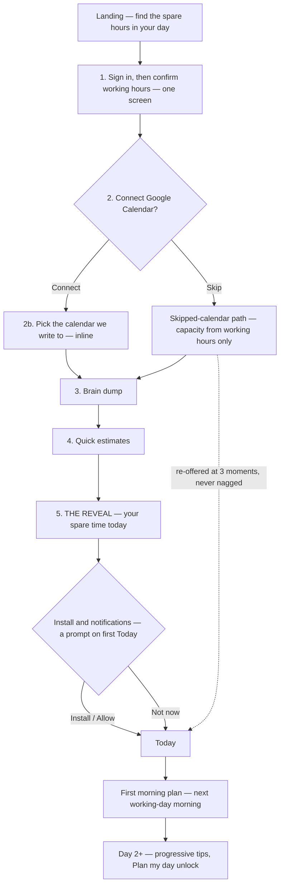

# Sparehour — onboarding

**Goal.** A new user sees **their real spare time** and has a **first plan** in under 3 minutes.

**Milestone.** **M2** (ruled 2026-09-13 — beta users need it; `PRODUCT_SPEC.md` §25 item 2). M1 ships only the working-hours confirmation (1b) and the brain dump (step 3), as a minimal first-run for a single user. M3 adds the landing page, billing hand-off and import.

**The one thing that must happen.** Step 5, *the reveal* — a real number, computed from the user's own calendar and their own tasks, that they did not have before they arrived. Everything before it is setup; everything after it is habit. If a step does not make the reveal truer or faster, it does not belong in onboarding.

**Constraints.**

| | |
|---|---|
| Total budget | **180 seconds** to the reveal, median |
| Steps | **5** (ruled 2026-09-13), plus one post-reveal prompt. Sign-in is the only thing you can't skip; hours is a one-tap accept; calendar, brain dump and estimates are skippable |
| Required inputs | Sign-in, and nothing else |
| Taxonomy asked for | **None.** No areas, no projects, no tags, no priorities (P4 — the default setup is the good setup) |
| Never | No product tour, no feature carousel, no "what brings you here?" survey, no confetti, no fake progress bars |
| Tone | Plain, second person, short sentences. Never "Awesome!", never exclamation marks |
| Phone (< 640 px) | **One step per screen** — 1a/1b and 2/2b become consecutive screens — with full-width buttons and ≥ 44 px targets; the reveal keeps hero + ribbon + equation in one column. Bands per `SCREENS.md` §0; every screen is responsive from M1 |

**Time budget per step** (median target, measured from `onboarding_started`):

| Step | Screen | Budget | Cumulative |
|---|---|---|---|
| 1 | Sign in, then working hours (one screen) | 40s | 0:40 |
| 2 | Connect calendar, write-calendar picked inline | 35s | 1:15 |
| 3 | Brain dump | 50s | 2:05 |
| 4 | Quick estimates | 30s | 2:35 |
| 5 | **The reveal** | 15s | **2:50** |
| — | Install + notifications (post-reveal prompt) | 20s | 3:10 |

The install prompt sits deliberately *after* the reveal, outside the numbered flow: we ask for permissions only once we've given something.

---

## 1. Flow



---

## 2. Screen by screen

Each screen: **purpose · copy · inputs · defaults · skip · saved · validation · analytics.** Copy in quotes is final; everything else is intent.

---

### Step 0 — Landing (M3)

**Purpose.** Set the promise before the sign-in wall.

**Copy.**
- H1: "Find the spare hours in your day."
- Sub: "Sparehour reads your calendar, subtracts your meetings, and tells you how much time you actually have left. Then it helps you plan into it — without ever making you feel behind."
- CTA: "Start free — no card"
- Under CTA: "Free forever for the core. Pro is $6/mo."

**Analytics.** `landing_viewed`, `landing_cta_clicked`.

---

### Step 1 — Sign in, then working hours (one screen)

#### 1a — Sign in

**Purpose.** Establish an account with the least possible friction. (Q25)

**Copy.**
- H1: "Let's find your spare hours."
- Sub: "Takes about two minutes."
- Buttons: "Continue with Google" · "Email me a link"
- Under: "We'll ask about your calendar in a moment — separately, and you can say no."

**Inputs.** Google OAuth (identity scope only — **calendar scopes are requested later, at step 2, never bundled here**), or an email address for a magic link.

**Defaults.** Google is the primary button. Time zone and locale are read from the browser and confirmed in 1b, on the same screen.

**Skip.** None. This is the only required step.

**Saved.** `User` (email, name, avatar, time zone, locale), one `Space` named "Personal", empty `WorkHours` defaults (§1b).

**Validation.**
- Invalid email → inline "That doesn't look like an email address."
- Magic-link sent → "Check your email. The link works for 15 minutes." Plus a "Send it again" that is disabled for 30s.
- OAuth cancelled → return to this screen with no error copy, focus on the buttons.
- Existing account signing in → skip the whole flow, go to Today.

**Analytics.** `onboarding_started`, `signin_method_selected {method}`, `signin_completed {method, is_new}`, `signin_failed {reason}`.

> **Why calendar scopes are not requested here.** Bundling calendar access into sign-in is the single most common reason people bounce at this screen, and it makes the privacy promise at step 2 impossible to state honestly.

---

#### 1b — Working hours (same screen, shown the moment sign-in succeeds)

**Purpose.** Without this, capacity is guesswork. It is also the cheapest possible input: most people accept the default.

**Copy.**
- H1: "When do you work?"
- Sub: "This is how we know what's left. You can change it any time."
- Time-zone line: "Times are in *Europe/London*. Change"
- Primary: "That's right" · Secondary: "Edit my hours"

**Inputs.** A week strip — five weekday pills pre-selected, Sat/Sun off — and one start/end pair applied to all selected days. "Edit my hours" expands to per-day rows with add-a-segment for split days.

**Defaults.** **Mon–Fri, 09:00–18:00** (assumed — confirm; the 9h day every example in these documents uses). Buffer 15% of the working day, not shown here — it is explained at the reveal instead, where it means something.

**Skip.** Primary button *is* the skip: accepting the default takes one tap.

**Saved.** `WorkHours` rows per weekday. `buffer_pct = 0.15`. Time zone confirmed.

**Validation.**
- End before start → inline "End time is before the start." Save blocked.
- Zero days selected → "Pick at least one working day." Save blocked.
- Segment longer than 16h → allowed, with a quiet "That's a long day" note. We do not police it.
- Overlapping segments on one day → merged automatically, with a note.

**Analytics.** `workhours_shown`, `workhours_edited`, `workhours_set {days, total_minutes, used_default}`.

---

### Step 2 — Connect calendar

**Purpose.** The difference between a guess and a fact. This is the highest-leverage and highest-anxiety step in the flow, so it gets the most explicit copy in the product.

**Copy.**

> **H1:** "Connect your calendar."
> **Sub:** "Your meetings are the reason you don't have as much time as you think. We subtract them."
>
> **What we do, exactly:**
> - **We read all your calendars.** Just the times you're busy — so the spare-hours number is real.
> - **We write to one calendar only.** The one you pick next. Your time blocks go there and nowhere else.
> - **We never touch your existing events.** We don't create, move or delete anything we didn't put there ourselves.
> - **We don't read the contents of your meetings.** Titles are used to label the timeline, and stay on your device. We store no attendees, no descriptions, no attachments.
>
> **Primary:** "Connect Google Calendar"
> **Secondary:** "Skip for now — I'll use my working hours"
> **Footer link:** "What we store, in plain English →"

**Inputs.** Google OAuth consent for calendar read + write-to-one.

**Defaults.** None. Nothing is connected until the user acts.

**Skip.** A real, first-class path — see §3.

**Saved.** OAuth tokens (server-side), the list of visible calendars, and a per-calendar `counts_as_busy` flag defaulted to **on for the primary calendar and on for any calendar the user owns**, off for subscribed/holiday calendars (assumed — confirm).

**Validation.**
- Consent denied → stay on this screen, swap the copy to "No problem. You can connect later from Settings", keep both buttons, advance on the secondary.
- Partial scopes granted (read but not write) → proceed, skip the write-calendar picker (2b), and note in Settings that blocking is unavailable until write access is granted.
- Zero calendars found → treat as the skipped path, with a note.
- Connection times out → "Google didn't answer. Try again" with a retry, and the skip still works.

**Analytics.** `calendar_connect_shown`, `calendar_connect_clicked`, `calendar_connected {calendar_count, meeting_count_today}`, `calendar_skipped`, `calendar_denied {reason}`, `calendar_privacy_link_clicked`.

---

#### 2b — Choose the write-calendar (inline, in the connect result)

**Purpose.** Make the "we write to one calendar" promise concrete, and let people keep their work calendar clean.

**Copy.**
- H1: "Where should your time blocks go?"
- Sub: "We'll only ever write here. Everything else stays read-only."
- Under the list: "Tip: a separate calendar keeps your blocks out of your colleagues' view." + "Create a new *Sparehour* calendar"

**Inputs.** A radio list of writable calendars, each with its account and a "read-only" badge where applicable. Plus the create-new option.

**Defaults.** The primary calendar is pre-selected. If the account already has a calendar named "Sparehour", that wins.

**Skip.** "Use my main calendar" is the primary button, so the default is one tap. The picker is auto-skipped if exactly one writable calendar exists.

**Saved.** `write_calendar_id`.

**Validation.** Creating a calendar that already exists reuses it rather than erroring. Loss of write permission later disables blocking with a re-connect banner, never a silent failure.

**Analytics.** `write_calendar_shown`, `write_calendar_chosen {is_default, created_new}`, `write_calendar_auto_skipped`.

---

### Step 3 — Brain dump

**Purpose.** Give the reveal something to subtract. Also the first, and best, demonstration of quick-add.

**Copy.**
- H1: "What's on your plate today?"
- Sub: "One per line. Don't organise anything — just get it out."
- Placeholder (animated through three examples, 2.5s apart): `Draft the proposal 3pm ~45m` → `Call the plumber` → `Review PRs ~1h #work`
- Hint strip under the input: "Try `3pm`, `~45m`, `#project`, `!1` — we'll pick them up as you type."
- Primary: "Next" (label becomes "Next — 5 things" once there are tasks)
- Secondary: "I'll add things later"

**Inputs.** A multi-line composer. Each `Enter` commits a line as a task and starts a fresh one; the committed tasks stack above the input as real rows with live-parsed chips. Paste of a multi-line list creates one task per line at once.

**Live parsing.** Tokens highlight as chips *while typing*, and a one-line interpretation strip restates the parse: *"Today 3:00pm · 45m"*. This is the same component as the production quick-add — onboarding is not a special case, so what people learn here transfers (`PRODUCT_SPEC.md` §5).

**Defaults.** Tasks committed here get `do_date = today` and `state = active` — the whole point is to fill *today*. A task that carries its own date token respects that date instead and is quietly noted: "Friday — I'll keep it for then."

**Skip.** "I'll add things later" → the reveal still runs, showing a full-capacity day and the empty-day copy (§4).

**Saved.** `Task` rows, `do_date = today`, `estimate_min = null` unless the line specified one.

**Validation.**
- Empty line → ignored, no error.
- Duplicate title → allowed. We never dedupe someone's brain.
- Over 20 tasks → after 20, a quiet line appears: "That's plenty for one day — the rest can live in your Inbox." Adding continues; tasks 21+ go to the Inbox instead of today. (assumed — confirm)
- A line over 200 characters → accepted; the row truncates visually with the full text in the note.

**Analytics.** `braindump_shown`, `braindump_task_added {index, had_tokens, token_types[]}`, `braindump_paste {line_count}`, `braindump_completed {task_count, tasks_with_estimates}`, `braindump_skipped`.

---

### Step 4 — Quick estimates

**Purpose.** Estimates are what turn a list into a number. Asking for them once, in a batch, with big targets, is far cheaper than asking per task later.

**Copy.**
- H1: "Roughly how long?"
- Sub: "A guess is fine — you can change it any time. Anything you skip counts as 30 minutes."
- Per row: the task title, then a chip row: `15m · 30m · 45m · 1h · 2h · Skip`
- Running total, pinned: "**2h 45m planned** of your day so far"
- Primary: "See my day" · Secondary: "Skip the rest"

**Inputs.** One tap per task. Keyboard: `1`–`5` pick the presets, `0` skips, and focus advances automatically. Arrow keys move between rows. A custom value is available behind a "…" chip.

**Defaults.** Tasks that already carried a `~` token show their value pre-selected and are pushed to the bottom of the list. Unanswered tasks stay at 30m, flagged.

**Skip.** "Skip the rest" fills every remaining task with the flagged 30m default and advances. The flow never blocks on this screen.

**Saved.** `estimate_min` per task; `null` for skipped, which renders as the dashed `~30m?` chip everywhere in the product.

**Validation.** Custom values are clamped to 5 minutes–8 hours. Over 4h shows "That's a big one — you can break it down later", non-blocking.

**Analytics.** `estimates_shown {task_count}`, `estimate_set {task_index, minutes, method}`, `estimates_completed {answered, skipped, total_minutes}`, `estimates_skipped_all`.

---

### Step 5 — The reveal

**Purpose.** The aha. The first time the user sees the product's entire thesis as one number about their own actual day.

**Layout.** Full-bleed, one card, nothing else on screen. The ribbon animates in once — segments filling left to right over ~700ms — and then it is static. This is the only moment in the product that gets a deliberate reveal animation; everywhere else, motion is feedback only (Q26).

```
┌──────────────────────────────────────────────────────────────────────┐
│                                                                      │
│                       Here's your Tuesday.                           │
│                                                                      │
│   9am                                                        6pm     │
│   ├──────────────────────────────────────────────────────────┤       │
│   │███│      │██████│        │▒▒▒▒▒▒▒▒▒│                     │       │
│   └───┴──────┴──────┴────────┴─────────┴─────────────────────┘       │
│    Standup    Design review   planned          spare                 │
│                                                                      │
│                                                                      │
│              You have  3 h 20 m  spare today.                        │
│                                                                      │
│      9h working  −  2h in meetings  −  1h 20m buffer  −  2h 20m      │
│      planned                                                         │
│                                                                      │
│      At this pace you're done by 4:30pm.                             │
│                                                                      │
│      The buffer is 15% of your working day, held back for the        │
│      things that always come up. Change it in Settings.              │
│                                                                      │
│                        [  Start my day  ]                            │
│                                                                      │
└──────────────────────────────────────────────────────────────────────┘
```

The numbers are the canonical example from `PRODUCT_SPEC.md` §9.1: a 9h day, 2h of meetings, a 1h 20m buffer (15% of the working day, capped so capacity never goes below zero), 2h 20m planned — 3h 20m spare.

**Copy variants.**

| Situation | Copy |
|---|---|
| Normal | "You have **3h 20m** spare today." + the subtraction line + "At this pace you're done by 4:30pm." |
| Tight (`spare < 45m`) | "You have **25m** spare today. That's a full day — nice work planning it." |
| Over (`spare < 0`) | "That's **40m more than fits.** Not a problem — move one thing to tomorrow and you're set." + [Trim today] |
| No calendar connected | "You have **7h 40m** of working time today." + "Connect your calendar and we'll subtract your meetings — that's where the real number is." + [Connect calendar] |
| No tasks added | "You have **5h 40m** spare today. Nothing planned yet." + [Add something] |
| Non-working day | "Today's not a working day. Here's **Monday** instead." (the reveal runs on the next working day) |
| Late in the day (< 2h of work window left) | "Only **40m** left of today. Here's **tomorrow** instead." (the reveal runs on tomorrow) |

**Inputs.** One button.

**Skip.** None — but no data is required either. Every variant is a valid reveal.

**Saved.** Nothing new. `DayPlan.planned_at` is set for today if the user arrived here with tasks, which suppresses today's morning nudge.

**Validation.** If calendar events are still loading, the ribbon shows a skeleton with "Reading your calendar…" for up to 4 seconds, then falls back to the no-calendar variant with a "still loading — it'll update" note. **The reveal never blocks on the network.**

**Analytics.** `reveal_shown {variant, spare_minutes, capacity_minutes, planned_minutes, meeting_minutes, task_count, ms_since_onboarding_started}` — the last field is the flow's primary health metric. Plus `reveal_cta_clicked`, `reveal_trim_clicked`, `reveal_connect_calendar_clicked`.

---

### After the reveal — Install and notifications (a prompt on first Today, not a numbered step)

**Purpose.** Both permissions, asked once, after value, in the right order — install first, because on iOS notifications are *impossible* without it.

**Copy.**
- H1: "Keep it one tap away."
- Sub: "Sparehour works offline and opens instantly when it's installed."

**Desktop / Android (Chromium).** The `beforeinstallprompt` event is captured earlier and fired here.
- Primary: "Install Sparehour" → native prompt
- Then: "Remind me when a block starts" → the Notification permission prompt
- Secondary: "Not now"

**iOS / iPadOS Safari.** No install prompt exists, so we coach:

> **Add Sparehour to your Home Screen**
> 1. Tap the **Share** button at the bottom of Safari. *(animated inline diagram of the share icon)*
> 2. Scroll down and tap **Add to Home Screen**.
> 3. Tap **Add**.
>
> "Notifications and offline only work from the Home Screen — that's an Apple rule, not ours."
> [ Show me again ] [ I've done it ] [ Not now ]

On iOS 26+, anything added to the Home Screen opens as a web app by default, so the coaching is three steps, not five (`07` §D36).

**Notification permission timing.** Requested **only** here, and only after an install or an explicit "Remind me". If the user picks "Not now", we never auto-ask again; the request moves to the moment it first buys something — the first time a time block is created, inline on the block: "Want a nudge when this starts?" This is the single most important rule on this screen: a denied permission is close to unrecoverable on the web.

**Defaults.** Notification categories default to the Q24 set: block start **on**, deadline **on**, one morning nudge **on**; shutdown nudge and per-task reminders **off**. Quiet hours 21:00–08:00.

**Skip.** "Not now" on either half. The flow completes regardless. A dismissible tip returns after 3 active days, once only.

**Saved.** `install_state`, `notification_permission`, default notification settings, `onboarding_completed_at`. `navigator.storage.persist()` is requested here, silently, since install is the moment it is most likely to be granted (`07` §D34).

**Validation.** Permission denied → no error, no re-ask, and Settings → Notifications shows the honest state with browser-specific instructions for re-enabling.

**Analytics.** `install_prompt_shown {platform}`, `install_accepted`, `install_dismissed`, `ios_coaching_shown`, `ios_coaching_confirmed`, `notification_prompt_shown`, `notification_granted`, `notification_denied`, `storage_persist_result {granted}`, `onboarding_completed {duration_ms, steps_skipped[]}`.

---

### Hand-off to Today, and the first morning plan

Landing on Today, the first view carries **one** coach mark, anchored to the ribbon, dismissed by any click:

> "This is your spare time. It updates as you add and finish things."

Nothing else is highlighted. No tour.

**The first morning plan** is the real second session. On the next working-day morning, at the start of the first work segment, the one permitted morning nudge fires:

> **"Good morning. 5h 40m fits today, 2 meetings."**
> "Plan your day — about 2 minutes." [ Plan ] [ Not today ]

Tapping through opens the morning plan ritual (`PRODUCT_SPEC.md` §12.1) with a first-run difference: step 1 carries one extra line — "This takes two minutes and you can stop at any step" — and step 3 (Block time) carries one extra line on first run: "Drag a task onto the timeline to give it a time — or skip; the list is enough."

If notifications were denied, the same prompt appears as a banner at the top of Today on first open of the day.

**Analytics.** `today_first_view`, `coachmark_ribbon_dismissed`, `morning_nudge_sent`, `morning_nudge_opened`, `first_plan_started`, `first_plan_completed {duration_ms, steps_completed}`, `first_plan_abandoned {last_step}`.

---

## 3. The skipped-calendar path

Roughly a third of users will skip step 2. They must still get a real product, and a real reveal.

| What changes | Behaviour |
|---|---|
| Capacity | `work_minutes − buffer`, with no meeting subtraction |
| Ribbon | Shows planned and spare only; no meeting segments. Label: "Based on your working hours" |
| Reveal copy | The no-calendar variant (§Step 5) |
| Timeline pane | Shows work hours and blocks, with an empty-meetings state: "No calendar connected — your meetings would show here." |
| Time-blocking | Works locally. Blocks simply don't sync anywhere |
| Re-offer | Three moments, each once, each dismissible forever: (1) a persistent, quiet line in the Today ribbon's overflow; (2) the first time the user manually creates a block — "Want these on your real calendar?"; (3) the third completed morning plan — "You've planned three days by hand. Connecting your calendar makes the spare number exact." |
| Never | No modal, no repeated banner, no nag on app open |

---

## 4. The returning-user empty day

The state most people hit on day 2 or 3, and the one most likely to lose them. It is a planning prompt, not an empty illustration.

```
┌──────────────────────────────────────────────────────────────┐
│  Tuesday 16 Sep            [ Plan my day ]  [ Shutdown ]  ⋯  │
│                                                              │
│  ├───┬────────────────────────────────────────────────┬──┤   │
│  │███│                                                │  │   │
│  └───┴────────────────────────────────────────────────┴──┘   │
│   6h 40m spare · nothing planned yet · 1h in meetings        │
│                                                              │
│                                                              │
│      Nothing planned for today. You have 6h 40m.             │
│                                                              │
│      [ Plan my day  ·  2 min ]                               │
│                                                              │
│      or pull something in:                                   │
│      ○ Send the invoice          Inbox        ~30m           │
│      ○ Book the dentist          Someday      ~15m           │
│      ○ Review the deck           Due Thu   !2 ~1h            │
│                                                              │
│      Or just start typing.                                   │
└──────────────────────────────────────────────────────────────┘
```

**Suggestion rules for the pull-in list** (max 3, deterministic at M1):
1. Tasks with a `deadline` in the next 3 days and no `do_date`.
2. Tasks whose `start_date` is today.
3. Inbox tasks, oldest first.
4. Never a Someday task unless the first three yield nothing — and then it is labelled "from Someday".

At M2 this becomes **backlog suggestions** (`07` §B16): ranked by age, reschedule count and deadline proximity.

**Copy rules.** Never "You're all caught up!" with a celebration. Never an empty-state illustration that implies failure. State the fact, offer the action.

**Analytics.** `empty_day_shown {spare_minutes, suggestion_count}`, `empty_day_suggestion_accepted {source}`, `empty_day_plan_clicked`.

---

## 5. Progressive onboarding after day 1

No tour. Features announce themselves **once, in context, at the moment they would have helped**, and never more than **one tip per day**.

| Trigger | Tip | Milestone |
|---|---|---|
| 3rd task added without a `~` estimate | "Add `~30m` while you type and we'll count it toward your day." | M1 |
| First task carried over | "This moved from yesterday. Nothing's late — pick a day, or let it sit here." | M1 |
| 3rd carry on the same task | The three-carry ask itself (`PRODUCT_SPEC.md` §8.3) | M1 |
| First over-capacity day | "More planned than fits. Trim today moves the biggest thing out in one tap." | M1 |
| 5th mouse-driven task completion | "`Cmd+Enter` completes the selected task." | M1 |
| First use of the palette | "`Cmd+K` finds every command. `?` shows the shortcuts." | M1 |
| 7 days of use | "You've planned 5 days. Your weekly review is ready." | M2 |
| 3rd day in a week with a block of the same title at the same time | "Same day again? Save it as a routine and run it for as many days as you like." | M2 |
| First recurring task completed early | "Complete early: this one only, or change the rule?" | M1 |
| First Someday auto-file batch | "6 things you hadn't touched in a month moved to Someday. Review them?" | M1 |

**When Plan my day unlocks.** It is a Pro feature (Q22), visible from day 1 as a button in the Today header.

1. **Day 1–3:** visible, and clicking it opens an explainer — what it does, what it reads, and a *real preview on the user's own data* with the Approve button replaced by "Start 30-day trial". Seeing the suggestion is free; applying it is not.
2. **Trigger to offer the trial:** the third day on which the user manually creates two or more time blocks, or the second over-capacity day. Both are moments where the value is self-evident.
3. **Trial:** 30 days, no card, all Pro features. Days remaining shown only in Settings and in the last 5 days, once per day, in the header.
4. **On expiry:** blocks stop syncing to the calendar but stay visible and usable; Plan my day returns to preview-only. **Nothing is deleted or hidden** (`PRODUCT_SPEC.md` §21 rule 6).

---

## 6. Activation metrics and targets

**Activation (the definition we optimise):** a new user who, within their first session, has (a) work hours set, (b) at least 3 tasks with today's `do_date`, and (c) fired `reveal_shown`. This is deliberately not "signed up" and not "connected a calendar" — it is the smallest set of facts that means the product did its job once.

| Metric | Target | Why |
|---|---|---|
| Sign-in → reveal completion | **70%** | The flow's headline number |
| Median time to `reveal_shown` | **< 3:00** | The stated goal |
| p75 time to `reveal_shown` | < 5:00 | Catches the slow path |
| Calendar connect rate | **60%** | The step with the most anxiety; below 45% means the privacy copy is failing |
| Brain-dump tasks added (median) | ≥ 5 | Fewer than 3 and the reveal isn't convincing |
| Tasks with a real estimate at reveal | ≥ 60% | Estimate quality drives the whole number |
| Install rate — desktop | 40% | |
| Install rate — mobile | 25% | iOS coaching is the constraint |
| Notification opt-in, of those asked | 45% | We only ask after value, so this should be high |
| **First morning plan within 48h** | **50%** | The best single predictor of week-4 retention |
| D1 return | 55% | |
| D7 return | 45% | |
| **W4 retention** | **35%** | This is the M2 exit test (`DECISIONS.md`) |
| Free → trial start | 25% by day 14 | |
| Trial → paid | 40% | RevenueCat median for 17–32-day trials is 42.5% (`05` §1) |

**Leading indicators to watch weekly during the beta:** days with a completed morning plan per active user; days with a completed shutdown; median `spare_minutes` accuracy (self-reported in the beta survey: "was that number right?"); carry-over rate per task; share of tasks with estimates. A rising carry rate with a falling shutdown rate is the early signal of the exact failure mode this product exists to prevent.

**Instrumentation rules.** Events are product analytics only — no task titles, no note bodies, no calendar event titles ever leave the device. Every event carries `space_id`, `platform`, `is_installed` and `app_version`. Analytics are disclosed in onboarding's privacy link and can be turned off in Settings without degrading the app.

---

## 7. Assumptions taken here (confirm)

| # | Assumption |
|---|---|
| B1 | Onboarding is an M2 deliverable; M1 ships only working hours + brain dump — **ruled** |
| B2 | Calendar scopes are requested at step 2, never bundled into sign-in |
| B3 | Default working hours Mon–Fri 09:00–18:00; buffer 15% of the working day, capped at (work − meetings) — **buffer ruled**, hours still assumed |
| B4 | `counts_as_busy` defaults on for owned calendars, off for subscribed/holiday ones |
| B5 | Brain-dump tasks past the 20th go to the Inbox rather than today |
| B6 | The reveal runs on tomorrow if fewer than 2h of today's work window remain |
| B7 | Notification permission is asked once, after the reveal, then only at first block creation |
| B8 | Plan my day is preview-free / apply-paid from day 1, with the trial offered on a behavioural trigger |
| B9 | Activation is defined as work hours + 3 dated tasks + reveal, in the first session |
