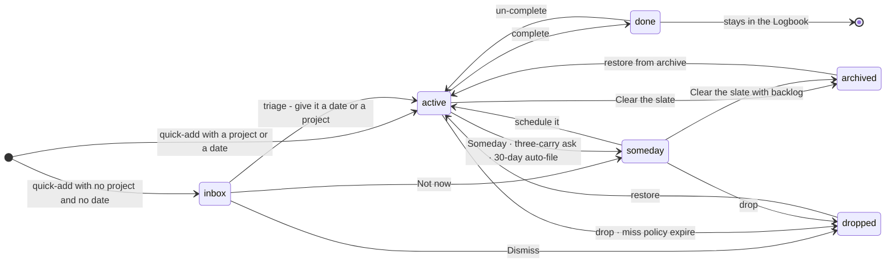

# Sparehour — product specification

**Tagline.** Find the spare hours in your day.
**Promise.** A Today that knows your real free time, and a guilt-free planning loop — you never feel behind.

**Status.** Draft 2, 2026-09-13 — coordinator rulings applied (recorded in §25). Written against `docs/DECISIONS.md` (source of truth) and `docs/FEATURES.md` (milestone catalogue). Evidence: `docs/research/05-users-trends-opportunities.md` and `docs/research/07-new-feature-ideas.md`, cited below as `05` and `07`.

**Scope of this document.** What the product does and why, feature by feature, with edge cases and milestone tags. Visual language (colour, type, spacing, motion curves) lives in `docs/design/DESIGN_SYSTEM.md`. Screen-by-screen layout lives in `SCREENS.md`. First-run flow lives in `ONBOARDING.md`.

**Milestones.** M1 = my own daily driver (2 weeks sole use). M2 = private beta, 10–30 users, exit test is week-4 retention. M2.5 = teams. M3 = public launch. Later = after launch. Never = deliberately out.

**"(assumed — confirm)"** marks a position taken here on a question DECISIONS.md still lists as open, or a rule invented to make a decision executable. Every one is collected in §24; the ones already ruled on are marked there.

---

## 1. Vision

Every task app knows *what* you said you'd do. Almost none know *when you could actually do it*. So the lists grow, the dates slip, the red numbers climb, and one day you stop opening the app. Research pain point #1 is backlog bloat and overdue guilt — "TODO bankruptcy" — and pain point #4 is that tasks are disconnected from time, which makes a list "paralyzing" (`05-users-trends-opportunities.md` §2).

Sparehour is built on one number: **spare time** — the hours left in your working day after meetings, buffer and everything you've already planned. It is on screen constantly, it updates as you add and finish things, and it is the answer to "can I take this on?"

Around that number sits a loop that is designed to be *survivable on a bad day*: things you miss move quietly to a "Carried over" section instead of turning red; after three moves the app asks, once, kindly; after thirty untouched days it files them away for you; and a single button clears the slate without deleting anything. The loop assumes you will fall behind, because you will.

Sparehour is not an autopilot. It suggests; you approve. It never moves your calendar behind your back (`FEATURES.md` §4, "Never").

---

## 2. Product principles

Seven principles. Each one resolves a trade-off, so it can be used to settle an argument.

**P1 — Time is the unit, not the task.**
Every list that can show its time cost, does: an estimate chip on a row, a capacity bar on a day, a projected finish on Today. *Trade-off resolved:* when a feature would make the list prettier but hide its time cost, the time cost wins. *Consequence:* no view ships without a way to see what it would cost you.

**P2 — Never make the user feel behind.**
No overdue counts, no red badges for missed do-dates, no streak loss, no shame copy. Only a missed **deadline** — a real, external commitment — gets an alarm state, and even then it's one row, not a number in the sidebar. *Trade-off resolved:* urgency vs. calm. Calm wins; urgency is bought with a real deadline, not with UI pressure. *Evidence:* pain #1; "Other todo apps punish you with overdue badges, streaks, and red numbers" is the ADHD-app positioning we are competing against.

**P3 — Honest by default, optimistic on request.**
The app tells you the truth about the day even when it's bad — "40m more than fits". It does not quietly shrink estimates, hide tasks, or pretend a 9-hour plan fits in 4 hours. *Trade-off resolved:* motivating vs. accurate. Accurate wins. The kindness is in the *copy and the offered next action*, never in the arithmetic.

**P4 — The default setup is the good setup.**
A new account is immediately usable: an Inbox, a Today, work hours, one Personal space. Structure (Areas, Projects, tags, filters) is available but never required, and no onboarding step demands taxonomy. *Trade-off resolved:* power vs. setup fatigue (pain #2, "productivity theater"). We pay for power with progressive disclosure, not with a configuration wizard.

**P5 — Keyboard-first, mouse-complete.**
Every action is reachable from `Cmd+K`; the twenty most frequent have single keys. Every keyboard action also has a visible, pointer-driven equivalent, because mobile and new users exist. *Trade-off resolved:* speed for power users vs. discoverability. Both, by making the command palette the discovery surface.

**P6 — Suggest, preview, approve.**
Anything the app generates — a plan, a breakdown, an estimate, an AI parse — is shown as a proposal you can see, edit and reject before it touches your data. AI is opt-in, labelled, and never a new price tier. *Trade-off resolved:* automation vs. trust. *Evidence:* AI fatigue data; Motion's autopilot complaints; 81% of consumers want AI content labelled.

**P7 — Your data can leave.**
Local-first, works offline, one-click export at M1, documented exit guarantee at M3. Nothing is stored in a shape we can't hand back. *Trade-off resolved:* lock-in as a retention strategy vs. trust as one. *Evidence:* Clockwise deleted user data on shutdown; Height shut down; pain #6 is lock-in fear.

---

## 3. Target users

### 3.1 Primary — the over-committed knowledge worker

**Maya, 34, senior product manager.** 5–6 hours of meetings a day, a list of 60 things, and no idea which of them fit in the gaps. She plans on a laptop in the morning, checks a phone all day. She has churned out of Todoist (list grew, guilt grew) and bounced off Sunsama (too expensive, too much ritual).

- **Job to be done:** "Before I say yes to this, tell me if I have the hours."
- **Success:** she opens Today, sees "2h 10m spare", and either takes the work or doesn't.
- **Buys because of:** capacity + two-way calendar blocking at a consumer price.
- **Churns if:** the calendar sync lags (TickTick's known weakness), or the app nags.

### 3.2 Secondary — the developer / keyboard maximalist

**Sam, 29, staff engineer.** Has a `todo.txt`. Wants speed, offline, `Cmd+K`, no cloud lock-in, and to be left alone. Will forgive a missing feature, never a 300ms input lag.

- **Job:** "Capture in under a second, and let me get back to work."
- **Success:** quick-add parses `fix flaky test tomorrow ~45m #infra !2` correctly the first time.
- **Buys because of:** local-first speed, export, MCP + API (M3).
- **Churns if:** it feels like a web app — spinners, lost keystrokes, a sync conflict that eats an edit.

### 3.3 Attended-to segment — ADHD and time-blind users

Not a separate mode at M1, but a constant constraint. From `05` §4: low density, visual time, no punitive mechanics, assistance with *task initiation* rather than an assumption of discipline.

What we owe them at M1: the spare-time ribbon as a visual time cue; "This Evening" and smart snooze so a bad morning isn't a failed day; per-task miss policy so routines never pile up; the three-carry ask phrased as a question, not a scold; no streaks; a one-key "start this now" path into a block. Later: a low-density mode, visual countdowns, energy budget, body doubling (`FEATURES.md` §5).

### 3.4 Explicitly not the target (yet)

Teams buying seats (M2.5 at the earliest), students, freelancers needing billable exports, agencies, anyone who wants a Gantt chart. Sunsama at $17–22/mo and Motion at $19–29/seat own the "manage my company" end; we sit deliberately below them.

---

## 4. Core objects

The shared vocabulary. Use these names in code, copy and conversation.

| Object | Key fields | Notes |
|---|---|---|
| **Space** | id, name, type (personal/team) | Every record carries `space_id` from day one. M1 ships exactly one, "Personal". (assumed — confirm, Q20) |
| **Task** | state, title, note (markdown), project_id, heading_id, area_id, tags[], priority 0–3, **do_date**, **do_time**, **deadline**, **start_date**, estimate_min, evening (bool), carry_count, carried_from, miss_policy, recurrence, last_touched_at, completed_at, routine_run_id?, routine_item_id? (M2 — set when the task is a routine item on its day) | States: `inbox`, `active`, `someday`, `done`, `dropped`, `archived` |
| **ChecklistItem** | task_id, title, done, order | Exactly one level. No nesting, ever (`FEATURES.md` §2 Never) |
| **Project** | name, area_id, status (`active`/`someday`/`done`/`archived`), deadline?, notes | |
| **Heading** | project_id, title, order | Optional grouping inside a project. Not a container for dates or estimates |
| **Area** | name, order | Top-level bucket. No dates, no completion |
| **Tag** | name | Flat. Contexts like `@calls`, `@errands` |
| **TimeBlock** | start, end, task_id?, title, locked (bool), calendar_event_id?, sync_state | The app's own writes to the calendar |
| **CalendarEvent** | external_id, calendar_id, start, end, busy, all_day, title | **Read-only mirror.** Never edited by Sparehour |
| **DayPlan** | date, planned_at, shutdown_at, highlights[], day_rating 1–5 | One per date, created lazily on first ritual |
| **WorkHours** | weekday, segments[] {start, end} | Per weekday; multiple segments allowed (split days) |
| **Routine** (M2) | name, items[] | A reusable day. Never dated itself (§11a) |
| **RoutineItem** (M2) | routine_id, title, kind (timed / anytime), start_time + duration_min (timed) or estimate_min (anytime), project_id?, tags[], checklist[] (one level), evening, order, effective_from | A "this and following days" edit writes a new version from that date |
| **RoutineRun** (M2) | routine_id, start_date, length (N days / until date / none), day_rule (every day / working days / weekdays[]), write_to_calendar, status (scheduled / running / paused / finished / ended), pauses[], day_overrides {date → item changes} | One scheduling of a routine. "Just this day" edits live in `day_overrides`. At most one running run per routine (assumed — confirm) |

**Derived values** (never stored, always computed — see §9):
`capacity` = work hours − meetings − buffer · **`spare time`** = capacity − planned estimates · `projected finish` · `carried over` set · a routine's `Day k of N` (M2).

---

## 5. Capture and quick-add — M1

### 5.1 Behaviour

One input, reachable everywhere: `Q` anywhere in the app, `Cmd+K` then type, the `+` button, or the mobile FAB. It opens over the current view, never navigates away, and returns focus to where you were.

1. Typing parses **live**. Recognised tokens highlight as chips inside the input as soon as they are complete; the remaining text is the title.
2. A one-line **interpretation strip** sits under the input restating the parse in plain English: *"Today 3:00pm · 45m · Acme · priority 1"*. This is the contract — if the strip is wrong, the parse is wrong.
3. Any chip can be removed with a click or `Backspace` when the caret is next to it. Removing a chip returns its literal text to the title.
4. `Enter` saves and clears, leaving the input open for the next one (brain-dump mode). `Cmd+Enter` saves and closes. `Esc` discards with a one-step undo.
5. **No date + no project → Inbox.** Any date or project → `active`.
6. Paste of multi-line text creates **one task per non-empty line**, each parsed independently. Lines starting with `-`, `*`, `[ ]` or `1.` have the marker stripped. A confirmation strip shows "12 tasks — Undo".

### 5.2 Syntax

All parsing is **deterministic** at M1. No AI (`DECISIONS.md`, AI section).

| Token | Sets | Examples | Rules |
|---|---|---|---|
| bare date / time | `do_date`, `do_time` | `tomorrow 3pm` · `next fri` · `mon` · `today` · `21 sep` · `tue 09:30` · `in 3 days` | Bare weekday means the **next** such day, never today. Time without a date implies today; if that time has passed, tomorrow (assumed — confirm) |
| `evening` | `evening = true` | `call mum evening` · `evening tue` | Alone → today; with a date → that date's evening. Clears `do_time` |
| `{ … }` | `deadline` | `{fri}` · `{30 sep}` · `{in 2 weeks}` | Date only, no time. The only field that can turn a row red |
| `after …` | `start_date` | `after mon` · `after 1 oct` | Hides the task from Today, Upcoming and search-default until that date |
| `#name` | `project_id` | `#acme` · `#"Q4 launch"` | Fuzzy match against existing projects; no match offers "Create project *acme*" inline |
| `@name` | `tags[]` | `@calls @deep` | Repeatable. No match offers create |
| `~duration` | `estimate_min` | `~45m` · `~1h30` · `~2h` · `~90` | Bare number = minutes. Max 8h; over that we suggest "Break it down" |
| `!1 !2 !3` | `priority` | `!1` | `!1` highest, absent = 0 = none. Three levels + none (Q23) |
| `every …` | `recurrence` (fixed) | `every mon` · `every weekday` · `every 2 weeks` · `every 15th` · `every mon,thu` | Next occurrence computed from the rule regardless of when you finish |
| `every! …` | `recurrence` (after completion) | `every! 3 days` · `every! 2 weeks` | Next `do_date` = completion date + interval |

**Worked examples**

| Typed | Result |
|---|---|
| `Draft proposal fri 3pm ~45m #acme @calls !1` | Title "Draft proposal", do 3pm next Friday, 45m, project Acme, tag calls, P1 |
| `Water plants every! 3 days ~5m` | Recurs 3 days after each completion, 5m |
| `Submit expenses {fri} after wed ~20m` | Hidden until Wednesday, deadline Friday, no do-date until you give it one |
| `Standup every weekday 9:15 ~15m #team` | Fixed weekday repeat at 9:15 |
| `Read the deck evening tomorrow` | Tomorrow, This Evening section, no time |
| `Email \#12 about the bug tomorrow` | Title keeps the literal "#12"; only the date is parsed |

### 5.3 Parsing rules

1. Tokens are recognised only as **whole, space-delimited** units. `~45m` parses; `roughly~45m` does not.
2. **Leftmost wins** for the date; a second bare date is left in the title. Duplicates of `~`, `!`, `#` — **last wins**.
3. `\` escapes the next character's token meaning.
4. Parsing is case-insensitive; date words follow the account locale and time zone.
5. Ambiguous dates resolve **forward**: on 21 Sep, `21 sep` means next year only if today is past; `sep 21` today means today.
6. Text between the tokens, in order, becomes the title, with runs of whitespace collapsed.
7. A token that fails to parse is left in the title verbatim — never dropped, never an error dialog.
8. Recurrence and `start_date` are mutually compatible; recurrence and `deadline` set a deadline on each occurrence.

### 5.4 Edge cases

| Case | Behaviour |
|---|---|
| Empty title after parsing (`tomorrow ~30m` alone) | Save is blocked; interpretation strip reads "Give it a name" |
| Estimate > 8h | Saved, flagged in the row: "Long — break it down?" |
| Deadline earlier than do-date | Both saved; the task shows a "due before you plan to do it" hint in the detail panel |
| `every` + a past date | Recurrence anchored to the next valid occurrence |
| Offline | Task saved locally and appears instantly; sync badge shows pending |
| Project name collides across Areas | Picker disambiguates with the Area name; nothing is auto-created on a collision |

### 5.5 Capture, later milestones

| Feature | Milestone |
|---|---|
| PWA share target into Inbox (Android/Chromium; **not possible on iOS**, WebKit bug 194593) | M2 |
| Apple Shortcut + email-in address as the iOS share path | M2 |
| Email forwarding → Inbox | M2 |
| Voice brain-dump → structured tasks (AI, labelled) | M2 |
| Browser extension; commitments inbox from Gmail/Slack/GitHub/Linear (pull, not push) | Later |
| Photo of a handwritten list; meeting transcript → actions | Later |

---

## 6. Organization — M1

**Inbox → Areas → Projects (optional Headings) → Tasks, with a one-level checklist.** Tags cross-cut. (Q23)

| Rule | Detail |
|---|---|
| Depth is capped | Area → Project → Heading → Task → ChecklistItem. A ChecklistItem has no date, estimate or assignee. Unlimited nesting is a permanent Never — it breaks estimates and time-blocking |
| Everything is optional | A task needs only a title. No project, no area, no tag, no date, no estimate |
| Convert task → project | Moves the task's checklist items to real tasks inside the new project, keeps the note, retires the task. Offered by name in the three-carry ask as "Break it down" |
| Headings | Ordering and grouping inside one project only. Cannot hold dates or be completed |
| Someday is a **state**, not a list | A Someday task keeps its project and tags; it just never appears in Today, Upcoming or capacity |
| Logbook | Every `done` and `dropped` task, newest first, grouped by completion day, with a filter by project/area |
| Priority | 3 levels + none. Affects sort order and the Plan-my-day ordering; it does **not** create urgency UI |
| Multi-select + bulk edit | Shift-click / `X` to select; bulk set date, project, tag, priority, estimate, state |
| Notes | Markdown on tasks and projects. Rendered, editable in place |
| Archive vs delete | Archiving is reversible and keeps everything. Permanent delete exists only in Settings → Data, and always names the count |

Later: Waiting-for with person + follow-up date (M2), templates (M2), attachments (M2), sequential projects, dependencies (Later).

---

## 7. Task lifecycle and states — M1



| State | Appears in | Counts toward capacity | Notes |
|---|---|---|---|
| `inbox` | Inbox only | No | Zero-friction landing zone. An Inbox count is the only number in the sidebar that can grow — and it is neutral, never red |
| `active` | Today / Upcoming / Project / Area / Week | Yes, on its `do_date` | With a `start_date` in the future it is hidden everywhere except its project and explicit search |
| `someday` | Someday view, project view (dimmed) | No | Fully reversible, no data lost |
| `done` | Logbook, and Today until midnight | Counted as *completed*, not planned | Completion animation is subtle feedback, not celebration (`FEATURES.md` §5 M1) |
| `dropped` | Logbook, under "Dropped" | No | Kept forever unless permanently deleted |
| `archived` | Settings → Data → Archive | No | Produced by "Clear the slate". Restorable as a batch |

**Transition rules.**
1. Completing a task with unchecked checklist items is allowed; the items are recorded as unchecked in the Logbook entry.
2. Un-completing restores the previous state and `do_date`; if that date is past, the task lands in **Carried over** today.
3. Dropping always shows an undo toast for 10 seconds, and the task remains recoverable from the Logbook indefinitely.
4. Every transition is undoable with `Cmd+Z` (`FEATURES.md` §8, undo for every action).
5. State changes update `last_touched_at`, which the 30-day auto-file reads.

---

## 8. Dates and the carry-over engine — M1

This is the guilt-free loop. It is the feature most likely to decide whether someone is still using Sparehour in week 4.

### 8.1 The four date fields

| Field | Means | UI consequence |
|---|---|---|
| `do_date` (+ optional `do_time`) | "I intend to do this on this day" | Puts the task in Today / Week / Upcoming. Missing it is **never** an error |
| `deadline` | "This is genuinely due to someone else" | Shown as a flag on the row. The **only** field that produces an alarm state, and only once it is actually past |
| `start_date` | "Don't show me this until…" | Hides the task from Today, Upcoming, Week and default search until the date. Visible in its project, dimmed |
| `evening` flag | "Today, but after work" | Moves the row to the "This Evening" section and out of working-hours capacity |

The do/due split is the single most-praised idea in the research (`05` §3: "I won't use a to-do app without a start date"; the Zesfy thread's reception). We must never blur it.

### 8.2 Rollover rules

1. **When.** At local midnight in the account time zone. If the device was asleep or offline, rollover runs on the first app open of the new day, before the first paint, and is idempotent per date.
2. **What rolls.** Every task where `state = active` and `do_date < today`.
3. **The default action (`miss_policy = carry`).** Set `carried_from = carried_from ?? do_date`; set `do_date = today`; `carry_count += 1`. The task appears in the **Carried over** section of Today.
4. **`miss_policy = skip`.** Recurring: this occurrence closes as *skipped* (not completed, no Logbook tick) and the next one is computed normally. Non-recurring: `do_date` is cleared and the task returns to its project unscheduled; `carry_count` is not incremented.
5. **`miss_policy = expire`.** The task becomes `dropped` with reason "expired" and appears in the Logbook. A single digest line appears once on Today: "2 time-sensitive tasks expired overnight — Review".
6. **Default policy** is `carry` for one-off tasks and `skip` for recurring tasks (assumed — confirm). This is what stops routines piling up — the #1 request on the TickTick and Akiflow boards (`07` §A5). Routine items (M2) are always `skip`, with no setting to change it (§11a.4).
7. **Deadlines never move.** Rollover changes `do_date` only.
8. **Ordering** in Carried over: `carry_count` descending, then `carried_from` ascending. The thing you've avoided longest is at the top, stated as a fact, not an accusation.
9. **Each row** offers four one-tap actions: **Today · Tomorrow · Someday · Drop**. Today is the default (it is already there); the row simply moves up into the Today list.
10. **Carried over renders only when non-empty**, and collapses to a summary line above 8 rows: "Carried over · 11 — Expand".

### 8.3 The three-carry ask

1. `carry_count` increments on an automatic rollover **and** on any user action that pushes `do_date` to a later date while the task was in Today or Carried over. Moving a task *earlier*, or scheduling it from Someday, does not increment.
2. `carry_count` resets to 0 on: complete, drop, move to Someday, convert to project.
3. When a task's `carry_count` reaches the threshold (default 3, a setting), its row in Carried over expands **once** to show the ask, in exactly this order:

   > **Carried over three times — still want this?**
   > [ Keep today ] · [ Someday ] · [ Break it down ] · [ Drop ]

   Four options, "Keep today" first (ruled 2026-09-13; `DECISIONS.md` originally listed three). Without a no-penalty way to say yes, the ask becomes a demand to justify yourself, which is exactly the pressure P2 forbids.

4. The ask is shown at most once per task per 7 days, and at most **two asks per day** across all tasks. It never blocks the view, never appears as a modal, and "Keep today" is a real, unpenalised answer.
5. "Break it down" converts the task into a project and opens it with the cursor in the first empty task row. At M2 this offers an AI-suggested breakdown (labelled, editable, rejectable).

### 8.4 The 30-day auto-file

1. `untouched_days` = days since `last_touched_at`. Any edit, reschedule, open of the detail panel, checklist tick, or block creation counts as a touch.
2. At 30 untouched days (a setting), a task with `state = active` moves to `someday` automatically.
3. **Exemptions:** a `deadline` in the future; an active recurrence; membership in a TimeBlock in the next 7 days; `priority = 1` (assumed — confirm — highest-priority things deserve a human decision, not a silent file).
4. It is announced once, gently, in the Someday view header and in the weekly review (M2): "6 tasks moved to Someday while you weren't looking — Review". No push notification. No count in the sidebar.
5. Fully reversible: "Bring them all back" restores state and clears `untouched_days`.

This is the calm version of the "gentle decay / graveyard" mechanic (`07` §B17) — fade to Someday, review in a ritual, never cull.

### 8.5 Clear the slate

1. One button, in Today's overflow menu and in Settings → Data.
2. Two scopes: **Today only** (everything with `do_date ≤ today`, including Carried over) or **Today + backlog** (adds all `active` tasks with no future date).
3. Sets `state = archived` and stamps a `batch_id`. **It never deletes.**
4. Confirmation names the number and the guarantee: "Archive 47 tasks? Nothing is deleted — you can bring the whole batch back for 30 days."
5. Recent batches are listed in Settings → Data → Archive with a one-click restore, indefinitely (the 30 days is the *promise*, not a purge; assumed — confirm).
6. After clearing, Today shows the clean empty state and one line: "Slate cleared. 47 tasks archived — Undo."

### 8.6 Smart snooze presets — M1

Available on any row (`.` menu, or single keys) and in the notification actions: **This evening · Tomorrow · In 4 hours · This weekend · Next week · Pick a date.** "This evening" sets the `evening` flag and today's date. "This weekend" means the next Saturday. Each snooze that pushes the date later counts toward `carry_count` (§8.3 rule 1).

---

## 9. Capacity and spare time — M1

The hero number. Everything else in the product exists to make it true.

### 9.1 Formulae

```
work_minutes(d)      = Σ length of WorkHours segments for weekday(d)

meeting_minutes(d)   = Σ length of ( CalendarEvent ∩ work window )
                       for events where busy = true and all_day = false,
                       with overlapping events merged so a minute is counted once

buffer_minutes(d)    = min( round5( buffer_pct × work_minutes(d) ),
                            work_minutes(d) − meeting_minutes(d) )
                       buffer_pct default 0.15 · round5 = nearest 5 minutes
                       → a 9h day reserves 1h 20m; the cap means capacity never goes below zero

capacity_minutes(d)  = work_minutes(d) − meeting_minutes(d) − buffer_minutes(d)
                       ( ≥ 0 by construction )

planned_minutes(d)   = Σ estimate_min of tasks where do_date = d
                           and state = active and evening = false
                     + Σ duration of TimeBlocks on d that have no task_id
                       ( ad-hoc blocks such as "lunch" or "deep work" )
                       routine items (M2) are tasks for their day, so the first term counts them

spare_minutes(d)     = capacity_minutes(d) − planned_minutes(d)
```

**Buffer is 15% of the day's working hours, capped at the time left after meetings** (ruled 2026-09-13). The plain-English version is "15% of your working day, held back for the things that always come up", and it is the same sentence in the reveal, the ribbon tooltip and the Settings preview. The cap means a day that is 100% meetings reports zero capacity, never a negative one.

**Canonical worked example — used for every number in these three documents.** A 9:00–18:00 day (9h) with 2h of meetings and 2h 20m of planned tasks:

```
work      = 540m
meetings  = 120m
buffer    = min( round5(0.15 × 540) = 80m, 540 − 120 = 420m ) = 80m   → "1h 20m"
capacity  = 540 − 120 − 80 = 340m                                     → "5h 40m fits today"
planned   = 140m                                                      → "2h 20m planned"
spare     = 340 − 140 = 200m                                          → "3h 20m spare"
```

**Evening is budgeted separately.** `evening_capacity` runs from the end of the last work segment to the evening cut-off (default 22:00), with no buffer. Evening tasks never consume working-hours spare time, and evening overload gets its own, quieter line.

### 9.2 Estimates

| Rule | Detail |
|---|---|
| Optional | A task without an estimate is assumed **30 minutes** and is visibly flagged with a dashed estimate chip reading `~30m?` |
| Honest | The flag exists so the number is never silently fake. Hovering says "No estimate — counted as 30m" |
| Granularity | 5-minute steps; presets 15m / 30m / 45m / 1h / 1h30 / 2h / 3h / 4h |
| Rounding | Displayed as `45m`, `1h`, `1h 30m`. Never decimal hours |
| Actuals | Tracked from focus sessions at M2; **used to suggest corrections only at Later** (`DECISIONS.md`: "Learning from actual durations comes after M2") |

### 9.3 Projected finish

Computed by walking the clock forward from `now`:

1. Start at `max(now, start of the current work segment)`.
2. Step through the rest of the work window. Minutes occupied by a busy `CalendarEvent` or a `TimeBlock` are consumed by that event.
3. Free minutes are consumed by the remaining unfinished, non-evening Today tasks, in list order, at their estimate.
4. The clock time when the last task's last minute is consumed is the **projected finish**, displayed as "done by 4:30pm".
5. If the walk runs past the end of the work window, the finish shows as the overflow instead: "**40m more than fits**".
6. Recomputed on every relevant change, debounced to 250ms. It is a rolling number and is expected to move during the day.

This is the Llama Life "running total makes time feel real" mechanic (`07` §B13), made continuous.

### 9.4 Capacity states

| State | Condition | Ribbon copy (indicative) | Behaviour |
|---|---|---|---|
| **Open** | `spare ≥ 45m` and `spare ≥ 15% capacity` | "3h 20m spare · 2h 20m planned · 2h in meetings · done by 4:30pm" | Normal. The "in meetings" term is always present when a calendar is connected — it is what makes the subtraction legible |
| **Tight** | `0 ≤ spare < 45m` | "25m spare · 5h 15m planned · 2h in meetings · done by 5:45pm" | Ribbon's spare segment narrows; no warning |
| **Over** | `spare < 0` | "40m more than fits — move something to tomorrow?" | Ribbon shows an over-capacity overhang past the end of the day. Tapping the copy opens **Trim today** |
| **Well over** | `spare < −120m` | "2h 30m more than fits — want help trimming?" | Same, with Trim today offered inline |
| **Empty** | `planned = 0` | "5h 40m spare · nothing planned yet · 2h in meetings — Plan your day" | Invites the morning plan |
| **No calendar** | No connected calendar | "7h 40m of working time · connect a calendar to see real free time" | Capacity = work hours − buffer (9h − 1h 20m); the ribbon shows no meetings and says so |
| **Non-working day** | No WorkHours segments | "No working hours today · 3 things planned" | Tasks still listed; no capacity maths, no overload |

**The over states are never an alarm.** No red, no shake, no exclamation, no blocking dialog (P2, and `DECISIONS.md`: only missed deadlines are red). The copy always ends in an offered action.

**Trim today** is a small panel listing today's tasks by estimate, largest first, each with Tomorrow / Someday / Drop, and a live "X more than fits → now fits" readout at the top. It closes itself the moment the day fits.

### 9.5 Work hours and buffer

- Set per weekday, multiple segments allowed (e.g. Mon 09:00–12:30, 13:30–18:00). Default Mon–Fri 09:00–18:00, weekends off (assumed — confirm; the 9h day is the one the onboarding reveal and every example here use).
- Buffer is one slider, 0–30%, default 15%, with a live preview: "15% · 1h 20m held back on a 9h day".
- Changing either recomputes every open day instantly, including Upcoming's 7-day columns.
- Time zone follows the account; travel is handled by changing the account time zone, which recomputes but never rewrites stored dates.

---

## 10. Time-blocking and calendar — M1

### 10.1 Connection model

- **Google Calendar, two-way, at M1.** Outlook at M3. iCloud/CalDAV Later.
- **Reads all calendars** the account can see; each calendar has a per-calendar toggle for "counts as busy".
- **Writes to exactly one calendar**, chosen during onboarding and changeable in Settings. We never create, edit or delete anything on any other calendar. This is stated in plain words at connect time and again in Settings.
- Sync target is **under 60 seconds** each way, with an explicit "Synced 12s ago" status and a manual Sync now. Beating TickTick's ~15-minute lag is a stated competitive goal (`05` §2 pain #4).

### 10.2 Blocks

| Rule | Detail |
|---|---|
| Creating | Drag a task from the Today list onto the timeline; drag on empty timeline space for an ad-hoc block; `B` on a selected task places it in the next free gap large enough for its estimate. On phones (M1): tap the task, then tap a slot |
| Default length | The task's `estimate_min`, snapped to 5 minutes; an ad-hoc drag snaps to 15 |
| A block is not a completion | Completing the task marks the block done; deleting a block never changes the task |
| Locked blocks | `locked = true` pins a block so re-plan and Plan-my-day (M2) will not move it. Toggle with `L` or the padlock |
| Overlaps | Allowed, drawn side by side, and counted once in `planned_minutes` — a block and its meeting are the same minutes |
| Outside work hours | Allowed; the timeline dims the region and the ribbon notes "1h planned outside working hours" |
| Multiple blocks per task | Allowed (split a 3h task into two). Their durations are summed against the estimate; a mismatch shows a hint, never an error |

### 10.3 Two-way sync rules

1. Sparehour → Calendar: creating, moving, resizing or deleting a block writes the corresponding event on the chosen write-calendar, titled with the task name and a discreet Sparehour marker.
2. Calendar → Sparehour: moving or resizing that event in Google moves the block. **The calendar wins on conflict** (assumed — confirm) — it is the surface the rest of the person's world sees.
3. Deleting the event in Google deletes the block but **never** the task; the task returns to the Today list unblocked, with a quiet note "block removed in Google Calendar".
4. Deleting the *task* deletes its blocks and their events.
5. If the write-calendar is removed or access is revoked, blocking is disabled with a banner and a re-connect action; existing blocks are kept locally and marked "not synced".
6. Declined meetings and events marked Free do not count as busy. All-day events do not count as busy unless the user flips a per-calendar switch (assumed — confirm).
7. Private event titles from other calendars are mirrored as "Busy" if the calendar is marked private in Settings.

### 10.4 Paywall

Reading the calendar is free. **Writing blocks back is Pro** (Q22). The free tier therefore shows a real, meeting-aware capacity — the core promise stays free — and charges for the two-way loop.

---

## 11. Plan my day — M2

Suggest → preview → approve. Never full-auto (`DECISIONS.md`; `FEATURES.md` §4 "Never": full auto-rescheduling that moves your calendar on its own).

1. Triggered from the Today header, `Cmd+Shift+P`, or as the last step of the morning plan.
2. It reads: today's active tasks (+ Carried over), estimates, priorities, deadlines, existing locked blocks, meetings, work hours and buffer.
3. It produces a **preview** — ghost blocks on the timeline, nothing written — plus a plain-English list of what it did and why:
   - "*Draft proposal* at 9:30 — 2h, your first gap, and it's due Friday."
   - "*Expenses* moved to tomorrow — it didn't fit and has no deadline."
   - "Left 1h 20m unplanned — that's your buffer."
4. Controls in preview: **Approve** (writes all blocks), **Approve some** (checkboxes per block), **Shuffle** (re-run with a different arrangement), **Discard**.
5. Locked blocks and meetings are immovable inputs.
6. **Re-plan the rest of today** does the same for the remaining hours only, leaving the past alone.
7. It never moves calendar events, only Sparehour blocks. It never silently drops a task — anything that doesn't fit is listed under "Didn't fit" with the reason and one-tap Tomorrow / Someday.
8. Ordering heuristic (deterministic, explainable, no AI required for placement): deadline proximity → priority → carry_count → estimate fits the gap → task's usual time of day (Later). AI at M2 writes the *explanations*, not the placement.

**Pro feature** (Q22).

---

## 11a. Routines — M2

Added 2026-09-14 at the user's request (`DECISIONS.md`; `FEATURES.md` §4). **Build a whole day once — timed items and "anytime" items — and run it for as many days as you choose.** It is for deliberate stretches: 21 working days of deep work, a 30-day morning routine, a travel week. `DECISIONS.md` notes it could move to M1 if wanted.

A routine is not a recurring task (one task on a rule, §5.2) and not a template (`FEATURES.md` §2, M2 — it stamps out a set of tasks once). It is the shape of a day, scheduled for a counted run of days.

### 11a.1 Building a routine

| Part | Fields | Rules |
|---|---|---|
| **Routine** | name, items | Any number can exist; several can run at the same time |
| **Timed item** | title, start time, duration | Sits on the day timeline at that time. Its duration is its estimate |
| **Anytime item** | title, estimate | No time. Listed in the routine's group; counts at its estimate |
| Optional on any item | project, tags, one-level checklist, evening flag | Same meaning as on a task. An evening item lands in This Evening and counts against evening capacity (§9.1) |

Timed items sort by start time; anytime items follow in manual order. The editor shows the daily total — "3h 50m each day" — so the routine's cost is visible before it is scheduled (P1).

### 11a.2 Scheduling ("apply")

| Control | Options | Default |
|---|---|---|
| Starts | Any date from today | The next working day (assumed — confirm) |
| Repeat for | 7 · 14 · 21 · 30 · custom N days · until a date · no end | 21 (assumed — confirm) |
| On | Every day · Working days · Pick weekdays | Working days (assumed — confirm) |
| Calendar | "Put timed items on my calendar" — per routine | Off |

1. **"N days" counts days the routine appears, not calendar days.** 21 on working days from Mon 21 Sept is 21 weekdays, ending Mon 19 Oct.
2. **Working days** are the weekdays that have `WorkHours` segments, as the user's hours stand on each date (§9.5).
3. **Until a date** includes that date if it qualifies. **No end** runs until paused or ended.
4. The **preview** is live and always names the count and the span: *"Appears on 21 days · Mon 21 Sept → Mon 19 Oct"*. Until a date: *"Appears on 18 days · Mon 21 Sept → Wed 14 Oct"*. No end: *"Appears every working day from Mon 21 Sept · no end date"*.
5. Scheduling creates a `RoutineRun` (§4). A routine has at most one running run; scheduling it again offers **Extend this run** or **Replace from a date** (assumed — confirm).
6. **Calendar writes**, when the toggle is on, go to the chosen write-calendar only (§10.1), on a rolling 14-day horizon — so colleagues see the blocks ahead of time without a no-end run writing hundreds of events (assumed — confirm). Writing blocks is two-way time-blocking, and therefore Pro (§10.4, §21).

### 11a.3 On a scheduled day

1. **Today.** Each running routine's items appear as one group at the top of the Today section: **Routine · Deep-work weekday · Day 4 of 21**, with the group's total. Evening items appear in This Evening under the same label. Several routines give several groups, ordered by each one's first item time.
2. **Each item is an ordinary task for that day** — checkbox, estimate chip, checklist, detail panel — linked to its run and item, with `miss_policy = skip`. It is created at that day's rollover (§8.2) or the first time the day is opened; days further ahead are computed previews, and editing one creates it early (assumed — confirm).
3. **Timeline.** Timed items also appear on the day timeline at their times as routine blocks. They sync to the calendar only if the routine's toggle is on (then exactly like any block, §10.3); otherwise they stay in Sparehour. Plan my day (§11) treats timed routine items as fixed, like locked blocks.
4. **Capacity.** Routine items count toward `planned_minutes` like any task (§9.1), so they reduce spare time. Projected finish treats timed items as fixed at their times and anytime items as part of the remaining queue (§9.3). Upcoming counts each future appearance in that day's bar. The morning plan's step 2 shows each running routine as one pre-included line, so its readout includes routine time.
5. **What a routine item can't do:** move to Someday, snooze to another day, or carry over. Its day actions are **complete · Skip today · Edit…**; for a timed item, **Move** changes its time on that day only.

### 11a.4 Missed items — skipped, never carried

1. `miss_policy = skip` is fixed for routine items; the setting isn't offered.
2. At rollover an undone item closes as *skipped* — the same outcome as a skipped recurring occurrence (§8.2 rule 4): not completed, no Logbook entry, **never Carried over, never red**. The run records it for progress.
3. The evening shutdown lists them softly under step 2 — *"Skipped · Lunch walk, Read industry news"* — with no actions; nothing moves to tomorrow (§12.2).
4. **A skipped day still counts toward N** — whether by **Skip today** on the group header (every remaining item that day) or because every item was missed. **Only a pause moves the end date** (ruled 2026-09-14).

### 11a.5 Editing, pausing, extending, ending

| Action | Behaviour |
|---|---|
| Edit an item on a day (title, time, duration, checklist, remove) | Asks **Just this day** · **This and following days** — the same model as recurrence exceptions ("just this once" vs "change the rule"). Past days never change |
| Edit the routine in the Routines screen | Equivalent to *this and following days* from today; items already done today stay as they are |
| **Pause** | From today or from tomorrow. Paused days don't count toward N — pause is the **only** thing that moves the end date. **Resume** picks a date and shows the shifted end — paused from Mon 5 Oct on day 10 of 21: "Resumes Mon 12 Oct · now ends Mon 26 Oct" |
| **Extend** | Adds days to N; the preview shows the new span |
| **End early** | Sets the end to today: "Ended after 12 of 21 days". Future calendar blocks are removed |
| **Delete routine** | Removes the routine, its future days, today's undone items and their future calendar blocks. **Completed items stay in the Logbook**, labelled with the routine's name. The confirmation says so |

### 11a.6 Progress — gentle

- Group header: **Day 4 of 21**. No-end runs: **Day 4**.
- Per item, in the Routines screen: **"done on 3 of 3 days"** — days it was done out of days it has appeared so far.
- When a run finishes: "Finished · 21 days", with the per-item counts ("Deep work · done on 19 of 21 days").
- **No streaks, no streak-loss messages, no "you missed", no red** (P2, §23).

### 11a.7 Clashes and overlaps

1. **Meeting clash.** On a day where a timed item overlaps a busy `CalendarEvent`, that day's item shows **"clashes with Standup"** and offers **Move** (a just-this-day time change) or **Skip today**. It is **never moved automatically**. Both stay drawn side by side on the timeline (§10.2).
2. **Routine overlap.** If two running routines overlap in time, the later-created routine's items are flagged on those days — "overlaps Deep-work weekday" — with the same Move / Skip today.
3. A task block the user drags onto a timed routine item isn't flagged; the user placed both.

### 11a.8 Navigation

Desktop: a **Routines** item in the sidebar, below Logbook. Phone: a **Routines** row at the top of Browse. Keyboard: `G R`. Command palette: **New routine** and **Schedule routine…** (`SCREENS.md` §8a).

### 11a.9 Edge cases

| Case | Behaviour |
|---|---|
| Work hours change mid-run (working-days mode) | Remaining appearances recompute from the new hours; the end date shifts and is shown. Past days are untouched |
| Every-day mode on a non-working day | Appears — "every day" means every calendar day. Its items are listed; with no working hours there is no capacity maths that day (§9.4) |
| A timed item outside the work window (e.g. 07:00 gym) | Allowed, as with any block (§10.2), and noted on the ribbon as time planned outside working hours. Use the evening flag for after-work items |
| A task blocked inside a timed routine item (a task dragged into "Deep work") | Counts **once** (ruled): planned time is the union of scheduled intervals, so the nested task adds nothing unless it runs past the routine block. Recorded as A20 |
| Start date is today and some times have passed | Earlier timed items appear as past and skippable — not red |
| Time zone change | Timed items keep their wall-clock times in the new zone |
| Offline | Scheduling, editing and completing work offline; calendar writes queue (§19.2) |
| Pro lapses with the calendar toggle on | The routine keeps running; its blocks stop syncing but stay on the timeline (§21 rule 6) |

### 11a.10 Reference example (used in the mockups)

```
Deep-work weekday                                   3h 50m each day
  09:00    Plan the day              15m
  09:30    Deep work                 2h
  12:30    Lunch walk                30m
  14:30    Inbox & Slack             30m
  17:30    Shutdown                  15m
  anytime  Read industry news        20m

Scheduled   21 days · working days · from Mon 21 Sept · timed items on the calendar
Preview     Appears on 21 days · Mon 21 Sept → Mon 19 Oct
On a day    Thu 24 Sept shows "Routine · Deep-work weekday · Day 4 of 21". On the
            canonical 9h day with 2h of meetings (§9.1), the routine is 3h 50m of
            the day's 5h 40m capacity — 1h 50m spare before any other task.
```

---

## 12. Rituals — M1 (weekly review M2)

All rituals are skippable, dismissable forever, and never block the app.

### 12.1 Morning plan — M1

Target: **2–5 minutes.** Entered from the Today header, a single morning nudge, or `Cmd+Shift+M`.

Three steps (ruled 2026-09-13; matches `docs/design/mockups/MorningPlan.dc.html`).

| Step | Content | Exit |
|---|---|---|
| 1. Here's your day | Work hours, meetings, capacity, spare time, and how many things carried over. Read-only, sets the frame | Next |
| 2. Pick today's tasks | One picker, three groups, tick to include: **Carried over** (each with Today / Tomorrow / Someday / Drop; the three-carry ask appears inline if due) · **Due this week** (deadline in the next 7 days, or starting today) · **From your projects** (Inbox and undated tasks, oldest first). Estimates editable in place. A live readout — "5h 40m fits today · 6h 20m picked" — and, when over, the coach: "40 minutes more than fits" with an **Easiest move** (the largest picked task with no deadline that fits tomorrow, with the reason) and Move to tomorrow / Keep it anyway | Next (allowed with anything unresolved) |
| 3. Block time | M1: the drag-to-block timeline. M2 (Pro): the Plan my day preview — Approve / Approve some / Shuffle / Discard | Done |

Sets `DayPlan.planned_at`. Skipping at any step is a plain "Skip" that leaves everything touched so far intact. Evening tasks are not counted in step 2's readout; they get their own line ("their own 50 minutes after 18:00").

### 12.2 Evening shutdown — M1

Target: **60–90 seconds.** Entered from the header, an opt-in nudge (off by default, Q24), or `Cmd+Shift+E`.

| Step | Content |
|---|---|
| 1. Done today | Today's completed tasks, with the total time |
| 2. Carried to tomorrow | The unfinished tasks, each with Tomorrow / Someday / Drop / Keep for today; unresolved rows carry by default. Undone routine items (M2) follow as one soft line — "Skipped · Lunch walk, Read industry news" — with no actions (§11a.4) |
| 3. Day rating | 1–5, one tap, optional, no label beyond a quiet scale; a sparkline of the last 14 days appears once there are 5 ratings |
| 4. One highlight | A single free-text line, prefilled with the completed tasks as one-tap picks. "What was worth it today?" |
| 5. Tomorrow's first draft | Tomorrow's current load and spare time, including what step 2 moved there, with "Plan tomorrow now" and "Plan it in the morning" |
| 6. Close the day | "That's the day. Nothing is waiting for you." |

Order ruled 2026-09-14, the same on desktop and phone.

Sets `DayPlan.shutdown_at`, `highlights`, `day_rating`. The research is explicit that writing "here's what I did" is what makes people stop working (`07` §C22).

### 12.3 Weekly review — M2

A wizard, default Friday afternoon: Inbox to zero · projects with no next action · stalled projects (no activity 14 days) · Waiting-for follow-ups · tasks auto-filed to Someday this week · the week's completions, highlights and rating trend · next week's capacity at a glance. AI writes an optional, labelled summary draft at M3.

---

## 13. Focus timer and actual time — M2

- Start a focus session from a task or a block (`F`). Countdown to the estimate, or a Pomodoro cycle; both optional.
- Records `actual_minutes` against the task. Visible in the task detail and the Logbook; feeds planned-vs-actual insights (M2) but does **not** auto-correct estimates until Later (`DECISIONS.md`).
- Screen Wake Lock keeps the display on during a session (iOS 18.4+ home-screen apps).
- Document Picture-in-Picture "Now" card on desktop Chromium/Firefox: current task, time remaining, pause, done (`07` §D32). Not available in Safari — the feature degrades to a normal tab, never breaks.
- Overrun is quiet: the timer counts up past zero and offers "+15m" or "Done".

---

## 14. Notifications — M1 (Q24)

| Category | Default | Trigger |
|---|---|---|
| Time block starting | **On** | At the block's start (offset configurable, default 0) |
| Deadline | **On** | Day before at 17:00, and day of at the morning nudge time |
| Morning nudge | **On**, once | At the start of the first work segment, only if the day has no `planned_at` |
| Evening shutdown nudge | **Off** | 30m before the end of the last work segment |
| Per-task reminders | **Off** | Explicit per task |
| "Urgent" repeat until acknowledged | **Off**, opt-in per task (M2) | Repeats at a chosen interval |
| Weekly review | **Off** (M2) | Chosen day and time |

**Rules.**
1. **Never "you have N overdue tasks."** This is a permanent Never (`FEATURES.md` §6).
2. Quiet hours (default 21:00–08:00) suppress everything except an explicitly opted-in urgent repeat; suppressed notifications are silently dropped, not queued into a morning pile.
3. Every category has an off switch, and a single master off.
4. **Actionable notifications — M1 on Android and desktop:** each carries **Start · Snooze 15m · Plan** buttons. **iOS shows the same notification without action buttons** (home-screen web apps don't get them — `07` §D, iOS gaps), so the body is always self-sufficient and tapping it opens the right screen on every platform. Ruled 2026-09-13.
5. Declarative Web Push is used where supported (iOS 18.4+, Safari 18.5+) for reliability; a service-worker path is the fallback.
6. **App-icon badge** shows today's remaining task count via the Badging API (iOS 16.4+, macOS Dock). It is a neutral count of what's *planned*, never of what's late, and it clears at shutdown. It only appears after notification permission is granted.
7. Permission is requested **at the moment it buys something** — after the first block is created or the first reminder is set — never on first load (§ONBOARDING).

---

## 15. Search and the command palette — M1

- `/` opens search. Full-text over task titles, notes, checklist items, project and area names. Results in under 100ms locally, grouped by type, ranked by recency then relevance.
- Default search excludes `archived`; `done`, `dropped` and start-date-hidden tasks appear in a collapsed "Also found" group.
- Filter chips inside search: project, area, tag, state, date range, has-deadline, no-estimate.
- `Cmd+K` opens the command palette: **every action in the product**, searchable, with its shortcut shown (P5). It also accepts a raw task title and offers "Add task…" as the first result. Full command list in `SCREENS.md` §12.
- Saved filters with a visual builder: **M2**. A text query language: Later.

---

## 16. Views — M1

| View | Milestone | Purpose |
|---|---|---|
| **Today** | M1 | The dashboard. Ribbon, Carried over, Today, This Evening, day timeline |
| **Upcoming · rolling 7 days** | M1 | One view (ruled 2026-09-13 — the Week planner and Upcoming are the same screen): the next 7 days as columns with a capacity bar per day and a "Not yet planned" rail; keeps scrolling past day 7 grouped by day, with deadlines and start dates surfacing |
| **Calendar day / week** | M1 | Meetings and blocks together; drag tasks in to block |
| **Inbox** | M1 | Triage queue |
| **Someday** | M1 | The guilt-free parking lot, with an auto-filed group at the top |
| **Logbook** | M1 | Done and dropped, by day |
| **Area / Project** | M1 | Structure views, with headings, project notes and a project-level estimate total |
| **Board per project** | M2 | Kanban over the same data |
| **One-thing-now focus** | M2 | Single task, timer, nothing else |
| **Saved filters** | M2 | Visual builder, pinned to the sidebar |
| **Routines** | M2 | Routine list and editor; schedule a routine for N days (§11a) |
| **Eisenhower, Available-now, Year heatmap** | Later | Switchable views over one model (`05` §7) |

---

## 17. AI — opt-in, labelled, included in the price

| Milestone | What |
|---|---|
| **M1** | **None.** Quick-add is deterministic parsing. This is a feature, and we say so |
| **M2** | Brain-dump → structured tasks · "Break this down" · estimate suggestions · plain-English Plan-my-day explanations |
| **M3** | Weekly-review summary draft · MCP server + public API with scoped permissions (read-only / propose-then-approve) · agent activity log with undo |
| **Never** | Credits, AI add-ons, metered AI, "chat with your tasks" as a headline feature |

**Rules.** Every AI output is visibly labelled, previewed before it writes, and reversible in one action. AI is included in Pro at no extra charge (`DECISIONS.md`) — the research is unambiguous that metered AI and AI-justified price rises are resented (`05` §5, Todoist backlash). AI runs server-side only; provider keys never reach the browser (`CLAUDE.md`). A global "no AI" switch in Settings removes the surfaces entirely rather than greying them out.

---

## 18. Settings — M1 unless noted

| Section | Contents |
|---|---|
| **Account** | Name, email, sign-in methods (Google, magic link; passkeys/Apple M3), time zone, sign out, delete account |
| **Working hours** | Per-weekday segments, buffer slider, evening cut-off, non-working days |
| **Calendar** | Connected accounts, per-calendar "counts as busy" and "private" toggles, the chosen write-calendar, sync status, disconnect |
| **Notifications** | The category table from §14, quiet hours, permission status with a re-request path, badge toggle |
| **Planning** | Carry threshold (default 3), auto-Someday days (default 30), default estimate (default 30m), default miss policy, default view on open, week start day |
| **Appearance** | Light / dark / system. Density (M2). Nothing that changes the data model |
| **Data** | Export, import (M3), Archive with batch restore, permanent delete, storage persistence status |
| **Billing** (M3) | Plan, trial days left, founding-member badge, invoices, cancel |
| **Labs** | Opt-in unfinished features for beta users (M2) |

---

## 19. Data, export and offline

### 19.1 Export and import

| Feature | Milestone | Detail |
|---|---|---|
| One-click export | **M1** | JSON (complete and re-importable), Markdown (human-readable, one file per project), CSV (flat task table). Includes tasks, checklists, projects, areas, tags, blocks, day plans, settings |
| Import from Todoist / TickTick / Things | M3 | The switching path |
| Continuous export + written exit guarantee | M3 | A public promise about what happens to the data if the company dies |

`FEATURES.md` §8 places export at M1; `DECISIONS.md` lists "data export" as an M3 launch gate. **Ruled 2026-09-13:** the raw JSON/Markdown/CSV dump ships at **M1** (it is cheap, and it is the promise behind P7); the polished export UI, imports and the written exit guarantee are the **M3** gate. See §25 item 1.

### 19.2 Offline

1. **Local-first.** Every read is local. Every write applies locally, immediately, and syncs in the background. The UI never waits on the network.
2. `navigator.storage.persist()` is requested after onboarding; home-screen installs are exempt from Safari's 7-day eviction (`07` §D34). Settings → Data shows the persistence status honestly.
3. Offline you can do everything except: connect a calendar, pull new calendar events, or run AI. Blocks created offline are queued and written on reconnect; the block shows a "will sync" marker.
4. **Conflicts.** Last-write-wins per field, with the losing value kept in the task's activity history so nothing is silently lost (assumed — confirm). Calendar wins over local for block times (§10.3).
5. The sync indicator has four states: Synced · Syncing · Offline — N changes waiting · Sync problem (with a specific reason and a retry).
6. The stack that delivers this is **not decided** (`DECISIONS.md` Q21; PowerSync + Supabase recommended, Firestore fallback). This spec assumes only the behaviour above.

---

## 20. Sharing and teams — M2.5 outline only

Deferred by decision (Q20). Sketch, so the data model doesn't paint us into a corner:

- Every record already carries `space_id`. A team is a second Space you can be a member of.
- **Planning stays personal.** A shared Space shares projects and tasks; it never shares your Today, your blocks, your capacity, your ratings or your highlights.
- Assigning a task puts it in the assignee's **Inbox** and gives the assigner a **Waiting-for** entry.
- Comments and an activity feed on shared tasks.
- Teammate availability, if ever built, shows busy / free / overloaded — **never task details** (`FEATURES.md` §9).
- Nothing about teams is designed in detail until the personal app has survived the M2 retention test.

---

## 21. Pricing and paywall — M3 (Q22)

| | Free | Pro |
|---|---|---|
| Price | $0 | **$6/mo billed yearly · $8 monthly** |
| Tasks, projects, areas, tags | Unlimited | Unlimited |
| Today, Week, Inbox, Upcoming, Someday, Logbook | ✓ | ✓ |
| Quick-add, search, command palette, keyboard | ✓ | ✓ |
| Work hours, capacity, **spare time**, projected finish | ✓ | ✓ |
| Carry-over engine, rituals, day rating | ✓ | ✓ |
| Routines (M2) — build, schedule, see on the timeline (assumed — confirm) | ✓ | ✓ |
| Calendar **read** (all calendars, real capacity) | ✓ | ✓ |
| Export | ✓ | ✓ |
| Notifications, PWA, offline | ✓ | ✓ |
| **Two-way time-blocking** (writing blocks to the calendar, including routine items) | — | ✓ |
| **Plan my day** and re-plan (M2) | — | ✓ |
| Focus timer + planned-vs-actual insights (M2) | — | ✓ |
| Saved filters, board view, templates (M2) | — | ✓ |
| AI features (M2+), MCP + API (M3) | — | ✓ |
| Multiple calendar accounts | 1 | Unlimited |

**Rules.**
1. **The free tier must be genuinely good.** The core promise — a Today that knows your real free time — is free, because that is what makes the product worth telling someone about. We charge for the loop that writes back to your calendar and plans for you.
2. **30-day, no-card trial.** RevenueCat's 2026 productivity data: 17–32-day trials convert at a 42.5% median vs 25.5% for trials under 4 days (`05` §1).
3. **Founding-member price locked for beta users**, for as long as the subscription is continuous. Said in writing at beta invite time.
4. **No lifetime deal at launch.** No AI credits, no add-ons, ever.
5. **Paywall behaviour:** Pro surfaces are always visible and always explain themselves; hitting one shows what it does, with a "Try free for 30 days" and a working "not now" that does not re-ask for 7 days. Never a blocking wall on data you created.
6. **Downgrade is lossless.** If Pro lapses, blocks stop syncing to the calendar but are kept and still shown on the timeline. Nothing is deleted, nothing is hidden, no feature you used destroys data on the way out.

---

## 22. M1 scope — the build list

Everything below ships before the two-week sole-use test starts. Anything not on this list is out of M1, including things this document describes in detail.

**Foundations**
1. One Personal `Space`; every record carries `space_id`.
2. Local-first store, offline reads and writes, sync status indicator, `storage.persist()`.
3. Undo for every mutating action (`Cmd+Z`), with toasts.
4. Light and dark themes.
5. Installable PWA; **every screen responsive from M1** across the four width bands in `SCREENS.md` §0 (phone < 640 px, narrow 640–899, medium 900–1179, wide ≥ 1180), with tap-to-schedule on phones (ruled 2026-09-14; supersedes `DECISIONS.md`'s "capture and Today mobile-first, full responsive by M2").

**Data and capture**
6. Task with all fields in §4; ChecklistItem (one level); Project, Heading, Area, Tag.
7. Quick-add with the full §5.2 syntax, live chips, interpretation strip, multi-line paste.
8. Inbox, and triage from it.
9. Markdown notes; multi-select and bulk edit; convert task → project.
10. Recurrence, fixed and after-completion, with "just this once" vs "change the rule", skip, and pause.
11. Per-task miss policy: carry / skip / expire.

**The loop**
12. Carry-over engine: midnight rollover, Carried over section with 4 one-tap actions, three-carry ask, 30-day auto-Someday, Clear the slate, smart snooze presets.
13. Work hours per weekday, buffer, capacity, **spare time**, projected finish, all capacity states.
14. Morning plan and evening shutdown rituals, with day rating and highlights.

**Time**
15. Google Calendar two-way: read all, write blocks to one chosen calendar; per-calendar busy/private toggles; sync status.
16. Manual drag-to-block on the Today timeline and the Calendar view; locked blocks.

**Views**
17. Today (the dashboard, per the layout in `SCREENS.md` §2), Upcoming (one view: rolling 7 days with a capacity bar per day and a Not-yet-planned rail, scrolling on beyond day 7), Calendar day/week, Inbox, Someday, Logbook, Area, Project.

**Interaction**
18. Command palette with every action; the full single-key shortcut map; full-text search.
19. Task detail panel.

**Notifications**
20. Web push: block start, deadline (day before + day of), one morning nudge; quiet hours; per-category off; app-icon badge.

**Trust**
21. One-click export: JSON, Markdown, CSV.

**Explicitly out of M1:** Plan my day, routines (M2 — `DECISIONS.md` notes they could move to M1), AI of any kind, focus timer, actual-time tracking, weekly review, saved filters, board view, templates, attachments, waiting-for, share target, email-in, Outlook, billing, teams, the onboarding flow (a minimal first-run — working hours and a brain dump — is enough for a single user; the full flow in `ONBOARDING.md` is an **M2** deliverable, ruled 2026-09-13 — see §25 item 2).

---

## 23. The Never list

Permanent decisions. Each one is a thing a competitor does that we will not do.

| We will never | Why |
|---|---|
| Show "you have N overdue tasks", anywhere | Research pain #1. It is the single biggest cause of abandonment |
| Turn a missed **do-date** red | A do-date is an intention, not a promise. Only a missed deadline earns alarm |
| Use punitive gamification — HP loss, broken streaks, guilt copy, shaming stats | Habitica's damage model; ADHD apps market explicitly against it |
| Auto-reschedule your calendar without approval | Motion's most-cited complaint. Suggest → preview → approve, always |
| Nest subtasks without limit | Breaks estimates, capacity and time-blocking. One-level checklist, plus "convert to project" |
| Make subtasks independently schedulable | Same reason; "convert to project" covers the real need |
| Sell AI credits, AI add-ons, or a price rise justified by AI | AI fatigue; the Todoist backlash |
| Ship "chat with your tasks" as a headline feature | Research: metered and conversational AI is resented in this category |
| Build Gantt charts, sprints, workload charts, or team PM features in the personal app | Team-PM bloat is a different product |
| Write to any calendar the user didn't explicitly choose | Trust is the whole feature |
| Promise location reminders | Background geofencing is impossible for a web app. Better to not have it than to have it badly |
| Delete user data as a consequence of downgrade, lapse or "clear the slate" | Archive, never delete. Clockwise deleted user data on shutdown; that is the anti-pattern |
| Require a setup wizard before the app is usable | Setup fatigue is pain #2 |

---

## 24. Assumptions taken here (confirm before M2)

Each of these is a decision this spec had to make to be executable, and none of them are in `docs/DECISIONS.md`.

| # | Assumption | Where |
|---|---|---|
| A1 | M2 beta is individuals-only; teams at M2.5; every record carries `space_id` | §4, §20 (Q20) |
| A2 | Pricing per Q22; paywall at two-way blocking and Plan my day | §21 |
| A3 | Organization per Q23; notifications per Q24; sign-in per Q25; design direction per Q26 | §6, §14, §18 |
| A4 | ~~Buffer is applied to (work hours − meetings)~~ **Ruled:** buffer = 15% of working hours, capped at (work − meetings) so capacity never goes below zero | §9.1, §25 #7 |
| A5 | Default work hours are Mon–Fri 09:00–18:00 (the 9h day of every example); evening cut-off 22:00 | §9.5 |
| A6 | Default `miss_policy` is `carry` for one-off tasks, `skip` for recurring ones | §8.2 |
| A7 | `carry_count` increments on manual pushes to a later date, not just automatic rollovers; resets on complete / drop / Someday / convert | §8.3 |
| A8 | The 30-day auto-file exempts future deadlines, recurring tasks, blocked tasks and priority-1 tasks | §8.4 |
| A9 | "Clear the slate" batches are restorable indefinitely; "30 days" is the promise floor | §8.5 |
| A10 | A bare time with no date means today, or tomorrow if that time has passed | §5.2 |
| A11 | On a block conflict, the external calendar wins | §10.3 |
| A12 | All-day events don't count as busy unless the user opts a calendar in | §10.3 |
| A13 | Sync conflicts resolve last-write-wins per field, with the losing value kept in activity history | §19.2 |
| A14 | Export ships at M1 (raw), polished + import at M3 — **ruled** | §19.1 |
| A15 | Day rating is a 1–5 scale; **one** highlight per day (free text, prefilled from completions) — shutdown order **ruled** | §12.2 |
| A16 | The full onboarding flow is an M2 deliverable; M1 needs only a minimal first-run — **ruled** | §22 |
| A17 | Plan-my-day placement is deterministic and explainable; AI writes the explanation, not the placement | §11 |
| A18 | Routines themselves are free; writing their timed items to the calendar is Pro, because it is two-way blocking | §11a.2, §21 |
| A19 | Routine items become ordinary tasks for their day at rollover or first open; later days are computed previews | §11a.3 |
| A20 | **Ruled:** a task blocked inside a timed routine item counts once — planned time is the union of scheduled intervals | §11a.9 |
| A21 | One running run per routine (scheduling again offers Extend or Replace); defaults next working day · 21 days · working days; calendar writes on a rolling 14-day horizon | §11a.2 |
| A22 | A skipped day (Skip today, or every item missed) still counts toward N; only a pause moves the end date; Extend adds days; End early sets the end to today — **ruled** 2026-09-14 | §11a.4, §11a.5 |

---

## 25. Conflicts found — and the rulings (2026-09-13)

All of the following were raised in draft 1 and ruled on by the coordinator. The rulings are applied throughout this document, `ONBOARDING.md` and `SCREENS.md`. Items 5 and 6 need edits to files outside this spec's remit.

**In the existing docs**

| # | Conflict | Ruling | Applied at |
|---|---|---|---|
| 1 | Export: `FEATURES.md` §8 says M1, `DECISIONS.md` says M3 | Raw JSON/MD/CSV export **M1**; polished export + import **M3** | §19.1, §22 |
| 2 | Onboarding: `FEATURES.md` §10 says M2, `DECISIONS.md` says M3 | **M2** — beta users need it | §22, `ONBOARDING.md` header |
| 3 | Estimate learning: M2 in `FEATURES.md` §11, Later in §4 and `DECISIONS.md` | Planned-vs-actual **insights M2**; automatic estimate **correction Later** | §9.2, §13 |
| 4 | Actionable notifications tagged M1, but iOS has no action buttons | **M1 on Android and desktop**; iOS shows the notification without buttons | §14 rule 4, `SCREENS.md` §19 |
| 5 | `DECISIONS.md` / `FEATURES.md` link to `research/…`; the files are at `docs/research/` | Research lives at `docs/research/`. These three documents use that path; the two source docs still need their links fixed | header |
| 6 | `FEATURES.md` still titled "Personal Work Management" | The product is **Sparehour** everywhere. These three documents comply; `FEATURES.md`'s title still needs the rename | — |

**Against the parallel mockups (`docs/design/mockups/`)**

| # | Conflict | Ruling | Applied at |
|---|---|---|---|
| 7 | Buffer formula: spec used `15% × (work − meetings)`, mockups `15% × work` | `buffer = min(15% × work, work − meetings)` — a 9h day reserves 1h 20m; capacity never goes below zero. Canonical example: 9h day, 2h meetings, 1h 20m buffer, 2h 20m planned → **3h 20m spare** | §9.1, §9.4, §9.5, §24 A4 |
| 8 | Morning plan: spec had 5 steps, mockup 3 | **3 steps** — Here's your day · Pick today's tasks (with the Easiest-move coach) · Block time | §12.1, `SCREENS.md` §14 |
| 9 | Three-carry ask: `DECISIONS.md` listed 3 options, spec proposed 4 | **4 options, in this order: Keep today · Someday · Break it down · Drop.** The mockup now matches | §8.3, `SCREENS.md` §2.3 and §14 |
| 10 | Separate Upcoming and Week planner views | **One view: "Upcoming · rolling 7 days"**, with a "Not yet planned" rail; scrolls on past day 7 | §16, §22, `SCREENS.md` §3 and §6 |
| 11 | Ribbon wording | Adds the meetings term: `3h 20m spare · 2h 20m planned · 2h in meetings · done by 4:30pm` | §9.4, `SCREENS.md` §2.2 |
| 12 | Carry chip `↻N` vs `×N` | **`×N`** | `SCREENS.md` §2.3, §14, §22 |
| 13 | "Clear the slate" placement | Also on the **Carried over section header**, not only in the Today overflow | §8.5, `SCREENS.md` §2.3 |
| 14 | Sidebar order | Inbox → Today → Upcoming → Calendar → Someday → Logbook → Areas; no Week entry | `SCREENS.md` §1 |
| 15 | Onboarding: spec had 8 steps, mockup 5 | **5 steps** — Sign in + hours · Calendar (write-calendar inline) · Brain dump · Estimates · Reveal — with install + notifications as a post-reveal prompt | `ONBOARDING.md` |
| 16 | Mobile scope: `DECISIONS.md` says capture + Today mobile-first at M1, full responsive by M2, planning desktop-first | **Every screen responsive from M1** (2026-09-14), on the four width bands in `docs/design/DESIGN_SYSTEM.md` §4a; tap-to-schedule on phones from M1 | §10.2, §22 item 5, `SCREENS.md` §0 and every section's Responsive note |

**Still open after the rulings:** everything in §24 not marked "ruled" — chiefly A6 (default miss policy by task type), A7 (carry-count semantics), A8 (auto-file exemptions), A11 (calendar wins on conflict), A13 (last-write-wins per field).
